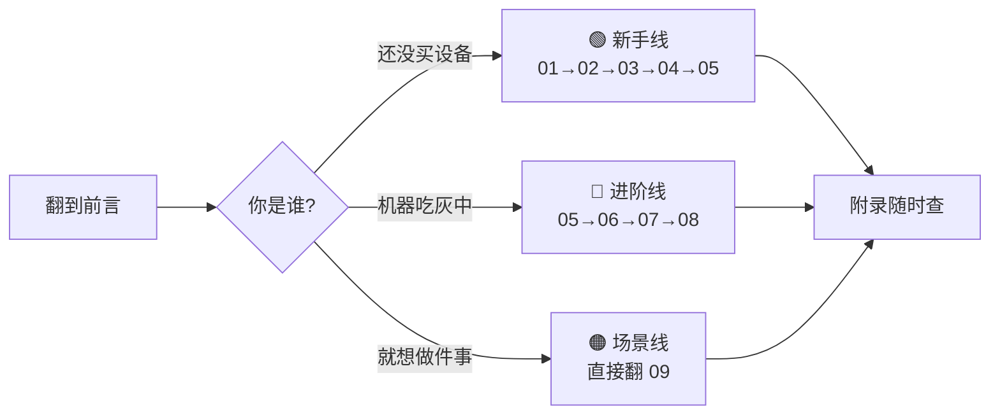

<p align="center">
  
</p>

# NAS 入门指南

> 一台小盒子，装着一家人的照片、电影和回忆。
> 这份指南想做的，就是陪你从零开始，把它稳稳地搭起来。

<p align="center">
  <a href="https://github.com/cv-superding/nas-guide"></a>
  <a href="LICENSE"></a>
  <a href="CONTRIBUTING.md"></a>
</p>

---

## 写在最前面

说说这份指南是怎么来的。

最早想写它，是因为身边总有朋友问我同一类问题："手机照片快存不下了，怎么办？""网盘会员又涨价了，有没有别的办法？""我看别人家里那台小机器能看电影、能自动备份，我能不能也整一台？"

这些问题背后其实是同一件事：**大家想把数据的掌控权，重新拿回自己手里。** 但真动手时，搜索出来的资料又碎又乱——有人讲硬件，有人讲 Docker，有人甩你一堆命令行，却没人告诉你"先做什么、后做什么、做到哪一步算够"。

于是就有了这份指南。它不追求把你变成运维工程师，只希望你能安安稳稳地搭起一台属于自己的 NAS，知道每一步在干什么，遇到问题不至于慌。

> 一句话原则：**先让它跑起来，再让它跑得好，最后才让它跑得花哨。**

## 你会得到什么

- 🧭 **一条不迷路的学习路线**：三条路径，按你的目标挑着走
- 🖥️ **六台"选手"的横向比拼**：群晖、威联通、TrueNAS、CasaOS、飞牛 fnOS、树莓派，同题对比
- 🧩 **从"这是啥"到"能折腾"**：零基础起步，一路到 Docker、自动化、本地 AI
- 🖼️ **图比字多一点的讲解**：手绘配图 + 流程图 + 截图，尽量不让你盯着一大段字发呆
- ✍️ **学完就能动手验**：每章都有练习和验收清单，做没做对一目了然
- 🇨🇳 **为中文用户写的**：国内网络、本土应用、真实场景，不是翻译腔

## 三张配图，先看个大概

| 场景 | 图 |
| --- | --- |
| 认识 NAS：数据不再东一块西一块 |  |
| 选平台：六位"选手"坐下来聊聊 |  |
| 应用服务：家里的影院、相册、AI 都在这台小盒子里 |  |

## 怎么读这本书

每个人来的目的不一样，没必要从头硬啃。



- **🟢 完全零基础**：从 [第 1 章](docs/01-认识NAS/README.md) 开始，一路读到第 5 章，读完你就能独立搭好一台能用的 NAS。
- **🔵 机器已经在手边**：直奔 [第 5 章](docs/05-存储与数据保护/README.md)——先把数据守住，再谈别的。
- **🟠 带着目标来的**：翻 [第 9 章](docs/09-实战案例/README.md)，照着做，缺什么回查什么。

完整目录在 [docs/SUMMARY.md](docs/SUMMARY.md)。

## 章节一览

| 章节 | 讲什么 | 难度 | 读完你会 |
| --- | --- | --- | --- |
| [00 前言](docs/00-前言/README.md) | 这本书怎么用 | ⭐ | 找到自己的路线 |
| └ [新人避坑指南](docs/00-前言/新人避坑指南.md) | 前人踩过的 12 个坑 | ⭐ | 少走弯路 |
| [01 认识 NAS](docs/01-认识NAS/README.md) | 它到底是什么 | ⭐ | 判断自己需不需要 |
| [02 硬件选型](docs/02-硬件选型/README.md) | CPU、硬盘怎么挑 | ⭐⭐ | 配出一台合适的机器 |
| [03 平台横评](docs/03-平台横评与选型/README.md) | 六大系统同题对比 | ⭐⭐ | 选对系统不纠结 |
| [04 第一次搭建](docs/04-第一次搭建/README.md) | 从开机到能用 | ⭐⭐ | 亲手装好第一台 |
| [05 存储与数据保护](docs/05-存储与数据保护/README.md) | 别让照片丢了 | ⭐⭐⭐ | 把数据真正守住 |
| [06 网络与远程访问](docs/06-网络与远程访问/README.md) | 人在外面也能取 | ⭐⭐⭐ | 安全地远程访问 |
| [07 应用服务](docs/07-应用服务/README.md) | 影音、相册、AI | ⭐⭐⭐ | 让小盒子干实事 |
| [08 进阶主题](docs/08-进阶主题/README.md) | 自动化与调优 | ⭐⭐⭐⭐ | 从会用变会管 |
| [09 实战案例](docs/09-实战案例/README.md) | 四个完整场景 | ⭐⭐⭐ | 照着做出成品 |
| [附录](docs/附录/README.md) | 速查、FAQ、社区 | — | 遇到问题回来翻 |

## 六大平台，一句话印象

| 平台 | 一句话 | 适合谁 |
| --- | --- | --- |
| 群晖 DSM | 花钱买省心，开箱就能用 | 不想折腾的家庭 |
| 威联通 QTS | 配置给得足，性价比能打 | 想多一点自由的人 |
| TrueNAS | 数据至上的"保险柜" | 特别在意数据的人 |
| CasaOS | 旧电脑复活神器 | 想先试试看的人 |
| 飞牛 fnOS | 中文体验最贴心的新秀 | 国内用户、自装机 |
| 树莓派 | 巴掌大的极客玩具 | 爱动手、爱低功耗 |

细看请到 [3.1 六大平台横向对比](docs/03-平台横评与选型/3.1-六大平台横向对比.md)。

## 仓库里还有什么

```
NAS入门指南/
├── docs/           # 正文，按章节排
├── examples/       # 能直接抄的配置和脚本
│   ├── docker-compose/   # 影音、下载、AI、反代……
│   ├── scripts/          # 硬盘体检、自动备份
│   ├── configs/          # fail2ban 等安全配置
│   └── ansible/          # 自动化运维剧本
├── exercises/      # 每章练习，边学边练
├── assets/         # 手绘配图 + Mermaid 图示源码
├── templates/      # 想一起写？用这些模板
└── .github/        # Issue / PR / 自动部署
```

## 动手之前

```bash
git clone https://github.com/cv-superding/nas-guide.git
cd nas-guide
```

想看排版好的网页版：

```bash
pip install -r requirements.txt
mkdocs serve
# 打开 http://127.0.0.1:8000
```

## 站在别人的肩膀上

这份指南参考了不少前辈和同好写得极好的资料，每一份都列在 [致谢与来源](CREDITS.md) 里。没有他们，就没有这份文档。如果你发现某处内容源自某篇文章而我们漏了署名，欢迎提 Issue，我们一定补上。

## 一点点请求

- 帮你忙了？点个 ⭐，让更多人看到
- 发现错了？提个 [Issue](https://github.com/cv-superding/nas-guide/issues)，我们改
- 想补充你的实战故事？太好了，先读 [贡献指南](CONTRIBUTING.md)

## 声明

我们**不提供任何软件下载、镜像或破解资源**，工具请去官方渠道拿。改存储、动网络有风险，下手前先备份，想清楚每一步在干什么。文中提到的品牌和产品归各自所有者。详见文末说明。

## 许可证

[MIT](LICENSE) · 自由使用，欢迎分享，记得署名。

---

<p align="center">
  
  <br>
  <em>愿你家的数据，都像这张图一样，被温柔地收好。</em>
</p>
