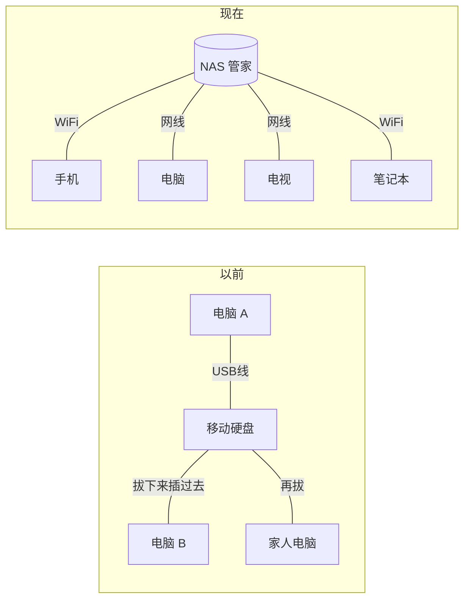

# 1.1 NAS 到底是什么

<p align="center">
  
</p>


> 📌 没有任何前置 · ⏱ 大约 10 分钟

## 先讲个比喻

想象你家里有个特别勤快的管家。

他不睡觉（7×24 开机），记性特别好（硬盘），谁上门他都能接待（手机、电脑、电视都能连），而且你不在家时，他也能通过一条安全通道给你递东西（远程访问）。

这个管家，就是 NAS。

NAS 的全称是 **Network Attached Storage，网络附属存储**。拆开看：

- 它是一台**电脑**——有 CPU、内存、硬盘、系统
- 它**连在网上**——不靠 USB 线拴在某台电脑旁边
- 它**专门管数据**——所有设计都为"存得稳、取得快、不丢"

## 为什么不是"大号移动硬盘"这么简单

这个比喻其实挺容易让人误会。区别在哪儿？



以前是**硬盘跟着人跑**，来回插拔，谁急谁抓瞎。现在是**人找管家要**，所有设备连到同一处。

差别不只是方便——它意味着你的数据第一次有了"固定的家"。

## 一个有温度的画面

想象一个周六的傍晚：

- 你在沙发上用电视看去年旅行的短片（Jellyfin 从 NAS 读片）
- 你太太在卧室用手机翻孩子的照片，顺手备份了几张新的（相册 App 自动上传）
- 楼下书房里，一台旧电脑在悄悄下载下一周要看的剧（NAS 的下载器后台跑着）

三件事同时发生，都指向同一个小盒子。它不抢戏，只是安静地亮着几颗绿灯。

这就是 NAS 真正迷人的地方——**它让数据从"藏在不同设备里"，变成"自然地流向需要它的人"。**

## 它的四样本事

| 本事 | 大白话 | 为什么重要 |
| --- | --- | --- |
| 一直在线 | 不关机、随时能访问 | 半夜想找张照片也不用开机 |
| 多块硬盘协作 | 坏一块不至于全丢 | 硬盘是会坏的，这是物理规律 |
| 会说多种"语言" | SMB/NFS/WebDAV | Windows、Mac、Linux 都能连 |
| 能装应用 | Docker、虚拟机、AI | 从"存东西"变成"干事情" |

## 软硬件是可以分开看的

新手常把 NAS 理解成一个品牌，比如"我要买个群晖"。其实它更像"电脑 + 系统"的组合：

```
NAS = 硬件（品牌机 / 自己攒 / 旧电脑 / 树莓派）
    + 系统（DSM / QTS / TrueNAS / CasaOS / 飞牛 fnOS）
    + 网络服务（让各种设备都能访问）
```

这意味着：

- 你可以买品牌整机，图省心（第 3 章会讲）
- 也可以拿旧电脑装个免费系统，图省钱（[3.5 CasaOS](../../docs/03-平台横评与选型/3.5-CasaOS.md)）
- 硬件和系统的选择是**两件事**，别混在一起想

## 几个常见的误会

> ❌ **"NAS 就是个大 U 盘。"**
> ✅ U 盘是离线的、单点的、要用时插上；NAS 是在线的、多人的、会自己干活。

> ❌ **"买了 NAS 数据就安全了。"**
> ✅ 它让数据更有条理，但安全要靠 RAID + 快照 + 备份一起守。这句话我们在 [5.4](../../docs/05-存储与数据保护/5.4-备份3-2-1原则.md) 会反复讲。

> ❌ **"NAS 很费电，得一直开着心疼。"**
> ✅ 低功耗机型闲时可能就十几瓦，一年电费一两百块。算笔账见 [2.5](../../docs/02-硬件选型/2.5-功耗噪音与散热.md)。

## 小结

NAS 是一台**长期在线、专门管数据、能被全家设备访问的小电脑**。理解这一点，后面所有章节都只是在回答三个问题：怎么挑、怎么装、怎么用好。

## 小练习

1. 用你自己的比喻，跟一个不懂技术的朋友解释"NAS 是啥"（不能说"网络附属存储"）。
2. 数一下你现在有几台设备存着数据。答案是"好几台"的话，你已经理解为什么要 NAS 了。
