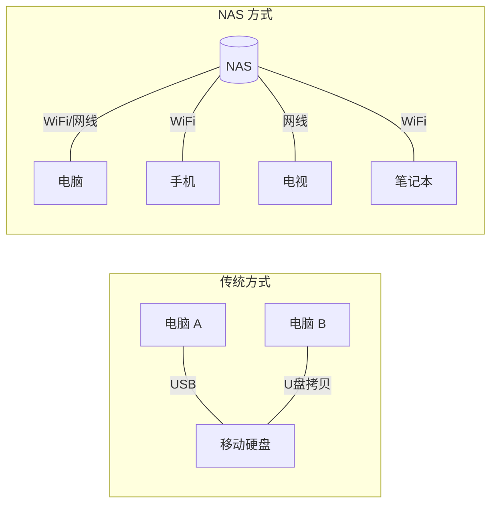

# 1.1 什么是 NAS

> 📌 前置：无 · ⏱ 约 10 分钟

## 本章目标

- 建立一个关于 NAS 的准确心智模型
- 理解 NAS 与普通电脑、移动硬盘、云盘的本质区别

## 一句话定义

**NAS（Network Attached Storage，网络附属存储）是一台连接在网络上、专门用来存储和共享数据的计算机。**

把它拆开看：

- **"计算机"**：它有 CPU、内存、硬盘、操作系统，本质是一台小电脑。
- **"连接在网络上"**：它不靠 USB 线连到某一台电脑，而是通过网口接入局域网，家里所有设备都能访问。
- **"专门存储与共享"**：它的软硬件都为"可靠地存数据、方便地取数据"而设计。

## 一个直观的比喻



传统方式下，数据跟着硬盘"跑来跑去"；NAS 方式下，数据固定在一个地方，所有设备"上网去取"。

## NAS 的四个关键特征

| 特征 | 说明 | 为什么重要 |
| --- | --- | --- |
| 7×24 运行 | 长期开机、低功耗设计 | 随时可用，支持后台下载与备份 |
| 多盘位与 RAID | 多块硬盘协同工作 | 单盘故障时可保全数据 |
| 网络共享协议 | SMB / NFS / WebDAV 等 | 不同系统、不同设备都能访问 |
| 管理与扩展 | Web 管理界面、应用生态 | 不用懂命令行也能维护，还能装各种服务 |

## NAS 是软硬件一体的概念

初学者容易把 NAS 理解成"一个品牌"（如群晖）。实际上：

- **硬件**：可以是品牌 NAS 整机（群晖、威联通），也可以是自装机、旧电脑、树莓派。
- **系统/软件**：可以是厂商系统（DSM、QTS），也可以是通用系统（TrueNAS、CasaOS、飞牛 fnOS、OpenMediaVault）。

```
NAS = 硬件载体 + 存储系统 + 网络服务
```

本指南第 2 章讲硬件，第 3 章讲系统/平台，两者可以自由组合。

## 常见误区

> ❌ 误区 1："NAS 就是个大号移动硬盘。"
> ✅ 真相：移动硬盘是"离线、单点、需插线"；NAS 是"在线、多用户、可保护"。

> ❌ 误区 2："有了 NAS 就不用担心数据丢了。"
> ✅ 真相：RAID/快照不是备份，RAID 无法防误删、勒索病毒、整机失窃。见 [5.4 备份 3-2-1 原则](../05-存储与数据保护/5.4-备份3-2-1原则.md)。

> ❌ 误区 3："NAS 很费电，不如关机。"
> ✅ 真相：低功耗 NAS 闲置时可能只有几瓦到十几瓦，长期开机的成本可控。见 [2.5 功耗、噪音与散热](../02-硬件选型/2.5-功耗噪音与散热.md)。

## 小结

NAS 是一台为"存数据与共享数据"而生的联网小电脑。理解这一点，后面所有章节都只是在回答"怎么选、怎么装、怎么用好这台电脑"。

## 练习

1. 向一个不懂技术的朋友解释 NAS 是什么（用你自己的比喻）。
2. 列出你家里目前存数据的设备和方式（手机、电脑、网盘、移动硬盘……），数一数数据散落在几个地方。
