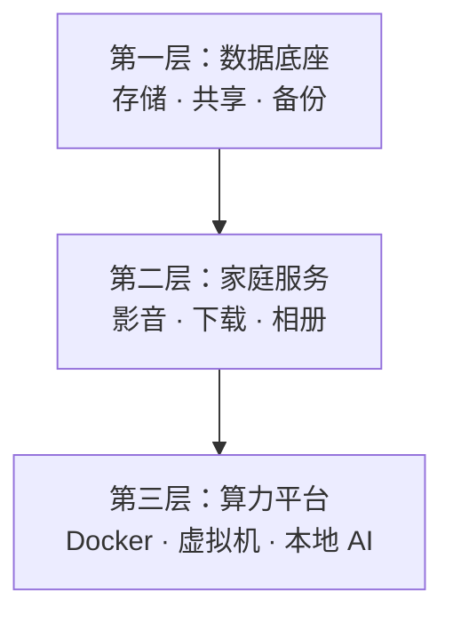

# 1.2 NAS 能做什么

  

> 📌 前置：[1.1 什么是 NAS](1.1-什么是NAS.md) · ⏱ 约 12 分钟

## 本章目标

- 系统了解 NAS 的典型应用场景
- 区分"核心能力"与"进阶玩法"，避免一开始就贪多

## 能力分层

NAS 的能力可以分成三层，建议按需逐层解锁：

### 第一层：数据底座（几乎人人需要）

| 场景 | 说明 | 对应章节 |
| --- | --- | --- |
| 集中存储 | 把照片、文档、视频统一放一处 | 4.3、5.1 |
| 多端共享 | 手机、电脑、电视同时访问 | 6.1 |
| 自动备份 | 手机相册自动上传、电脑定时备份 | 5.4、7.3 |
| 数据保护 | RAID、快照、校验、异地备份 | 第 5 章 |

### 第二层：家庭服务（提升幸福感）

| 场景 | 说明 | 对应章节 |
| --- | --- | --- |
| 影音中心 | 自建影片库，电视/手机流畅播放 | 7.2 |
| 离线下载 | 睡前丢链接，早上已下好 | 7.3 |
| 私有相册 | 人脸聚类、回忆相册、原图备份 | 7.4 |
| 文件同步 | 多设备文件实时同步（类似 Dropbox） | 7.3 |
| 远程访问 | 出门在外也能取家里文件 | 第 6 章 |

### 第三层：算力平台（进阶玩法）

| 场景 | 说明 | 对应章节 |
| --- | --- | --- |
| Docker 应用 | 跑各种自托管服务 | 7.1 |
| 虚拟机 | 在同一台机器上跑多个系统 | 8.1 |
| 自动化运维 | 用 Ansible 管理配置 | 8.2 |
| 监控告警 | 盯住硬盘健康与服务状态 | 8.5 |
| 本地 AI | 在 NAS 上跑 DeepSeek 等模型 | 7.5 |

## 一个典型的"一天"

## 别一上来就贪多

> 💡 建议：第一台 NAS 先做好"数据底座"这一层——**存得下、找得到、丢不了**。等这套跑顺了，再逐步叠加影音、Docker、AI。很多人的 NAS 长期吃灰，就是因为一开始装了一堆用不上的服务。

## 特别说明：在 NAS 上跑 AI

近两年"." 本地大模型成为热门玩法：用 Ollama 在 NAS 上跑 DeepSeek 的蒸馏模型，断网也能问答，再配合 AnythingLLM、RAGFlow 搭建自己的知识库。这类玩法对内存和算力有要求，属于第三层，详见 [7.5 自托管 AI](07-应用服务/7.5-自托管AI.md) 与 [9.3 个人 AI 工作站](09-实战案例/9.3-个人AI工作站.md)。

## 小结

NAS 的能力是分层的。先把数据底座打牢，再按兴趣叠加服务，是最稳的路线。

## 练习

1. 从上面的场景清单中，圈出你最需要的 3 个，并标注优先级。
2. 判断这 3 个需求分别属于哪一层，据此决定你第一阶段的阅读重点。
