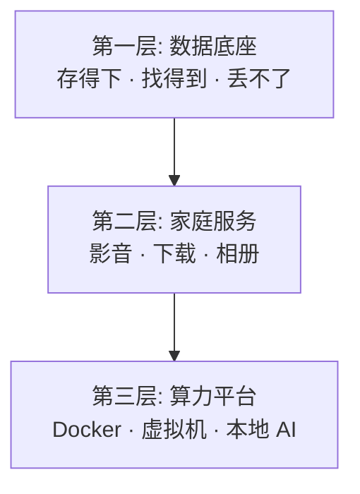

  

# 1.2 它能帮你干什么

> 📌 先读：[1.1 什么是 NAS](1.1-什么是NAS.md) · ⏱ 大约 12 分钟

## 先别想"它能干一百件事"

很多人一上来就问"NAS 能装哪些应用"，然后列一张长长的清单，最后哪个都没用明白。

换个思路更有用：**NAS 的能力是分层的。** 先把最底下那层做扎实，再往上加。就像盖房子——地基没打牢就装修，住进去会塌。

## 第一层：数据底座（几乎人人需要）

这是 NAS 最朴素也最重要的价值。

| 场景 | 大白话 |
| --- | --- |
| 集中存储 | 照片、视频、文档，都放一个地方，不再东一块西一块 |
| 多端共享 | 手机、电脑、电视连到同一台机器 |
| 自动备份 | 手机拍照自动上传，电脑定时备份 |
| 数据保护 | RAID、快照、异地备份，让数据真的丢不了 |

这一层对应的是 [第 5 章](../../docs/05-存储与数据保护/README.md)。我们在那里会反复强调一句话：**先守住数据，再谈别的。**

## 第二层：家庭服务（让日子舒服一点）

地基稳了，就可以往上盖了。

- **影音中心**：自己的影片库，电视上像流媒体一样选片（[7.2](../../docs/07-应用服务/7.2-影音中心.md)）
- **离线下载**：睡前丢个链接，早上已经下好（[7.3](../../docs/07-应用服务/7.3-下载与同步.md)）
- **私有相册**：人脸聚类、时间线、回忆相册（[7.4](../../docs/07-应用服务/7.4-私有云与相册.md)）
- **远程访问**：出门在外也能取家里文件（[第 6 章](../../docs/06-网络与远程访问/README.md)）

## 第三层：算力平台（折腾党的乐园）

- **Docker**：一个台子，装下各种自托管服务（[7.1](../../docs/07-应用服务/7.1-Docker基础.md)）
- **虚拟机**：一台机器跑多个系统（[8.1](../../docs/08-进阶主题/8.1-虚拟机与容器.md)）
- **自动化**：用 Ansible 把重复操作变成代码（[8.2](../../docs/08-进阶主题/8.2-Ansible自动化运维.md)）
- **本地 AI**：在自己家跑 DeepSeek，断网也能问（[7.5](../../docs/07-应用服务/7.5-自托管AI.md)）

## 一个普通人的一天

这些事同时发生，都指向那台安静亮着绿灯的小盒子。技术藏在背后，生活走到前面。

## 特别说说"在 NAS 上跑 AI"

近两年很火：用 Ollama 跑 DeepSeek 蒸馏版，配 AnythingLLM 做知识库，把合同、笔记喂给它，直接问"这份合同的要点是什么"。好处是**数据不出家门**，坏处是对内存有要求。

这是第三层的玩法，新手别急。详见 [7.5](../../docs/07-应用服务/7.5-自托管AI.md) 和 [9.3](../../docs/09-实战案例/9.3-个人AI工作站.md)。

## 一句提醒

> 💡 见过太多"装了二十个服务最后吃灰"的机器。**一次只解锁一层，每件事都验证过再往下。** 慢即是快。

就像[NEBULA](https://ooppll.icu/) 那些实践文章体现的思路——先把它用起来，再一点点加东西。

## 写在最后

NAS 的能力是分层的。先把数据底座打牢，再按兴趣往上叠。别把"能做什么"当成"必须做什么"。

## 动手试试

1. 从上面的场景里圈出你最需要的 3 个，按优先级排序。
2. 看看它们分别属于哪一层——这决定了你第一阶段的阅读重点。
