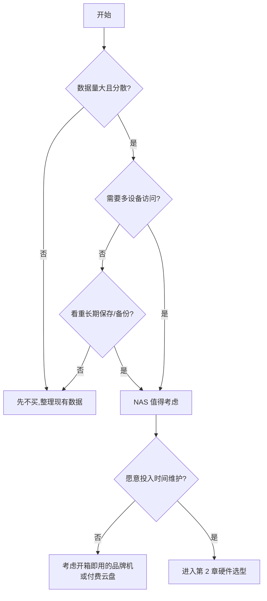

# 1.3 谁需要 NAS

  

> 📌 前置：[1.2 NAS 能做什么](1.2-NAS能做什么.md) · ⏱ 约 10 分钟

## 本章目标

- 通过自测判断 NAS 是否适合你
- 识别"不该买 NAS"的情况，避免冲动消费

## 快速自测

对下面每项回答"是/否"：

- [ ] 我的数据（照片、视频、文档）分散在多个设备里，经常找不到
- [ ] 手机存储空间经常告急，不敢拍 4K 视频
- [ ] 我担心网盘内容被审查、限速或突然失效
- [ ] 我有家庭影音收藏，希望在电视上整齐播放
- [ ] 我需要多台电脑/设备之间同步文件
- [ ] 我想长期保存对孩子/家人有意义的数据
- [ ] 我愿意花时间学习并维护一台设备
- [ ] 我有（或愿意搭建）家里稳定的有线/无线网络

**判断参考**：

- 命中 5 项以上：NAS 很可能适合你
- 命中 3～4 项：值得深入了解，先明确核心需求
- 命中 0～2 项：可以先放一放，或用更简单的方案

## 典型适合人群

| 人群 | 核心诉求 | 建议侧重 |
| --- | --- | --- |
| 家庭用户 | 照片/视频备份、影音中心 | 易用性优先，选群晖/飞牛/CasaOS |
| 隐私敏感者 | 数据自主、不依赖云盘 | 强化备份与远程访问（第 5、6 章） |
| 数码/动手爱好者 | 折腾 Docker、虚拟机、AI | TrueNAS / 自装机，看第 7、8 章 |
| 小团队/工作室 | 文件共享、协作、备份 | 重视权限与稳定性，看 9.4 |
| 内容创作者 | 大容量素材、快速存取 | 重视 2.5G/万兆网络与 SSD 缓存 |

## 什么情况下"暂时不需要"

> ⚠️ 以下情况买了 NAS 往往吃灰：
>
> 1. **数据很少**（不到几百 GB）：一块移动硬盘或云盘足够。
> 2. **没有任何维护意愿**：NAS 需要偶尔更新系统、关注硬盘健康，不是完全免维护。
> 3. **网络环境极差**：没有稳定宽带、没有无线覆盖，体验会大打折扣。
> 4. **只想要"离线冷备份"**：一年都不访问一次的数据，几块硬盘 + 防潮箱可能更合适。
> 5. **预算严重不足还追求全闪 + RAID**：勉强配出的方案反而体验糟糕。

## 决策流程

## 小结

NAS 适合"数据多且在意、愿意投入一点时间维护"的人。先确认需求真实存在，再花钱。

## 练习

1. 完成上面的自测，把命中项对应的需求写进你的"需求清单"。
2. 如果你的结论是"暂时不需要"，写下来原因，避免日后冲动下单。
