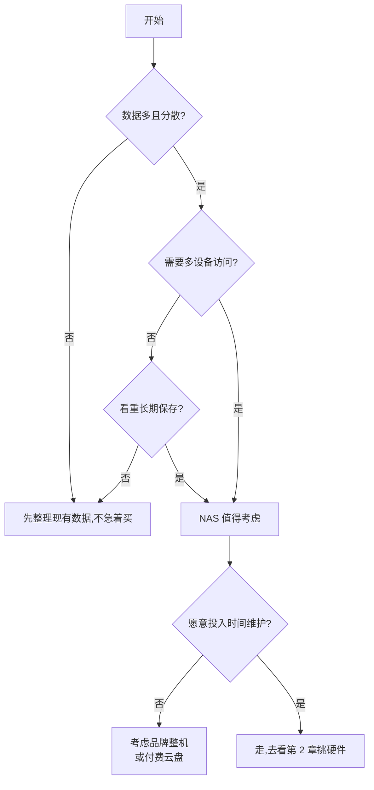

# 1.3 到底谁需要 NAS

> 📌 先读：[1.2 它能做什么](1.2-NAS能做什么.md) · ⏱ 大约 10 分钟

## 先做个诚实的自测

别急着下单。先回答几个问题，对每项说"是"或"否"：

- [ ] 我的数据分散在好几个设备里，经常找不到东西
- [ ] 手机存储老是告急，不敢拍 4K 视频
- [ ] 我担心网盘内容被审查、限速，或者哪天突然关停
- [ ] 我有影音收藏，想在电视上整齐播放
- [ ] 我需要在多台设备之间同步文件
- [ ] 我想长期保存对孩子、家人有意义的东西
- [ ] 我愿意花点时间学习、偶尔维护一台设备
- [ ] 我家里有稳定的网络

数一数命中几个。

- **5 个以上**：NAS 多半适合你，往下读
- **3～4 个**：值得深入了解，先想清楚核心需求
- **0～2 个**：先别买，用更简单的方案可能就够

## 这几类人，特别合适

| 你是谁 | 你在意什么 | 建议侧重 |
| --- | --- | --- |
| 家庭用户 | 照片备份、影音中心 | 易用优先：群晖、飞牛、CasaOS |
| 隐私敏感的人 | 数据自主、不靠云盘 | 重视备份和远程访问（第 5、6 章） |
| 数码爱好者 | Docker、虚拟机、AI | 自装机，TrueNAS 或飞牛，看第 7、8 章 |
| 小团队/工作室 | 文件共享、协作、备份 | 重视权限和稳定，看 9.4 |
| 内容创作者 | 大素材、快速存取 | 重视 2.5G 网口和 SSD，看 2.1 |

## 什么情况下，先别买

这部分可能比"适合谁"更值钱。

> ⚠️ 以下情况买了 NAS，大概率吃灰：
>
> 1. **数据很少**（几百 GB 以内）：移动硬盘或云盘就够了。
> 2. **完全不想维护**：系统要偶尔更新、硬盘健康要看看，它不是免家电。
> 3. **网络环境差**：没有稳定宽带、无线覆盖烂，体验会打折。
> 4. **只是冷存储**：一年都不访问一次的数据，硬盘 + 防潮箱更合适。
> 5. **预算紧还追求全闪+RAID**：勉强配出来，哪哪都别扭。

## 一张决策图

## 一句大实话

NAS 适合"数据多、在意、愿意花一点时间维护"的人。

它的价值不是"我有一台 NAS"，而是"我家的照片、文件、回忆，稳稳地待在自己手里"。如果你对这句话无感，那真的不用着急。

> 💡 还没想清楚也没关系。[一周上手计划](../00-前言/一周上手计划.md) 的第一天就是帮你做这件事——把数据盘一遍，答案常常自己就出来了。

## 写在最后

别因为别人晒 NAS 就心动。需求真实存在，再花钱。

## 动手试试

1. 完成自测，把命中的需求写进你的"需求清单"。
2. 如果结论是"暂时不需要"，写下原因，免得日后冲动下单。
