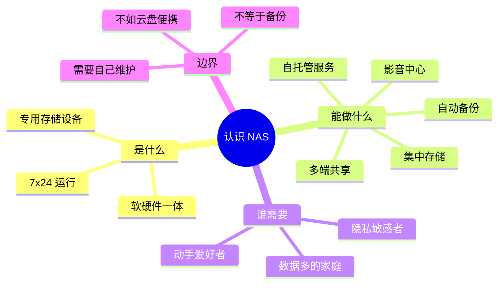

# 01 认识 NAS · 本章概览

> 难度：⭐ · 预计阅读：40 分钟 · 是否需要设备：否

## 本章目标

读完本章，你将能够：

1. 用通俗的话解释 NAS 是什么、它解决什么问题
2. 列举 NAS 的典型应用场景，并判断哪些与你的需求相关
3. 通过决策思路判断"我现在是否需要一台 NAS"
4. 分清 NAS、云盘、本地硬盘/移动硬盘的差异与适用边界

## 核心主题

- **本质**：NAS 是一台"连在网上、专门管数据"的小电脑
- **价值**：数据集中、可访问、可保护、可扩展
- **判断**：需求驱动，而不是"别人都买我也买"
- **边界**：NAS 不是云盘的完全替代，也不是万能备份方案

## 小节列表

| 小节 | 核心问题 | 关键产出 |
| --- | --- | --- |
| [1.1 什么是 NAS](1.1-什么是NAS.md) | NAS 到底是什么？ | 建立心智模型 |
| [1.2 NAS 能做什么](1.2-NAS能做什么.md) | 它能帮我做什么？ | 场景清单 |
| [1.3 谁需要 NAS](1.3-谁需要NAS.md) | 我需要吗？ | 自我判断结论 |
| [1.4 NAS vs 云盘 vs 本地硬盘](1.4-NAS-vs-云盘-vs-本地硬盘.md) | 和已有方案比呢？ | 选型边界 |

## 知识地图

## 学习建议

本章以理解为主，不需要动手。建议读完 1.3 后，写下你的"需求清单"，它会直接决定第 2 章的硬件选型和第 3 章的平台选择。

## 小结

NAS 不是一件"买来就完事"的家电，而是一种"把数据主权拿回自己手里"的思路。先想清楚需求，后面每一章都会更省力。

## 练习

见 [`exercises/01-认识NAS.md`](../../exercises/01-认识NAS.md)。
