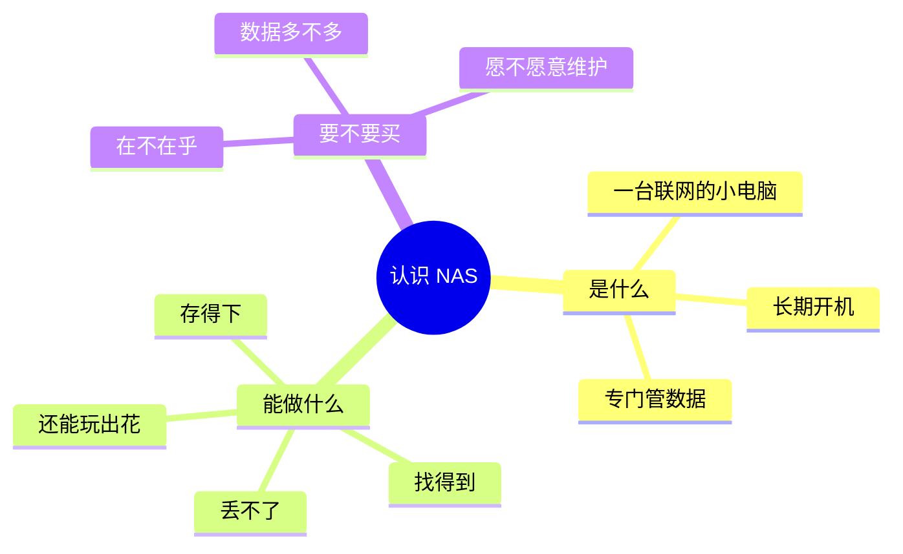

  

# 01 认识 NAS：先把这道题看明白

> ⏱ 大约 40 分钟 · 难度 ⭐ · 这一章不用动手，带上你的问题来读就行

> 🖼️ **关于本章配图**
> 这一章讲的是概念与判断，不涉及具体操作界面。
>
> **替代方案**：配图用生活化插画表达'数据需要一个家'的感觉。想看真实 NAS 后台长什么样，见 3.5 CasaOS、3.6 飞牛的官方截图。
>
> 如果你想为本章贡献一张高质量真实截图，欢迎提 PR，详见 [贡献指南](../../CONTRIBUTING.md)。

## 从一个再普通不过的晚上说起

手机弹窗："存储空间不足。"

你叹口气，开始翻相册——孩子的视频舍不得删，去年旅行的 4K 片段也舍不得，工作文档还散在三个网盘里。电脑 D 盘红了，移动硬盘在抽屉里落灰，云盘会员又涨价了。

你突然想问一句：**我的数据，到底散落在多少个地方？**

这就是大多数人和 NAS 相遇的起点。不是因为懂技术，而是因为——东西太多了，该有个家了。

## 这一章，我们先不聊参数

不聊 CPU、不聊 RAID、不聊 Docker。先把三件事想明白：

1. **它到底是什么**——不是"大号移动硬盘"那么简单
2. **它能帮你干啥**——哪些是刚需，哪些是锦上添花
3. **你现在需不需要**——这比"哪个牌子好"重要一百倍

想清楚这三件事，后面每一章你都会读得很顺。想不清楚，买回来大概率吃灰。

## 这一章的四站

| 小节 | 会解答什么 | 读完你能 |
| --- | --- | --- |
| [1.1 什么是 NAS](1.1-什么是NAS.md) | 用大白话讲清本质 | 跟朋友解释这是啥 |
| [1.2 它能做什么](1.2-NAS能做什么.md) | 分三层列清场景 | 圈出自己的刚需 |
| [1.3 谁需要它](1.3-谁需要NAS.md) | 一份诚实的自测 | 判断该不该买 |
| [1.4 和云盘比呢](1.4-NAS-vs-云盘-vs-本地硬盘.md) | 三方摆在一起看 | 明白各自的边界 |

## 一句话预告

NAS 不是一件"买回来就完事"的家电，更像一种态度：**我愿意花一点时间，把数据的家安在自己这里。**

如果这句话戳中了你，那就继续往下翻吧。

## 动手小练习

翻到 [exercises/01-认识NAS.md](../../exercises/01-认识NAS.md)，花五分钟做一下"数据盘点"。你可能会吓一跳——原来自己有这么多数据，散在这么多地方。
