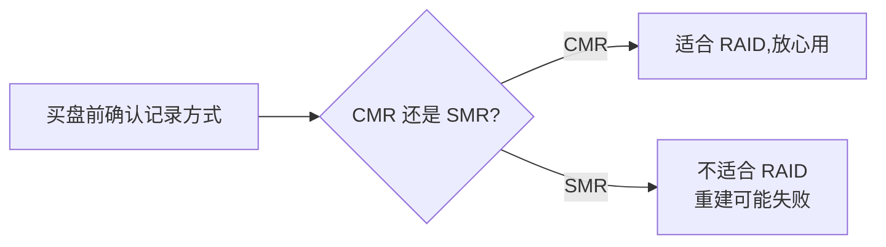

# 2.2 硬盘选型

> 📌 前置：[2.1 核心部件选型](2.1-核心部件选型.md) · ⏱ 约 15 分钟

## 本章目标

- 理解 HDD、SSD、NAS 专用盘的差异
- 掌握选购硬盘的关键指标与避坑要点

## 硬盘类型对比

| 类型 | 优点 | 缺点 | 适合场景 |
| --- | --- | --- | --- |
| 桌面级 HDD | 便宜、容量大 | 不适合 7×24、震动容忍差 | 临时/非关键存储 |
| NAS 专用 HDD | 为长期运行优化、抗震动、固件更好 | 价格略高 | NAS 主力盘 ✅ |
| 企业级 HDD | 最可靠、质保长 | 贵、可能吵 | 关键业务 |
| SATA SSD | 快、静音、抗震 | 每 GB 成本高 | 系统盘、缓存、热数据 |
| NVMe SSD | 极快 | 更贵、发热大 | 高速池、缓存、AI 数据 |

> 💡 **首选建议**：NAS 主力盘选"NAS 专用硬盘"（如各厂 NAS 系列），它们针对 24×7 运行、多盘共振和RAID 环境做了优化。桌面盘并非不能用，但长期可靠性和质保条款不利。

## 关键指标

### 容量与价格

- 计算"每 TB 单价"，而非只看总价。
- 大容量盘通常单位成本更低，但单次投入更大。

### 转速与缓存

- 5400 RPM：安静、省电、够用，家用 NAS 常见。
- 7200 RPM：更快，但更吵更热。
- 缓存大小：对持续读写影响有限，不必过度追求。

### 工作负载与质保

- NAS 盘标注的工作负载（如每年 180TB/550TB）反映耐用度。
- 质保年限（3/5 年）是可靠性的间接信号。

### 接口与协议

- SATA：主流，够用。
- SAS：企业级，需要兼容的控制器。
- NVMe：走 PCIe，速度最快，适合缓存或高速池。

## 避坑要点

> ⚠️ 1. **避免混用不同型号/批次的盘做 RAID**：性能受最慢的盘拖累，故障风险也更高。
>
> ⚠️ 2. **警惕二手盘与"清零盘"**：通电时间长、可能有坏道。买新盘更稳妥。
>
> ⚠️ 3. **不要买"SMR 叠瓦式"盘做 RAID**：在 RAID 重建时性能急剧下降甚至失败。选购时确认是 CMR（传统磁记录）。
>
> ⚠️ 4. **留出冗余空间**：硬盘用到 80%～90% 以上时性能和风险都会变化。

## CMR vs SMR

查询方式：搜索"硬盘型号 + CMR"或查厂商规格表，注意同系列不同容量可能不同。

## SSD 的正确用法

- **系统盘**：用一块小容量 SSD/NVMe 装系统，提速明显。
- **缓存层**：读缓存加速热点数据（部分系统支持）。
- **高速存储池**：放虚拟机、数据库、AI 数据。
- ⚠️ SSD 做 RAID 同样需要 TRIM 支持与定期维护。

## 健康监测

买回来先跑一遍基准与检测，之后定期看 S.M.A.R.T.。详见 [5.5 硬盘健康监控](../05-存储与数据保护/5.5-硬盘健康监控.md) 与示例 [`examples/scripts/disk-health-check.sh`](../../examples/scripts/disk-health-check.sh)。

> 💡 社区里有"新盘先跑一遍完整读写测试"的习惯（类似把 SSD 基准测试搬进 NAS），目的是尽早发现次品。参考 [附录 C 资源与社区](../附录/C-资源与社区.md)。

## 小结

主力选 NAS 盘、确认 CMR、按用途搭配 SSD、新盘先检测。硬盘是 NAS 里最值得投资的部件。

## 练习

1. 为你的 NAS 列出一份硬盘清单：类型、容量、数量、单盘预算。
2. 查证你选的硬盘型号是否为 CMR，并记录来源。
