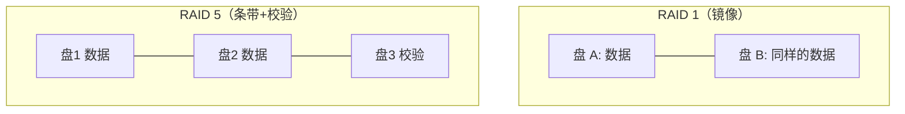

# 2.3 买多大？RAID 怎么选？

> 📌 先读：[2.2 硬盘选型](2.2-硬盘选型.md) · ⏱ 大约 15 分钟

## 先算清楚要多大

别拍脑袋。打开你的设备，老老实实统计：

- 照片/视频：约 ___ GB（4K 视频涨得很快）
- 文档/音乐：约 ___ GB
- 影音收藏：约 ___ GB
- 其他：约 ___ GB

然后按 **现有数据量 × 2～3** 规划，给未来三到五年留空间。照片和视频是增长主力，宁可多留点。

再扣掉 RAID 和格式化的开销：

```
可用容量 ≈ 裸容量 × RAID 效率 × 格式化系数(约 0.9)
```

## RAID 级别，一张表看懂

| 级别 | 最少盘 | 可用容量 | 能坏几块 | 读 | 写 | 适合 |
| --- | --- | --- | --- | --- | --- | --- |
| RAID 0 | 2 | N×单盘 | 0 | 快 | 快 | 临时高速，别存重要数据 |
| RAID 1 | 2 | 1×单盘 | 1 | 快 | 中 | 双盘镜像，简单省心 |
| RAID 5 | 3 | (N-1)×单盘 | 1 | 快 | 中 | 容量与冗余平衡 |
| RAID 6 | 4 | (N-2)×单盘 | 2 | 快 | 较慢 | 大容量盘更安心 |
| RAID 10 | 4 | N/2×单盘 | 每组 1 块 | 快 | 快 | 性能与可靠兼顾，费钱 |



## 怎么选，给你几个场景

- **2 盘位**：RAID 1，简单省心
- **3～4 盘位**：RAID 5 或 RAID 6（大盘推荐 RAID 6，重建更安全）
- **要性能**：RAID 10，但容量利用率只有一半
- **ZFS 用户**：用 mirror / RAIDZ1/2/3，见 [5.2](../../docs/05-存储与数据保护/5.2-RAID与存储池实战.md)

举个例：4 块 8TB 盘

| 方案 | 可用（约） | 评价 |
| --- | --- | --- |
| RAID 5 | 22 TB | 容量最大，但大盘重建有风险 |
| **RAID 6** | 15 TB | ✅ 推荐，安全与容量平衡 |
| RAID 10 | 15 TB | 性能最好 |

## 两件必须记住的事

> ⚠️ **RAID 不是备份！** 它防的是单块盘物理损坏，防不了误删、勒索、火灾、失窃。真正的备份见 [5.4](../../docs/05-存储与数据保护/5.4-备份3-2-1原则.md)。

> ⚠️ **大盘重建有风险**：容量越大，重建时间越长，期间遇到第二块盘坏的概率越高。这正是大容量盘推荐 RAID 6 的原因（英文社区对此有详细讨论，见 [致谢](../../CREDITS.md) 中 nasdecoded 的文章）。

## 写在最后

先估数据再定 RAID：容量算清楚，冗余留足够，同时牢记 RAID ≠ 备份。

## 动手试试

1. 统计你的数据量，按 ×2.5 估三年需求。
2. 假设有 4 块 6TB 盘，算算 RAID 5/6/10 各能用多少，结合用途选一个。
