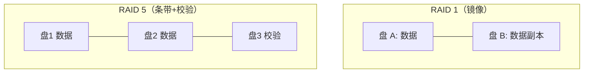

# 2.3 容量规划与 RAID 基础

<p align="center">
  
</p>


> 📌 前置：[2.2 硬盘选型](2.2-硬盘选型.md) · ⏱ 约 15 分钟

## 本章目标

- 能估算实际需求容量并留出合理余量
- 理解常见 RAID 级别的容量、冗余与性能取舍

## 容量规划

### 第一步：盘点现有数据

打开你的电脑和手机，统计：

- 照片/视频：约 ___ GB（4K 视频增长很快）
- 文档/音乐：约 ___ GB
- 影音收藏：约 ___ GB
- 系统备份/其他：约 ___ GB

### 第二步：估算增长

> 💡 一个常见做法：按"当前数据量 × 2～3"规划，为未来 3～5 年留出空间。照片和视频是增长主力。

### 第三步：扣除 RAID 与格式化开销

```
可用容量 ≈ 裸容量 × RAID 效率 × 格式化系数(约 0.9)
```

不同 RAID 的效率见下表。

## 常见 RAID 级别

| 级别 | 最少盘数 | 可用容量 | 容错 | 读性能 | 写性能 | 适用 |
| --- | --- | --- | --- | --- | --- | --- |
| RAID 0 | 2 | N×单盘 | 无 | 高 | 高 | 临时高速，不存重要数据 |
| RAID 1 | 2 | 1×单盘 | 坏 1 块 | 高 | 中 | 双盘镜像，简单可靠 |
| RAID 5 | 3 | (N-1)×单盘 | 坏 1 块 | 高 | 中 | 容量与冗余平衡 |
| RAID 6 | 4 | (N-2)×单盘 | 坏 2 块 | 高 | 较低 | 大容量盘更安心 |
| RAID 10 | 4 | N/2×单盘 | 每组坏 1 块 | 高 | 高 | 性能与可靠兼顾，成本高 |

### 图示



### 选择建议

- **2 盘位**：RAID 1（镜像），简单省心。
- **3～4 盘位**：RAID 5 或 RAID 6（大盘建议 RAID 6，重建更安全）。
- **追求性能**：RAID 10，但容量利用率只有 50%。
- **ZFS 用户**：不一定要传统 RAID，用 mirror / RAIDZ1/2/3，见 [5.2 RAID 与存储池实战](../05-存储与数据保护/5.2-RAID与存储池实战.md)。

## 容量计算示例

> 例：4 块 8TB 硬盘
> - RAID 5：可用 ≈ (4-1) × 8 = 24TB，格式化后约 21～22TB
> - RAID 6：可用 ≈ (4-2) × 8 = 16TB，格式化后约 14～15TB
> - RAID 10：可用 ≈ 16TB，但性能最好

## 重要认知

> ⚠️ **RAID 不是备份！** RAID 只防"单块/少数盘物理损坏"，无法防误删、勒索病毒、文件系统损坏、整机失窃或火灾。真正的备份策略见 [5.4 备份 3-2-1 原则](../05-存储与数据保护/5.4-备份3-2-1原则.md)。

> ⚠️ **大容量盘重建风险**：容量越大，RAID 重建时间越长，期间遭遇第二块盘故障的概率越高。这正是大盘推荐 RAID 6 的原因。

## 小结

先估数据再选 RAID：容量算清楚，冗余留足够，同时牢记 RAID ≠ 备份。

## 练习

1. 统计你的数据量，按"×2.5"估算三年需求。
2. 假设你有 4 块 6TB 硬盘，分别计算 RAID 5、RAID 6、RAID 10 的可用容量，并结合用途做出选择。
