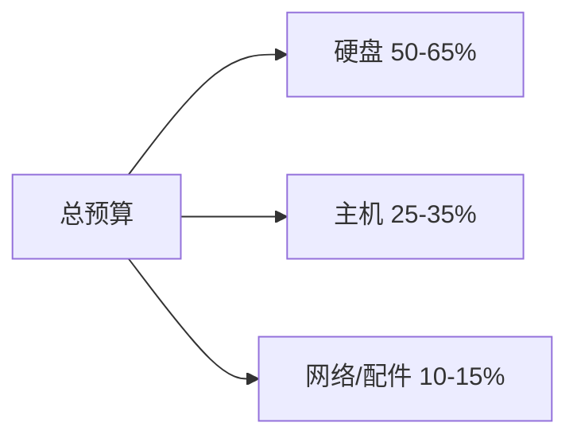

# 2.4 整机方案与预算

> 📌 前置：[2.1～2.3](README.md) · ⏱ 约 12 分钟

## 本章目标

- 了解四类硬件方案的优缺点
- 参考三档配置单形成自己的预算方案

> 💰 以下价格为思路性参考区间（人民币），会随市场波动，请以实际报价为准。

## 四类方案

| 方案 | 优点 | 缺点 | 适合 |
| --- | --- | --- | --- |
| 品牌整机（群晖/威联通等） | 开箱即用、系统成熟、售后好 | 贵、硬件规格保守 | 家庭用户、不想折腾 |
| 自装机（x86） | 性价比高、性能自由 | 需要装机与排障能力 | 动手党、进阶用户 |
| 旧电脑改造 | 成本最低、环保 | 功耗高、体积大、可能不稳 | 预算有限、先体验 |
| 树莓派/ARM | 极低功耗、小巧 | 性能与生态受限 | 轻量存储、学习 |

## 三档配置参考

### 入门体验档（约 ¥1500～2500，不含硬盘）

- 低功耗四核 CPU + 入门主板（2～4 SATA）
- 4GB 内存
- 千兆网口
- 小机箱 + 可靠电源
- 硬盘：2×4TB NAS 盘做 RAID 1

适合：纯存储、备份、轻量影音。

### 主流甜点档（约 ¥3000～5000，不含硬盘）

- 带核显的四核/六核 CPU（支持硬件转码）
- 8～16GB 内存
- 2.5G 网口
- 4～6 盘位机箱
- 一块 NVMe 做系统/缓存
- 硬盘：4×8TB NAS 盘做 RAID 5/6

适合：影音中心 + Docker + 多用户，覆盖 80% 家庭需求。

### 进阶性能档（约 ¥6000+，不含硬盘）

- 多核多线程 CPU / 支持 ECC
- 32GB+ 内存
- 2.5G/万兆网口
- 6～8 盘位 + HBA 卡
- 大容量 NVMe 高速池
- 硬盘：6×12TB+ 做 RAIDZ2 / RAID 6

适合：虚拟机、本地 AI、小型办公室、大量数据。

## 品牌整机怎么选

- **盘位数**：先满足容量，再考虑扩展。
- **CPU 是否带核显**：影音转码关键。
- **内存是否可升级**：很多品牌机出厂内存偏小。
- **系统生态**：DSM 易用、QTS 弹性、飞牛本土化，详见第 3 章。

## 旧电脑改造检查清单

- [ ] 电源是否稳定、功率是否够（多盘启动瞬间电流大）
- [ ] 主板有几个 SATA 口
- [ ] 内存是否至少 4GB（跑 Docker 建议 8GB）
- [ ] 是否支持从 U 盘启动目标系统
- [ ] 机箱能否装下硬盘架、风道是否通畅
- [ ] 7×24 运行的功耗是否可接受

## 预算分配建议

> 💡 **核心原则**：钱优先花在硬盘和内存上，CPU 够用即可。很多人配了顶级 CPU 却买了最便宜的硬盘，这是本末倒置。

## 小结

先定用途与容量，再选方案；预算向硬盘和内存倾斜。品牌机买省心，自装机买自由，旧机先体验。

## 练习

1. 按你的需求，从三档配置中选一档，写出完整配置清单与预估总价。
2. 分别计算"品牌整机 vs 自装机"三年总成本（含电费与硬盘），比较差异。
