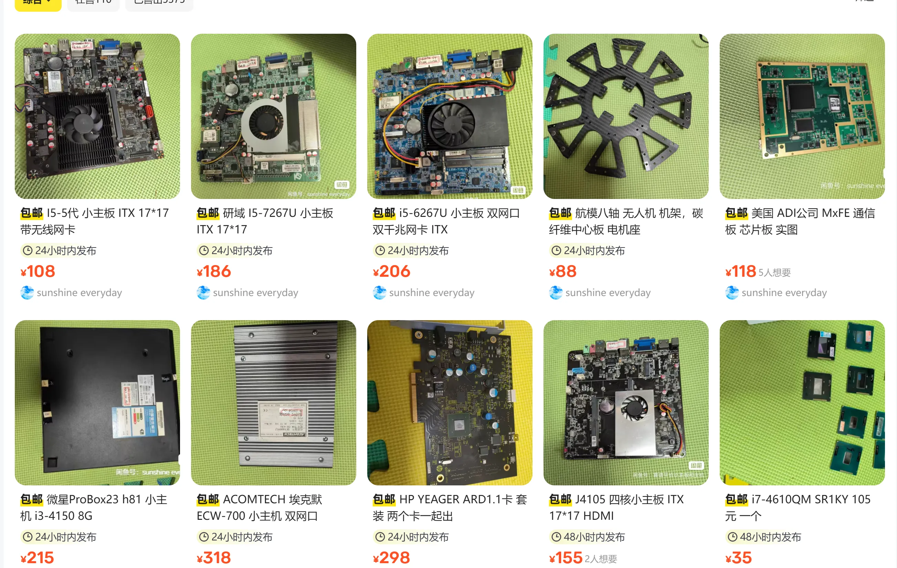
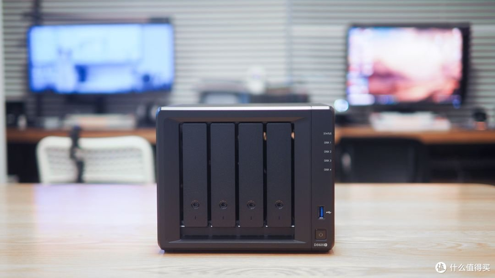
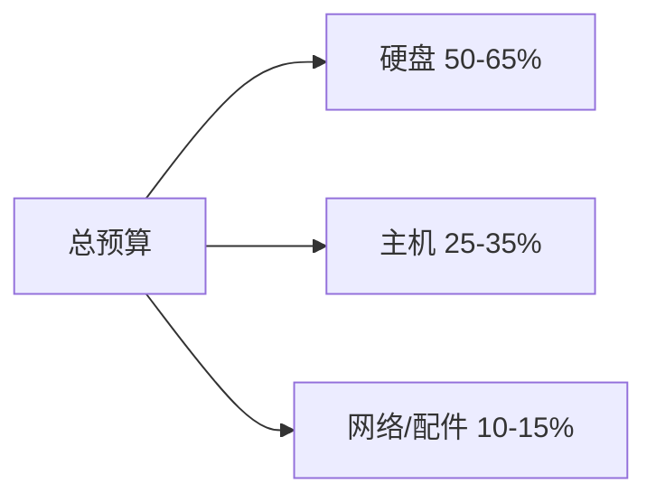

# 2.4 具体怎么配？三档方案给你参考

> 📌 先读：[2.1～2.3](README.md) · ⏱ 大约 12 分钟

> 💰 下面价格是思路性参考区间，随市场波动，以实际报价为准。

## 四条路线

| 路线 | 优点 | 缺点 | 适合 |
| --- | --- | --- | --- |
| 品牌整机 | 开箱即用、售后好 | 贵、硬件保守 | 家庭用户、不想折腾 |
| 自己攒（x86） | 性价比高、性能自由 | 要会装机和排障 | 动手党 |
| 旧电脑改造 | 成本最低、环保 | 功耗高、可能不稳 | 先体验 |
| 树莓派/软路由 | 极低功耗 | 盘位和性能受限 | 学习、轻载 |

社区里常有人整理各种低功耗硬件方案，下面这张图汇总了不少迷你主机、工控板的实物对比，选硬件时可以逛逛找灵感：

  

> 💡 截图来自 [fnnas.wiki 的硬件选购内容](https://fnnas.wiki/)（见 [致谢](../../CREDITS.md)）。具体参数请以官方规格为准。

品牌整机的做工与扩展性是它的价值之一，下面是一台四盘位群晖的实拍（硬盘托架、网口、内存位都看得到）：

  

> 💡 图片来自 [什么值得买的群晖 DS920+ 教程](https://post.smzdm.com/p/agq0p693/)（见 [致谢](../../CREDITS.md)）。

## 三档配置参考（不含硬盘）

### 入门体验档（约 ¥1500～2500）

- 低功耗四核 + 入门主板（2～4 SATA）
- 4GB 内存、千兆网口、小机箱
- 硬盘：2×4TB NAS 盘做 RAID 1

适合：纯存储、备份、轻量影音。

### 主流甜点档（约 ¥3000～5000）

- 带核显的四核/六核（能硬件转码）
- 8～16GB 内存、2.5G 网口
- 4～6 盘位机箱，一块 NVMe 做系统/缓存
- 硬盘：4×8TB NAS 盘做 RAID 5/6

适合：影音 + Docker + 多用户，覆盖八成家庭需求。

### 进阶性能档（约 ¥6000+）

- 多核多线程 CPU / 支持 ECC
- 32GB+ 内存、2.5G/万兆网口
- 6～8 盘位 + HBA 卡，大容量 NVMe 高速池
- 硬盘：6×12TB+ 做 RAIDZ2 / RAID 6

适合：虚拟机、本地 AI、小团队、海量数据。

## 钱该花在哪儿

> 💡 **核心原则：钱优先给硬盘和内存，CPU 够用就行。** 很多人配了顶级 CPU 却买最便宜的硬盘，这是本末倒置。

## 旧电脑改造，先查这几样

- [ ] 电源稳不稳、功率够不够（多盘启动电流大）
- [ ] 主板几个 SATA 口
- [ ] 内存至少 4GB（跑 Docker 建议 8GB）
- [ ] 能否从 U 盘启动目标系统
- [ ] 机箱装不装得下硬盘架、风道如何
- [ ] 7×24 的功耗能不能接受

有位数巢笔记的作者拿淘汰 ThinkPad 装飞牛，跑了三个月把经验写了下来——比如**系统分区给 64G**（更新和缓存会长），**合盖休眠要关掉**。这些细节规格表上查不到，原文见 [这里](https://www.shunot.com/nas/1000.html)。

## 写在最后

先定用途和容量，再选路线。预算向硬盘和内存倾斜。品牌机买省心，自装机买自由，旧机先体验。

## 动手试试

1. 从三档里选一档，写完整配置清单和预估总价。
2. 算算"品牌整机 vs 自装机"三年总成本（含电费和换盘），比一比。
