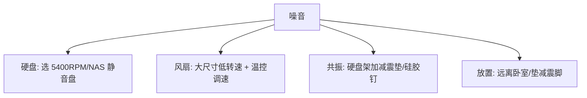

# 2.5 功耗、噪音与散热

<p align="center">
  
</p>


> 📌 先读：[2.4 整机方案与预算](2.4-整机方案与预算.md) · ⏱ 约 10 分钟

## 这一节能帮你

- 理解功耗、噪音、散热三者的关系
- 能判断一台 NAS 是否适合放在生活空间

## 功耗：长期运行的小账

NAS 长期开机，功耗直接影响电费与发热。

| 状态 | 典型功耗 | 说明 |
| --- | --- | --- |
| 休眠 | 几瓦 | 硬盘停转、CPU 低频 |
| 闲时 | 10～30W | 家庭 NAS 常见 |
| 高负载 | 40～100W+ | 转码/AI/多盘读写 |

估算电费：

```
年电费 ≈ 功耗(W) × 24 × 365 ÷ 1000 × 电价
```

> 例：25W 常年运行，电价 0.6 元/度 → 约 25×24×365/1000×0.6 ≈ 131 元/年。

> 💡 想要更低功耗：选低功耗 CPU、减少硬盘数量、用 SSD、开启硬盘休眠。但休眠会带来唤醒延迟与额外的硬盘启停损耗，需权衡。

## 噪音：最容易被忽视的体验杀手

噪音来源：

1. **硬盘**：机械盘转动与寻道声（约 20～40 dB）
2. **风扇**：CPU/机箱风扇，转速越高越吵
3. **共振**：硬盘架与机箱传导振动，产生低频嗡嗡声
4. **电源**：风扇与电流声

降噪思路：



> 💡 很多"NAS 很吵"的抱怨，其实是共振而非硬盘本身。加减震垫往往立竿见影。

## 散热：稳定与寿命的保障

- **风道**：前进后出或下进上出，避免热空气回流。
- **硬盘温度**：一般建议 25～45°C，超过 50°C 需改善散热。
- **CPU/ NVMe**：高速 NVMe 长时间读写会过热降速，注意散热片与气流。
- **定期清灰**：灰尘堆积会显著影响散热与噪音。

> ⚠️ **矛盾的平衡**：静音与散热往往冲突（低转速风扇安静但散热弱）。家用环境优先保证硬盘温度可控，再追求静音。

## 监控工具

- 大多数 NAS 系统提供温度与风扇转速查看。
- 命令行可用 `smartctl` 看硬盘温度，见 [5.5 硬盘健康监控](../05-存储与数据保护/5.5-硬盘健康监控.md)。
- 进阶可做温度告警，见 [8.5 监控与告警](../08-进阶主题/8.5-监控与告警.md)。

## 写在最后

功耗算清长期账、噪音重点防共振、散热保证硬盘温度。三者平衡好，NAS 才能安静可靠地待在家里。

## 动手试试

1. 估算你计划配置的 NAS 的年电费。
2. 想想它会放在哪里？结合位置评估对噪音的容忍度。
