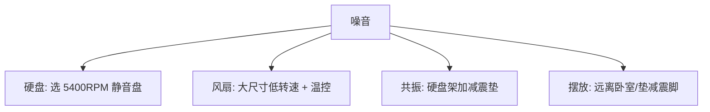

# 2.5 吵不吵、热不热、费不费电

> 📌 先读：[2.4 整机方案](2.4-整机方案与预算.md) · ⏱ 大约 10 分钟

## 噪音，最容易被忽略的体验杀手

很多人装完 NAS 才发现：它放在客厅，晚上"嗡嗡"响，根本受不了。

噪音从哪儿来？

1. **硬盘**：机械盘转动和寻道声（约 20～40 dB）
2. **风扇**：CPU/机箱风扇，转速越高越吵
3. **共振**：硬盘架与机箱传导振动，产生低频嗡嗡声
4. **电源**：风扇和电流声

> 💡 很多"NAS 很吵"的抱怨，其实是共振而不是硬盘本身。加个减震垫、换硅胶钉，往往立竿见影。



## 功耗：算算长期账

| 状态 | 典型功耗 |
| --- | --- |
| 休眠 | 几瓦 |
| 闲时 | 10～30W（家庭常见） |
| 高负载 | 40～100W+ |

```
年电费 ≈ 功耗(W) × 24 × 365 ÷ 1000 × 电价
```

25W 常年跑、0.6 元/度，一年约 130 块。想更低可以选低功耗 CPU、少放硬盘、用 SSD、开硬盘休眠——但休眠有唤醒延迟，要权衡。

## 散热：稳定与寿命的保障

- **风道**：前进后出或下进上出，别让热空气回流
- **硬盘温度**：一般 25～45°C 合适，超过 50°C 要改善
- **NVMe**：高速读写会过热降速，注意散热片和气流
- **清灰**：灰尘堆积明显影响散热和噪音

> ⚠️ 静音和散热常常冲突（低转速风扇安静但散热弱）。家用优先保证硬盘温度可控，再追求静音。

## 怎么监控

系统一般都有温度和风扇转速查看。命令行可以用：

```bash
sudo smartctl -A /dev/sda | grep -i temperature
```

更详细的硬盘健康检查见 [5.5](../../docs/05-存储与数据保护/5.5-硬盘健康监控.md)，进阶告警见 [8.5](../../docs/08-进阶主题/8.5-监控与告警.md)。

## 写在最后

功耗算清长期账，噪音重点防共振，散热保证硬盘温度。三者平衡好，NAS 才能安静可靠地待在家里。

## 动手试试

1. 估算你计划配置的年电费。
2. 想想它会放在哪里？结合位置评估对噪音的容忍度。
