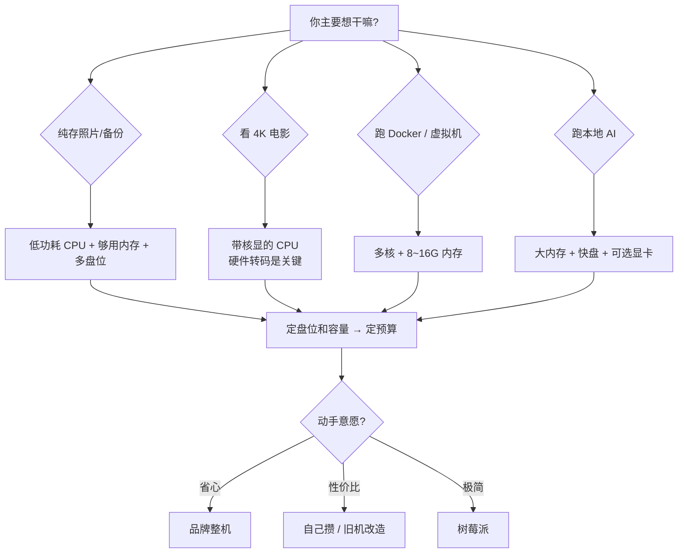

<p align="center">
  
</p>

# 02 挑硬件：别让预算花错地方

> ⏱ 大约 50 分钟 · 难度 ⭐⭐ · 建议开着购物网站对照读

## 先说个大实话

大部分人配 NAS，最容易犯的错是——**CPU 买太好，硬盘买太差。**

我见过有人上了 i7，结果配了三块最便宜的桌面盘。机器跑分很漂亮，但硬盘会半夜"咔哒"一声让你心跳加速，还要担心它哪天突然罢工。

NAS 这台机器，**主角是硬盘，不是 CPU。** 记住这句，能帮你省下不少冤枉钱。

## 这一章帮你搞定什么

```
你打算拿它干嘛  →  需要什么配置  →  买几块什么盘  →  花多少钱
```

读完你应该能填出一张属于自己的配置单，并且**知道每一项为什么这么选**，而不是照抄别人的清单。

## 决策地图



## 路线一览

| 小节 | 聊什么 | 你能拿走什么 |
| --- | --- | --- |
| [2.1 核心部件](2.1-核心部件选型.md) | CPU、内存、网口怎么挑 | 配置思路 |
| [2.2 硬盘](2.2-硬盘选型.md) | NAS 盘、CMR、SSD 的门道 | 一张硬盘清单 |
| [2.3 容量与 RAID](2.3-容量规划与RAID基础.md) | 得买多大、怎么组合 | 容量计算 |
| [2.4 整机方案](2.4-整机方案与预算.md) | 三档配置单 | 预算表 |
| [2.5 功耗噪音散热](2.5-功耗噪音与散热.md) | 吵不吵、费不费电 | 取舍依据 |

## 社区里的一句忠告

> 来自 [飞牛 OS 非官方教程站](https://fnnas.wiki/) 的硬件选购经验：先想清楚"把 NAS 当纯存储，还是当家庭服务器（Home Server）"。前者重容量和静音，后者重 CPU 和内存。方向不同，配置差很多。

这句话值得你写在纸上——**先定方向，再看价格。**

## 一个笨办法但很有效

打开备忘录，写下三行：

1. 我现在有多少数据：**___ GB**
2. 我三年后大概有多少：**___ TB**（一般按现在 ×2～3 估）
3. 我最想让它干的一件事：**___**

这三行填完，这一章读起来就特别有针对性。

## 小练习

翻到 [exercises/02-硬件选型.md](../../exercises/02-硬件选型.md)，做容量估算和配置清单。别急着下单，算完再说。
