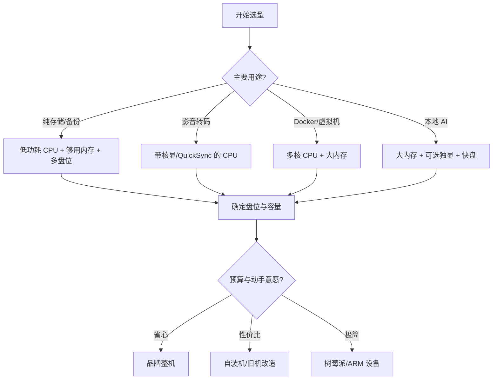

# 02 硬件选型 · 本章概览

> 难度：⭐⭐ · 预计阅读：50 分钟 · 是否需要设备：否（但建议对照电商页面）

## 本章目标

读完本章，你将能够：

1. 理解 CPU、内存、主板、硬盘、网卡等部件对 NAS 体验的影响
2. 根据容量需求和预算，选择合适的硬盘组合
3. 掌握容量规划与 RAID 级别的初步计算方法
4. 在"品牌整机 / 自装机 / 旧机改造 / 树莓派"之间做出合理选择
5. 评估功耗、噪音、散热，避免"买回来太吵太热"

## 核心主题

- **够用就好**：绝大多数家庭 NAS 不需要顶级 CPU，但内存和网卡不能太抠
- **硬盘是主角**：NAS 的体验、成本、风险大半由硬盘决定
- **冗余不是备份**：RAID 解决可用性，不解决备份问题
- **场景驱动**：影音/备份/Docker/AI 对硬件的侧重完全不同

## 小节列表

| 小节 | 核心问题 | 关键产出 |
| --- | --- | --- |
| [2.1 核心部件选型](2.1-核心部件选型.md) | CPU/内存/主板怎么选？ | 配置思路 |
| [2.2 硬盘选型](2.2-硬盘选型.md) | HDD/SSD/NAS 盘怎么挑？ | 硬盘清单 |
| [2.3 容量规划与 RAID 基础](2.3-容量规划与RAID基础.md) | 需要多大？怎么算？ | 容量与 RAID 方案 |
| [2.4 整机方案与预算](2.4-整机方案与预算.md) | 具体怎么配？ | 三档配置单 |
| [2.5 功耗、噪音与散热](2.5-功耗噪音与散热.md) | 吵不吵、费不费电？ | 取舍依据 |

## 选型决策树

## 小结

硬件选型没有"标准答案"，只有"匹配你需求的答案"。先明确用途与预算，再逐项决定。

## 练习

见 [`exercises/02-硬件选型.md`](../../exercises/02-硬件选型.md)。
