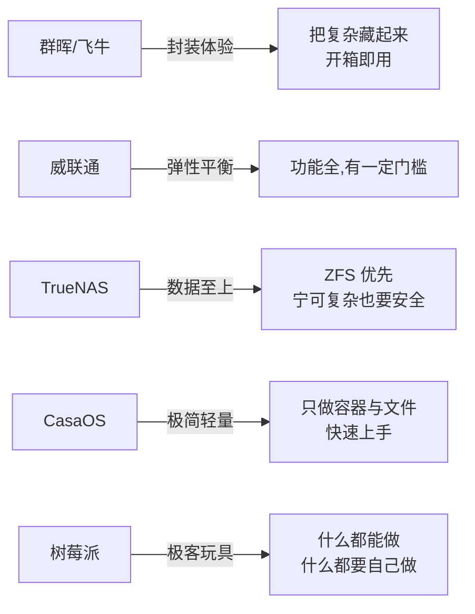

# 3.1 六大平台横向对比

> 📌 前置：[3.0 本章概览](README.md) · ⏱ 约 15 分钟

## 本章目标

- 通过统一维度对比六大平台
- 识别各平台的关键差异与适用场景

## 总览对比表

| 维度 | 群晖 DSM | 威联通 QTS | TrueNAS | CasaOS | 飞牛 fnOS | 树莓派 |
| --- | --- | --- | --- | --- | --- | --- |
| 类型 | 商业 | 商业 | 开源 | 开源 | 免费* | 开源硬件 |
| 上手难度 | 低 | 中 | 高 | 低 | 低 | 中 |
| 中文体验 | 优秀 | 良好 | 一般 | 良好 | 优秀 | 良好 |
| 文件系统 | Btrfs/ext4 | ext4/ZFS(QuTS) | ZFS | ext4/Btrfs | Btrfs | ext4 等 |
| Docker | ✅ 优秀 | ✅ 优秀 | ✅ (SCALE) | ✅ 核心 | ✅ 支持 | ✅ 可用 |
| 虚拟机 | ✅ | ✅ | ✅ | 有限 | ✅ | 有限 |
| 硬件自由度 | 低 | 低 | 高 | 高 | 中高 | — |
| 社区生态 | 非常大 | 大 | 大(海外) | 中 | 增长快 | 非常大 |
| 成本 | 高 | 中高 | 硬件自购 | 低 | 低～中 | 低 |
| 适合 | 省心家庭 | 性价比家庭 | 数据安全控 | 旧机/极简 | 国产易用 | 学习/轻载 |

> *飞牛 fnOS 对个人免费使用，具体条款以其官方为准。

## 哲学差异

## 关键差异解读

### 文件系统

- **ZFS（TrueNAS / QuTS hero）**：数据校验、快照、CoW、scrub 一体化，数据完整性最强，但吃内存、学习曲线陡。
- **Btrfs / ext4（群晖 / 飞牛 / CasaOS）**：成熟稳定，兼容性好，功能依赖厂商封装。

详见 [5.1 文件系统](../05-存储与数据保护/5.1-文件系统.md)。

### 开源与自由

- **开源（TrueNAS / CasaOS）**：可自装在任意 x86 硬件上，无厂商锁定。
- **商业（群晖 / 威联通）**：软硬件绑定，但体验与售后有保障。
- **飞牛 fnOS**：国产免费系统，兼顾易用与一定自由度。

### 中文与本土化

- **飞牛 fnOS**：中文界面、本土化应用（如国内网盘同步、百度网盘）、社区活跃，最贴合中文用户。
- **群晖 / 威联通**：中文支持多年，文档与社区成熟。
- **TrueNAS / CasaOS**：英文为主，中文社区相对小。

## 选型决策矩阵

给每个维度按你的重视程度打分（1～5），乘以权重后求和：

| 维度 | 权重 | 群晖 | 威联通 | TrueNAS | CasaOS | 飞牛 | 树莓派 |
| --- | --- | --- | --- | --- | --- | --- | --- |
| 易用性 | __ | | | | | | |
| 数据安全 | __ | | | | | | |
| 中文体验 | __ | | | | | | |
| 扩展能力 | __ | | | | | | |
| 成本 | __ | | | | | | |
| 硬件自由 | __ | | | | | | |

## 小结

用同一把尺子量平台，避免被单一优点带偏。先定权重，再看得分。

## 练习

1. 填写上面的决策矩阵，算出你的 Top 2 平台。
2. 针对 Top 2，阅读后续两节了解细节。
