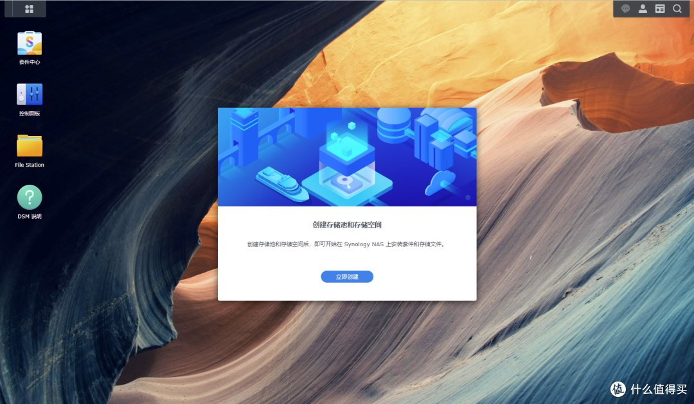
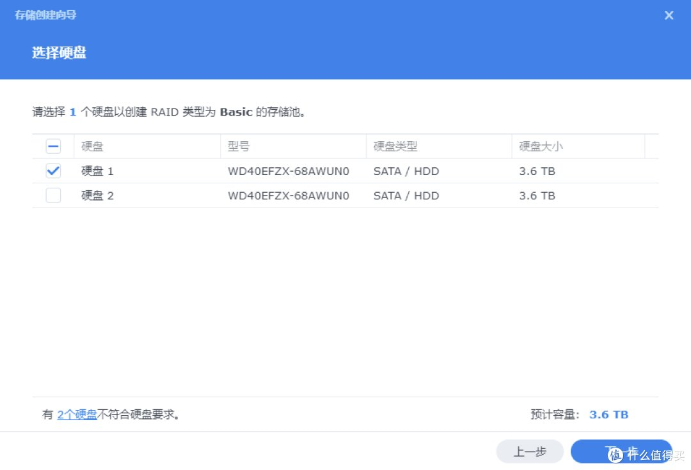
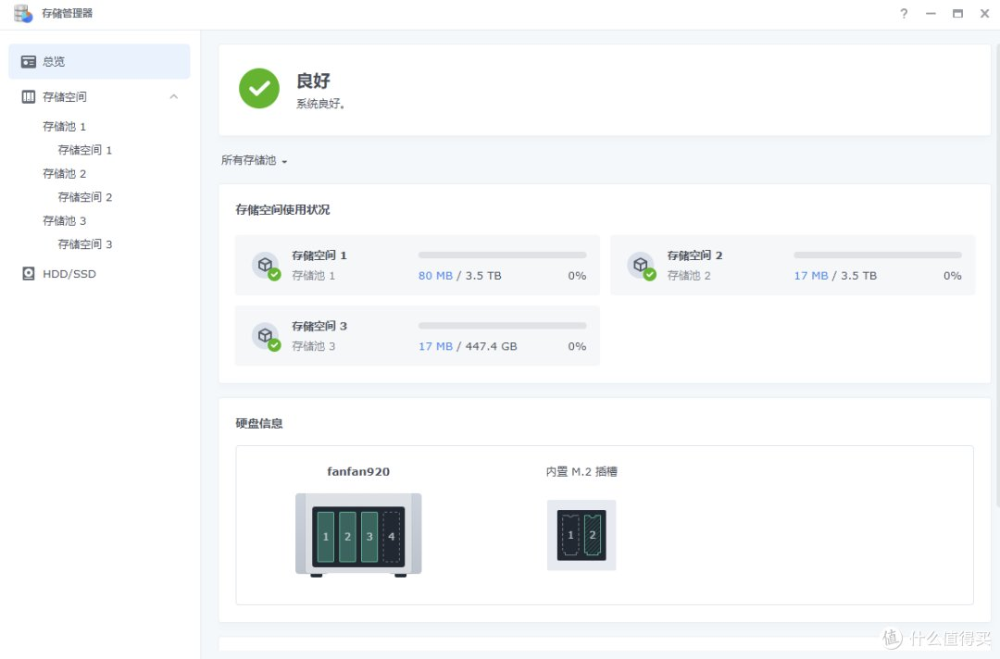

# 3.2 群晖 DSM：花钱买省心的"老大哥"

> ⏱ 大约 12 分钟

## 一句话印象

群晖是 NAS 界的"老大哥"——不便宜，但你买回去基本不用操心。

它的 DSM 系统被广泛认为是"最好上手的 NAS 系统"，界面像桌面电脑一样直观，新手几乎零门槛。

| 项目 | 说明 |
| --- | --- |
| 文件系统 | Btrfs（新机型）/ ext4（旧机型） |
| Docker | Container Manager，体验好 |
| 虚拟机 | Virtual Machine Manager |
| 中文支持 | 优秀 |
| 硬件 | 仅群晖整机，不能自装 |

DSM 的桌面长这样——和电脑桌面很像，上手几乎零门槛：

  

> 💡 截图来自 [什么值得买的群晖 DS920+ 保姆级教程](https://post.smzdm.com/p/agq0p693/)（见 [致谢](../../CREDITS.md)）。

## 它好在哪

1. **易用性天花板**：界面直观，文档全，遇到问题容易搜到答案
2. **应用生态完整**：Drive、Photos、DS video、Download Station 等官方套件成熟
3. **社区庞大**：中文资料多，求助容易
4. **售后靠谱**：整机购买，售后体系完善

## 它的边界

- **贵**：同硬件规格明显贵于自装方案
- **硬件保守**：CPU、内存常落后于同价位 DIY
- **厂商锁定**：系统装不到别的硬件上
- **自由度受限**：深度定制不如通用系统

## 适合你吗

**适合**：家庭用户、不想折腾、重视稳定和售后、需要成熟的照片/文件同步。

**不适合**：追求极致性价比、想跑大量 Docker/本地 AI、希望自由换硬件。

群晖的存储池与套件中心界面（这也是它"省心"的来源）：

  

  

> 💡 截图来自 [什么值得买的群晖教程](https://post.smzdm.com/p/agq0p693/)（见 [致谢](../../CREDITS.md)）。

## 各功能在哪儿（对照后面章节）

| 主题 | DSM 里的入口 | 章节 |
| --- | --- | --- |
| 存储池/卷 | 存储管理器 | [5.2](../../docs/05-存储与数据保护/5.2-RAID与存储池实战.md) |
| 快照 | Snapshot Replication | [5.3](../../docs/05-存储与数据保护/5.3-快照与版本管理.md) |
| 备份 | Hyper Backup | [5.4](../../docs/05-存储与数据保护/5.4-备份3-2-1原则.md) |
| Docker | Container Manager | [7.1](../../docs/07-应用服务/7.1-Docker基础.md) |
| 外网访问 | QuickConnect / DDNS | [6.2](../../docs/06-网络与远程访问/6.2-远程访问方案对比.md) |

> 💡 QuickConnect 方便但速度受官方中继影响。追求速度和隐私建议自建 VPN/反代，见 [第 6 章](../../docs/06-网络与远程访问/README.md)。

## 写在最后

群晖是"花钱买时间"的代表。如果你把时间看得比钱重，它依然是最稳的选择之一。

## 动手试试

1. 搜一下同价位"群晖 vs 自装"的硬件参数，看看差在哪。
2. 想想你更在意"省心"还是"性能与自由"。
