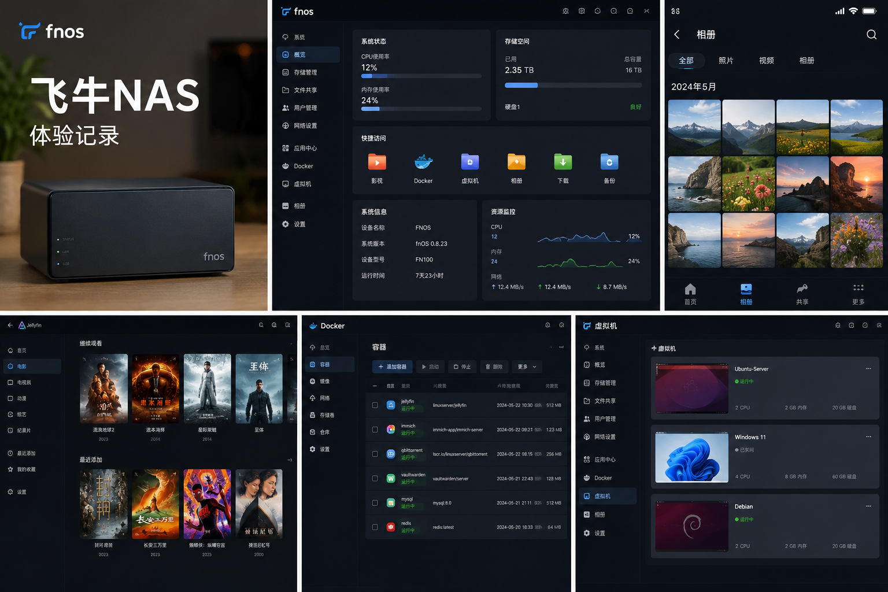

# 3.6 飞牛 fnOS

> 定位：国产新势力、本土化体验优秀、对个人用户免费

## 这位选手什么脾气

飞牛 fnOS 是这几位里最"接地气"的一个——它为中文用户而生，界面、应用、社区都带着浓浓的本土味。

对个人用户免费，界面像 Windows 一样亲切。唯一的"不稳定因素"是它比较年轻，还在快速成长。

它的桌面长这样，Windows 用户一看就懂：

  

> 💡 截图来自 [Lycoris 的飞牛折腾日记](https://lycoris.cloud/archives/019eda7f-15b1-743e-9aab-d0ee8999b0a5)（见 [致谢](../../CREDITS.md)）。

## 基本信息

飞牛 fnOS 是近年崛起的国产 NAS 系统，主打"为中文用户设计"。它提供 Windows 风格的桌面体验、本土化应用（如国内网盘同步、迅雷、影音）和友好的社区支持。

| 项目 | 说明 |
| --- | --- |
| 类型 | 国产 NAS 系统 |
| 文件系统 | Btrfs |
| Docker | 支持 |
| 中文支持 | 优秀（原生本土化） |
| 硬件 | 支持自装 x86，也有整机 |

## 它的长处

1. **本土化最到位**：中文界面、国内网盘、本地化服务整合。
2. **对个人免费**：降低入门门槛（具体条款以官方为准）。
3. **界面现代**：桌面式体验，Windows 用户上手快。
4. **社区活跃**：中文社区增长快，教程与反馈丰富。
5. **硬件自由度**：可自装，也可买整机。

## 它的短板

- **较新**：系统仍在快速迭代，部分功能与稳定性有待时间检验。
- **生态规模**：第三方应用数量不及群晖/威联通。
- **商业策略变化**：免费政策未来可能调整，重要数据仍需独立备份。

## 适合这样的人

- 中文用户、希望本土化体验
- 预算有限但想要易用系统
- 旧电脑改造、自装 NAS

## 这些人再想想

- 追求极致稳定、不愿承担新系统迭代风险
- 需要大量特定第三方应用

## 本书相关案例

本指南多处内容参考了飞牛的使用实践，例如：

- **从 0 搭建飞牛**：见 [4.2 系统安装](../04-第一次搭建/4.2-系统安装.md)
- **SSD 基准测试搬进 NAS**：新盘到手先检测，见 [2.2 硬盘选型](../02-硬件选型/2.2-硬盘选型.md) 与 [5.5 硬盘健康监控](../05-存储与数据保护/5.5-硬盘健康监控.md)
- **在 NAS 上跑本地模型**：见 [7.5 自托管 AI](../07-应用服务/7.5-自托管AI.md)

## 一位从 TrueNAS 换过来的用户怎么说

B 站 UP 主"旅客君 LookUplus"把工作室的 NAS 从 TrueNAS 换成了飞牛，并录了一条讲真实感受的视频。我们把视频逐句转录后，提炼出几个很实在的观察（[视频 BV1ncjJ6wE7C](https://www.bilibili.com/video/BV1ncjJ6wE7C)，文字稿见 [`transcripts/`](../../transcripts/)）：

- **他的定位**："不一定是适合所有人，但对于我这种 NAS 小白 + 内容创作者来说，确实省了很多事。"——注意是"省事"，不是"更强"
- **素材管理**：每期视频单独建一个项目文件夹，成片/封面/字幕按规范命名，找的时候按项目名一搜就全出来（这个习惯值得所有做视频的人抄）
- **iCloud + NAS 分工**：相机拍的 RAW 和编辑文件全进 NAS，iCloud 只存修好的成片和 iPhone 直拍——"真把大量 RAW 塞进 iCloud，2TB 很快就不够了"
- **飞牛影视的贴心处**：家人不用懂 NAS 是什么，在 Apple TV 打开飞牛影视、看到海报墙点进去就能播；还能挂载网盘里的资源（夸克/百度）进海报墙，不用先下载到本地
- **微信聊天记录备份**：应用中心里有个第三方 App 能备份微信聊天记录，备份后就能放心删 iPhone 本地记录——他称"这个 App 我给个好评"
- **他保留的部分**：自己依然订阅 Infuse 看片，iCloud 也照用——**换系统不是全盘否定，而是各取所需**

> 💡 这段是逐句看完视频提炼的。转录里"非牛=飞牛""刮销=刮削""绕文件=RAW 文件"，属识别误差，已更正。它说明一个道理：**平台选型没有绝对答案，看你更在意"数据至上的掌控"还是"开箱就用的省心"**——这正是 [3.1 对比表](3.1-六大平台横向对比.md) 想帮你判断的。

## 各功能在哪儿

| 主题 | 飞牛入口 | 章节 |
| --- | --- | --- |
| 存储管理 | 存储管理 | [5.2](../05-存储与数据保护/5.2-RAID与存储池实战.md) |
| 快照 | 快照管理 | [5.3](../05-存储与数据保护/5.3-快照与版本管理.md) |
| Docker | Docker 应用 | [7.1](../07-应用服务/7.1-Docker基础.md) |
| 外网访问 | 需自行配置或官方方案 | [第 6 章](../06-网络与远程访问/README.md) |

## 写在最后

飞牛 fnOS 是中文用户值得重点考虑的选择：易用、免费、本土化好。新系统请保持关注并备份数据。

## 动手试试

1. 到飞牛官网查看最新版本的功能列表与硬件要求。
2. 对比飞牛与群晖：在"本土化"和"生态成熟度"上各自的优劣是什么？
