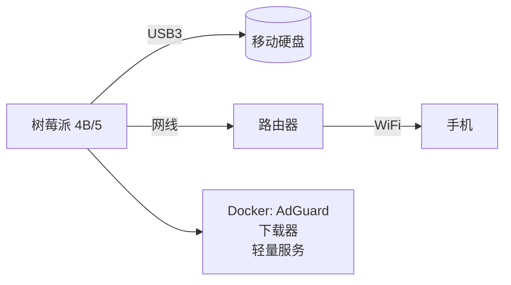

# 3.7 树莓派与软路由

  

> 定位：极低功耗、ARM 平台、动手党的玩具与学习平台

## 这位选手什么脾气

树莓派是"巴掌大的极客小学生"——功耗低到几乎可以忽略，什么都能学，但别指望它干重活。

它是理解 NAS 原理的绝佳玩具，却不适合当你家全部照片的唯一归宿。

## 这位选手是谁

树莓派（Raspberry Pi）等 ARM 单板机功耗极低、体积小巧，常被用来做轻量 NAS、下载机、DNS/广告过滤、家庭自动化中心。也有人在软路由（x86 小主机）上跑 NAS 服务。

| 方案 | 优点 | 缺点 |
| --- | --- | --- |
| 树莓派 + USB 硬盘 | 功耗极低、安静、便宜 | USB 带宽与供电限制、性能弱 |
| 树莓派 NVMe（CM4/新机型） | 速度提升 | 成本更高、仍需 ARM 生态 |
| 软路由小主机 | x86 生态、多网口 | 盘位有限、功耗高于 Pi |

## 适合拿它做什么

- 轻量文件共享（SMB/NFS）
- 离线下载机
- Docker 轻量服务（AdGuard Home、Home Assistant 等）
- DNS / 广告过滤
- 学习 Linux 与 NAS 原理

## 别指望它做这些

> ⚠️ 以下场景请谨慎选择 ARM 平台：
>
> - 大容量多盘 RAID（USB 接口带宽与供电是瓶颈）
> - 4K 实时转码（性能不足）
> - 本地大模型推理（内存与算力受限）
> - 高并发多用户访问

## 先认清这些限制

1. **USB 存储瓶颈**：USB 2.0 的 Pi 做存储会很慢；尽量选 USB 3.0 机型，并使用带独立供电的硬盘盒。
2. **供电**：硬盘启动瞬间电流可能超过 Pi 的供电能力，导致不稳定。
3. **ARM 软件兼容**：部分 Docker 镜像没有 ARM 版本，需找替代或自行构建。
4. **内存**：早期 Pi 内存偏小，跑 Docker 吃力；建议 4GB 以上。

## 装什么系统

- **Raspberry Pi OS + 手动配置**：最灵活，全靠自己。
- **CasaOS / openmediavault**：提供 Web 管理，降低门槛，见 [3.5 CasaOS](3.5-CasaOS.md)。
- **专用发行版**：如 Raspberry Pi 上的轻量 NAS 镜像。

## 一个典型架构

## 写在最后

树莓派适合学习与轻载场景，是理解 NAS 原理的绝佳平台，但不适合作为主力数据仓库。

## 动手试试

1. 如果你有树莓派，列出它当前跑的服务，评估是否适合增加 NAS 功能。
2. 查证：你感兴趣的一个 Docker 镜像是否提供 ARM64 版本。
