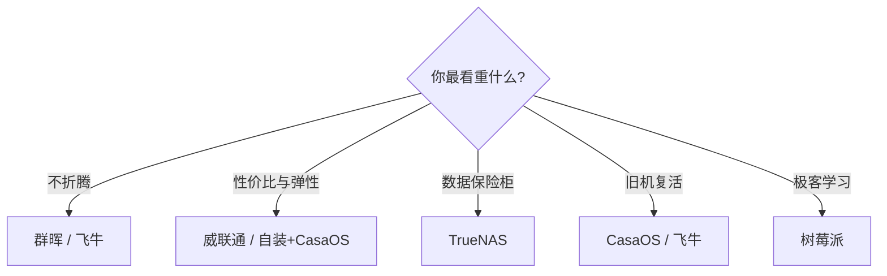

  

# 03 选系统：六位选手，看看谁适合你

> ⏱ 大约 60 分钟 · 难度 ⭐⭐ · 不需要设备，带着你的需求来

## 一场"相亲"

挑 NAS 系统，其实挺像相亲的。

没有绝对的"最好"，只有"合不合适"。有人看重省心，有人看重自由；有人预算充裕，有人想榨干旧电脑的最后一滴价值。

这一章，我们把六位选手请到一张桌子前，让它们各说各话：

- **群晖 DSM**——家境优渥、体贴周到的"老大哥"
- **威联通 QTS**——配置给得很足、有点极客气质的"实干派"
- **TrueNAS**——把数据安全刻进骨子里的"保险柜先生"
- **CasaOS**——轻装上阵、旧电脑救星的"邻家少年"
- **飞牛 fnOS**——中文说得最顺、势头很猛的"本土新秀"
- **树莓派**——巴掌大、什么都能学的"极客小学生"

先看看它们的合影，再听听各自的介绍。

## 你会带走什么

读完这一章，你应该能：

1. 说出每个系统"骨子里"是什么风格
2. 用一张对比表，把六个选手按你的需求排个序
3. 笃定地做出选择，而不是在网上继续纠结三个月

## 对比的方式

我们尽量用**同一把尺子**量它们：好不好上手、中文体验、数据安全、扩展能力、硬件自由度、成本。

## 路线一览

| 小节 | 内容 |
| --- | --- |
| [3.1 六大平台总览](3.1-六大平台横向对比.md) | 一张大表 + 打分模板 |
| [3.2 群晖 DSM](3.2-群晖DSM.md) | 老大哥的温柔与边界 |
| [3.3 威联通 QTS](3.3-威联通QTS.md) | 实干派的力气和脾气 |
| [3.4 TrueNAS](3.4-TrueNAS.md) | 保险柜先生有多较真 |
| [3.5 CasaOS](3.5-CasaOS.md) | 旧电脑的第二次青春 |
| [3.6 飞牛 fnOS](3.6-飞牛fnOS.md) | 本土新秀的中文温度 |
| [3.7 树莓派与软路由](3.7-树莓派与软路由.md) | 小身体的大玩具 |

## 一句大实话

> 别在"哪个系统最好"上纠结太久。**先按你的硬件条件和主要用途筛掉一半**，再在剩下的里面挑。选错了也不是死刑——数据备份好，重装系统只是几个小时的事。

## 小练习

翻到 [exercises/03-平台选型.md](../../exercises/03-平台选型.md)，填一填决策矩阵。填完你会发现，答案常常自己就浮出来了。
