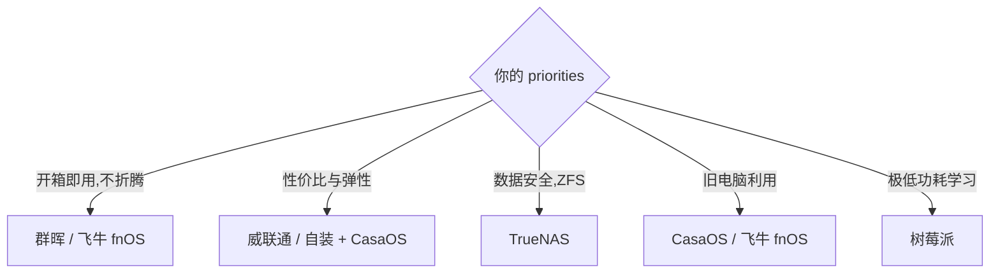

# 03 平台横评与选型 · 本章概览

> 难度：⭐⭐ · 预计阅读：60 分钟 · 是否需要设备：否

## 本章目标

读完本章，你将能够：

1. 从多个维度对比主流 NAS 系统的差异
2. 理解各平台的设计哲学、优势与局限
3. 根据需求、设备与动手能力选出合适的系统
4. 知道每个平台在本指南后续章节中的操作差异入口

## 核心主题

- **易用 vs 自由**：品牌系统开箱即用，通用系统灵活强大
- **文件系统分野**：ZFS（TrueNAS）CoW 与校验，Btrfs/ext4（群晖/威联通/飞牛）传统而成熟
- **中文体验**：飞牛 fnOS 本土化最好，群晖/威联通中文支持成熟
- **生态与社区**：Docker/虚拟机/AI 支持程度决定进阶上限

## 覆盖平台

| 平台 | 类型 | 内核基础 | 本指南侧重 |
| --- | --- | --- | --- |
| 群晖 DSM | 商业品牌系统 | Linux | 易用性、生态 |
| 威联通 QTS / QuTS hero | 商业品牌系统 | Linux | 弹性、ZFS 选项 |
| TrueNAS | 开源系统 | FreeBSD / Linux | ZFS、数据安全 |
| CasaOS | 开源轻量系统 | Linux (Debian) | 极简、旧机改造 |
| 飞牛 fnOS | 国产系统 | Linux | 本土化、易用 |
| 树莓派 / 软路由 | ARM 平台 | Linux | 低功耗、动手 |

## 小节列表

| 小节 | 核心问题 |
| --- | --- |
| [3.1 六大平台横向对比](3.1-六大平台横向对比.md) | 一张表看清差异 |
| [3.2 群晖 DSM](3.2-群晖DSM.md) | 为什么易用 |
| [3.3 威联通 QTS](3.3-威联通QTS.md) | 弹性与性价比 |
| [3.4 TrueNAS](3.4-TrueNAS.md) | ZFS 与数据安全 |
| [3.5 CasaOS](3.5-CasaOS.md) | 极简与旧机改造 |
| [3.6 飞牛 fnOS](3.6-飞牛fnOS.md) | 国产新势力 |
| [3.7 树莓派与软路由](3.7-树莓派与软路由.md) | ARM 低功耗方案 |

## 选型速查

## 小结

没有"最好的系统"，只有"最合适的系统"。明确你在"易用 / 自由 / 成本 / 安全"上的排序，选择自然清晰。

## 练习

见 [`exercises/03-平台选型.md`](../../exercises/03-平台选型.md)。
