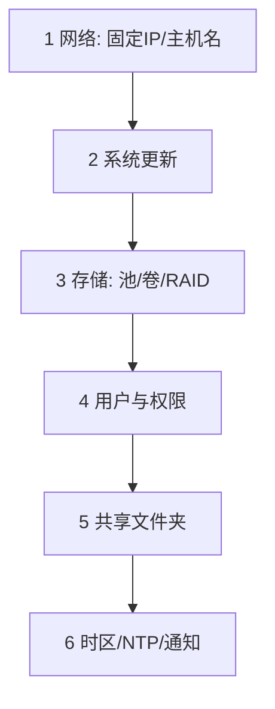
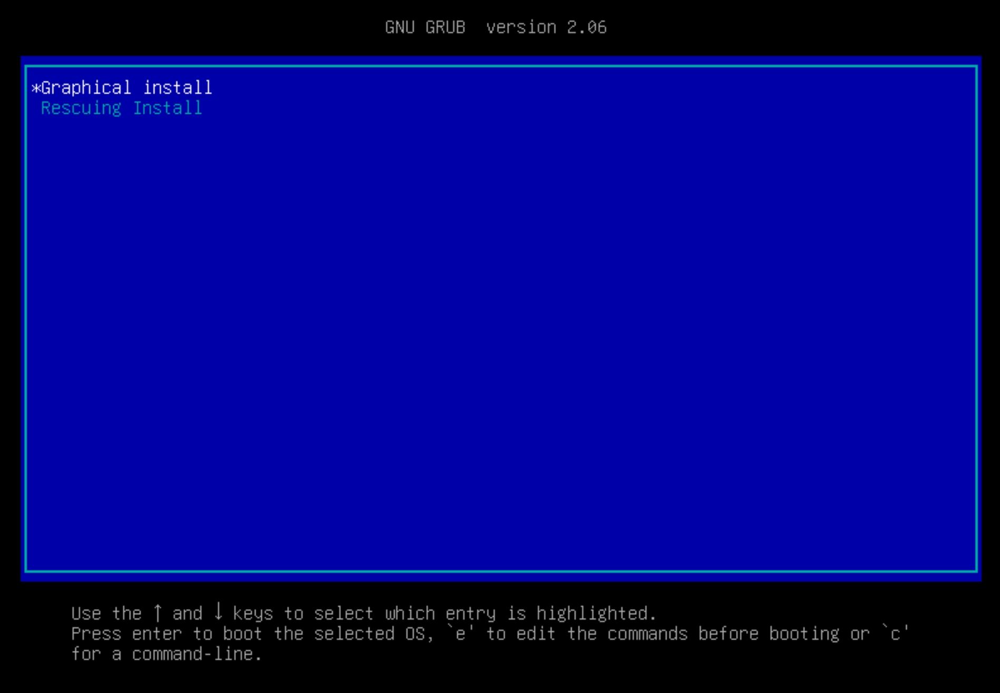
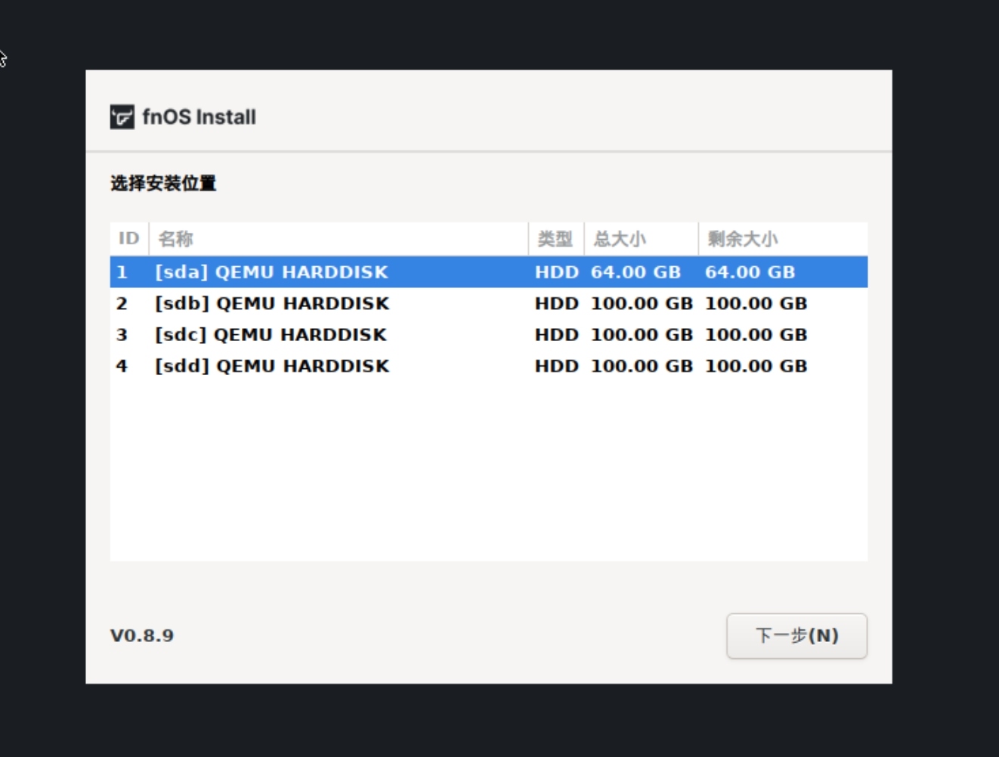
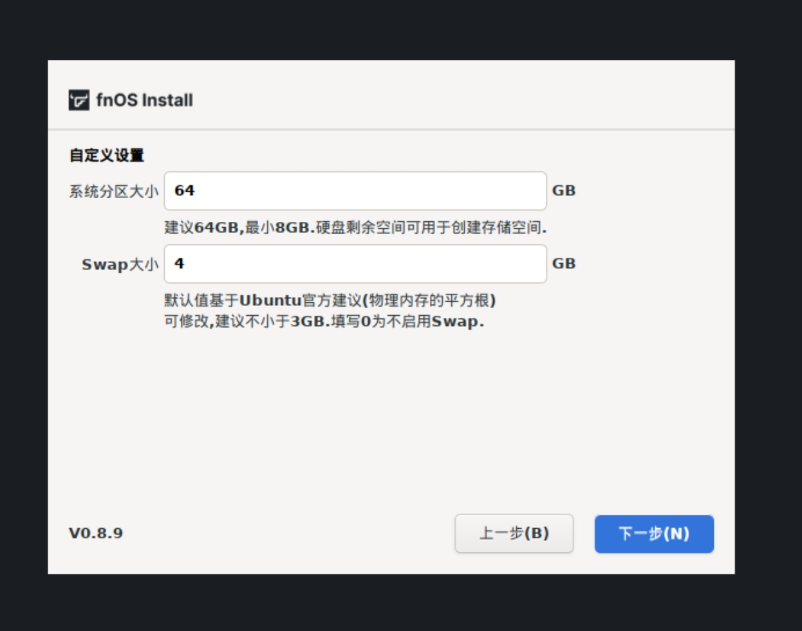

# 4.3 装好之后，先配这几样

> 📌 先读：[4.2 系统安装](4.2-系统安装.md) · ⏱ 大约 15 分钟

## 按这个顺序来



## 先看：首次开机的初始化向导

装完重启，浏览器访问安装时记下的 IP，会进入初始化向导。下面是飞牛 fnOS 的真实界面：

**① 设置设备名称**——给 NAS 起个好记的名字：

<p align="center">
  
</p>

**② 创建管理员账号**——用强密码，这是你以后登录的钥匙：

<p align="center">
  
</p>

**③ 配置存储**——系统盘以外的空间，在这里建存储池：

<p align="center">
  
</p>

> 💡 截图来自 [飞牛官方帮助中心](https://help.fnnas.com/articles/v1/start/install-os)，见 [致谢](../../CREDITS.md)。不同品牌的向导长得不一样，但无非就是"起名、建账号、划存储"这几件事。

## 1. 网络

- 设**固定 IP** 或做 DHCP 保留，避免重启后找不到机器
- 设主机名，好记
- 配 DNS（国内环境可用可靠的公共 DNS）

详见 [6.1](../06-网络与远程访问/6.1-局域网基础.md)。

## 2. 系统更新

第一时间装上更新，补掉已知漏洞。更新策略可以设自动，但把时间避开你常用的时段。

> ⚠️ 更新前确认重要数据已备份，尤其大版本升级。

## 3. 存储

创建存储池/卷，按规划选 RAID 级别。安装时没配的话现在配。记得留点空间，别一次用满。

详见 [5.2](../05-存储与数据保护/5.2-RAID与存储池实战.md)。

## 4. 用户与权限

从小处着手，遵循最小权限：

- 新建一个日常用户，**别长期用管理员账号**
- 按用途建组（家人、访客、服务账号）
- 不同共享设不同读写权限

> 💡 很多服务（Docker 容器）需要专门账号，建议单独建"服务账号"并限制它的访问范围。

## 5. 共享文件夹

建议先建这样一个骨架：

```
/共享
├── photos/      # 照片
├── documents/   # 文档
├── media/       # 影音
├── backup/      # 各设备备份
└── docker/      # 容器数据（交给 7.1）
```

给每个共享设好权限和配额，能开回收站/版本管理就开上——防误删。

## 6. 时区、时间、通知

- 设正确时区，开 NTP 对时
- 配好文件损坏、硬盘异常的通知（邮件/App 推送）

通知详见 [5.5](../05-存储与数据保护/5.5-硬盘健康监控.md) 和 [8.5](../08-进阶主题/8.5-监控与告警.md)。

## 各平台在哪儿配

| 配置项 | 群晖 | 威联通 | TrueNAS | 飞牛/CasaOS |
| --- | --- | --- | --- | --- |
| 网络 | 控制面板→网络 | 网络与虚拟交换机 | Network | 网络设置 |
| 存储 | 存储管理器 | 存储与快照总管 | Storage | 存储管理 |
| 用户 | 用户账号 | 用户管理 | Credentials | 用户管理 |
| 共享 | 共享文件夹 | 共享文件夹 | Shares | 共享文件夹 |

## 写在最后

初始化的目标就一句话：**最小可用**。网络稳、存储好、权限清、共享通。别急着装一堆应用。

## 动手试试

1. 建上面那套共享文件夹结构，设好权限。
2. 从电脑访问一个共享，验证读写都正常。
