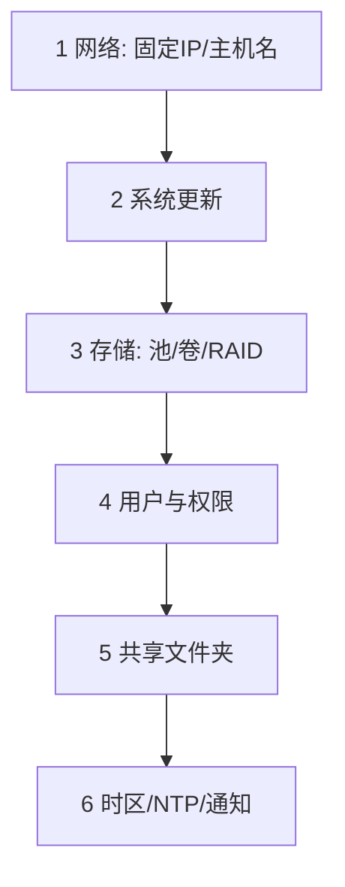

# 4.3 初始化配置

<p align="center">
  
</p>


> 📌 先读：[4.2 系统安装](4.2-系统安装.md) · ⏱ 约 15 分钟

## 这一节能帮你

- 完成网络、存储、用户、共享、更新的初始化
- 建立一个"能用"的最小系统

## 配置顺序



## 1. 网络配置

- 设置**固定 IP** 或在路由器做 IP/MAC 绑定，避免 IP 变化导致找不到设备。
- 设置主机名，便于记忆。
- 配置 DNS（国内环境可考虑可靠的公共 DNS）。

详见 [6.1 局域网基础](../06-网络与远程访问/6.1-局域网基础.md)。

## 2. 系统更新

- 第一时间安装系统更新，修补已知漏洞。
- 设置自动更新策略（建议更新时间避开使用高峰）。

> ⚠️ 更新前确认重要数据已备份，尤其大版本升级。

## 3. 存储配置

- 创建存储池/卷，按规划选择 RAID 级别。
- 若安装时未配置，此时创建。
- 预留少量空间，不要一次用满。

详见 [5.2 RAID 与存储池实战](../05-存储与数据保护/5.2-RAID与存储池实战.md)。

## 4. 用户与权限

最小权限原则：

- 新建一个日常用户，避免长期使用管理员账号。
- 按用途建用户组（家人、访客、服务账号）。
- 为不同共享设置不同读写权限。

> 💡 很多服务（Docker 容器）需要专门的账号，建议单独建"服务账号"并限制其访问范围。

## 5. 共享文件夹

建议的初始结构：

```
/共享
├── photos/      # 照片
├── documents/   # 文档
├── media/       # 影音
├── backup/      # 各设备备份
└── docker/      # 容器数据（交给 7.1）
```

- 为每个共享设置合适的权限与配额。
- 开启回收站/版本管理（若系统支持），防误删。

## 6. 时区、时间与通知

- 设置正确时区，启用 NTP 时间同步。
- 配置文件损坏、硬盘异常的通知（邮件/App 推送），见 [5.5 硬盘健康监控](../05-存储与数据保护/5.5-硬盘健康监控.md) 与 [8.5 监控与告警](../08-进阶主题/8.5-监控与告警.md)。

## 平台入口对照

| 配置项 | 群晖 | 威联通 | TrueNAS | 飞牛/CasaOS |
| --- | --- | --- | --- | --- |
| 网络 | 控制面板→网络 | 网络与虚拟交换机 | Network | 网络设置 |
| 存储 | 存储管理器 | 存储与快照总管 | Storage | 存储管理 |
| 用户 | 用户账号 | 用户管理 | Credentials | 用户管理 |
| 共享 | 共享文件夹 | 共享文件夹 | Shares | 共享文件夹 |

## 写在最后

初始化的目标是"最小可用"：网络稳定、存储就绪、权限清晰、共享可用。别急着装一堆应用。

## 动手试试

1. 建立上面建议的共享文件夹结构，并设置权限。
2. 从电脑访问一个共享，验证读写正常。
