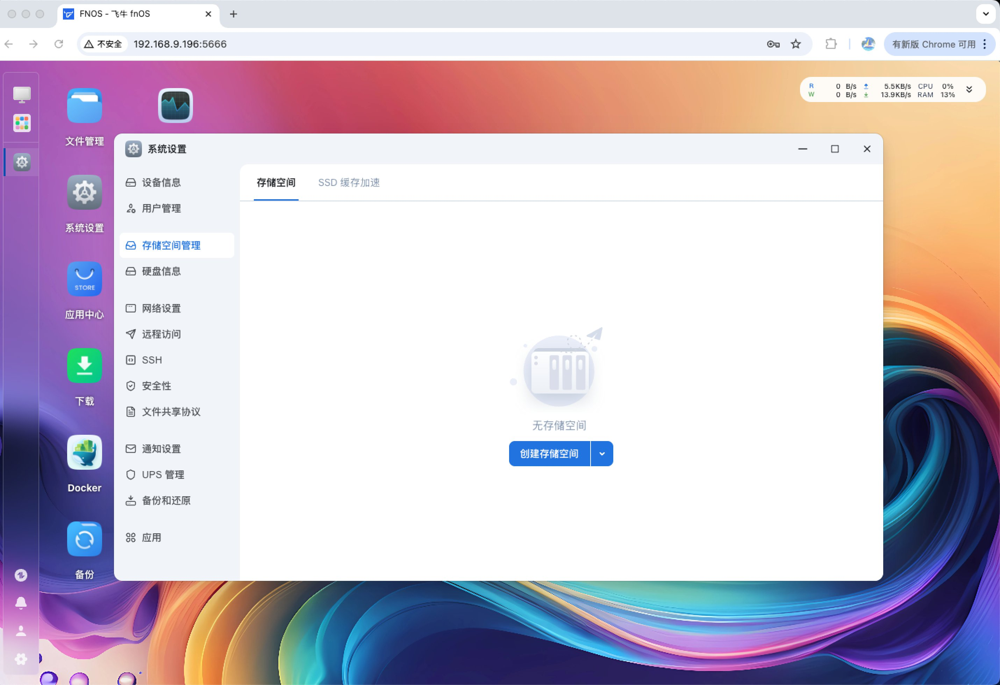

# 4.4 搬数据：小心点，别急

> 📌 先读：[4.3 初始化配置](4.3-初始化配置.md) · ⏱ 大约 15 分钟

## 三条原则

1. **分批**：先拿不重要的数据试水，再搬重要的
2. **留原件**：迁移完成并校验前，别删原位置的数据
3. **能校验**：搬完比一比数量和校验和

> 💡 迁移过程中尽量避免断电。有条件就接 UPS，见 [2.1](../02-硬件选型/2.1-核心部件选型.md)。

## 几种方式

| 方式 | 适合 | 优点 | 缺点 |
| --- | --- | --- | --- |
| 网络复制（SMB） | 电脑 → NAS | 简单通用 | 受网速限制 |
| 直接插盘迁移 | 硬盘 → NAS | 快 | 要系统支持，有风险 |
| 云盘中转 | 少量数据 | 方便 | 受带宽和容量限制 |
| 专用工具 | 手机相册等 | 自动化 | 依赖厂商生态 |

## 网络复制（SMB）

Windows：文件资源管理器地址栏输入

```
\\<NAS的IP>\photos
```

macOS：Finder → 前往 → 连接服务器

```
smb://<NAS的IP>/photos
```

Linux 命令行：

```bash
# 挂载 SMB 共享
sudo mount -t cifs //<NAS的IP>/photos /mnt/nas -o username=YOUR_USER

# 复制（保留属性，可断点续传）
rsync -avP /local/photos/ /mnt/nas/photos/
```

> 💡 大批量小文件用 `rsync` 比资源管理器拖拽稳得多，断了还能续。

**先建好目标文件夹再搬数据**——飞牛里创建文件夹的流程是图形化的：

<p align="center">
  
</p>

> 💡 截图来自 [飞牛官方帮助中心](https://help.fnnas.com/)（见 [致谢](../../CREDITS.md)）。

## 手机照片

- 用厂商 App（群晖 Moments、飞牛 App 等）开自动备份
- 或用通用方案（Syncthing、Nextcloud App），见 [7.3](../07-应用服务/7.3-下载与同步.md)
- ⚠️ 记得设"仅 WiFi 备份"，别偷跑流量

## 搬完要校验

```bash
# 数一数文件数量
find /local/photos -type f | wc -l
find /mnt/nas/photos -type f | wc -l

# 生成并比对校验和
find /local/photos -type f -exec sha256sum {} \; | sort > /tmp/local.sha256
find /mnt/nas/photos -type f -exec sha256sum {} \; | sort > /tmp/nas.sha256
diff /tmp/local.sha256 /tmp/nas.sha256
```

> 💡 小文件特别多时校验会跑挺久，放后台慢慢跑。

## 搬完立刻拍快照

数据到位、校验通过后，**马上建一个快照**，当作"干净状态"的还原点。见 [5.3](../05-存储与数据保护/5.3-快照与版本管理.md)。

## 写在最后

迁移的核心是"分批 + 留原件 + 校验"。确认无误再删原数据，并立刻拍个快照。

## 动手试试

1. 搬一小批数据，练一遍数量统计和校验和比对。
2. 搬完建一个快照，记下时间。
