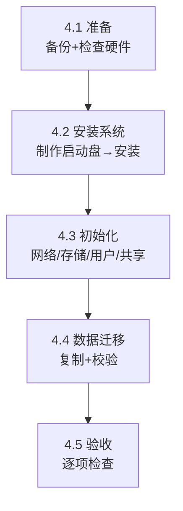

# 04 第一次搭建 · 本章概览

> 难度：⭐⭐ · 预计阅读：45 分钟 · 是否需要设备：是（实操章节）

## 本章目标

读完并做完本章，你将能够：

1. 在安装前做好数据备份与硬件检查
2. 完成目标系统的安装（以飞牛 fnOS / CasaOS 为例）
3. 完成网络、存储、用户、共享等初始化配置
4. 安全地完成首次数据迁移
5. 用验收清单确认一切正常

## 核心主题

- **备份先行**：任何安装/格式化操作前，先备份原始数据
- **先规划后动手**：盘位、RAID、系统盘位置想清楚再开始
- **最小可用**：先搭起能存能取的最小系统，再逐步扩展
- **验证闭环**：每一步都验证，别等到最后才发现错误

## 小节列表

| 小节 | 核心问题 | 关键产出 |
| --- | --- | --- |
| [4.1 安装前准备](4.1-安装前准备.md) | 需要准备什么？ | 检查清单 |
| [4.2 系统安装](4.2-系统安装.md) | 怎么装系统？ | 装好的系统 |
| [4.3 初始化配置](4.3-初始化配置.md) | 装完配什么？ | 可用的存储与共享 |
| [4.4 首次数据迁移](4.4-首次数据迁移.md) | 怎么搬数据？ | 数据到位 |
| [4.5 验收清单](4.5-验收清单.md) | 怎么确认成功？ | 验收结论 |

## 安装流程总览

> ⚠️ **全程最重要的提醒**：安装系统会清空目标盘数据。请务必确认你操作的是正确的磁盘，并已备份所有重要数据。

## 平台差异说明

本章以 **飞牛 fnOS** 和 **CasaOS** 为主线演示（代表"国产易用"与"极简开源"两类），并给出群晖/威联通/TrueNAS 的对照要点。具体按钮位置以各系统当前版本为准。

## 小结

第一次搭建的目标不是"功能全"，而是"稳稳地跑起来"。慢一点、多验证，比返工更省时间。

## 练习

见 [`exercises/04-第一次搭建.md`](../../exercises/04-第一次搭建.md)。
