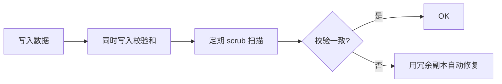

# 5.1 文件系统

  

> 📌 前置：[2.3 容量规划与 RAID 基础](../02-硬件选型/2.3-容量规划与RAID基础.md) · ⏱ 约 15 分钟

## 本章目标

- 理解 ext4、Btrfs、ZFS 的核心差异
- 能根据平台与需求理解文件系统的选择

## 三大文件系统对比

| 特性 | ext4 | Btrfs | ZFS |
| --- | --- | --- | --- |
| 类型 | 传统日志式 | 现代 CoW | 现代 CoW |
| 数据校验 | ❌ | ✅（元数据/可选数据） | ✅（全面） |
| 快照 | ❌ | ✅ | ✅ |
| 自修复 | ❌ | ✅（RAID 模式） | ✅ |
| 写时复制 CoW | ❌ | ✅ | ✅ |
| 内存需求 | 低 | 中 | 高 |
| 成熟度 | 非常成熟 | 成熟 | 非常成熟 |
| 常见平台 | 通用 Linux | 群晖/飞牛/威联通 | TrueNAS/QuTS hero |

## 概念解释

### 传统文件系统（ext4）

像在纸上直接改字：修改数据时**覆盖原位置**。优点是简单成熟、兼容好；缺点是没有数据校验，静默损坏（bit rot）不易发现。

### 写时复制 CoW（Btrfs / ZFS）

像写卡片：修改数据时**写到新位置**，再更新引用。原数据保留，因此：

- 快照可以瞬间创建且几乎不占空间
- 断电时一致性更好
- 可实现数据校验与自修复

### 数据校验与自修复

文件在磁盘上可能因磁场、介质老化发生"静默损坏"——文件还在，但内容错了。ZFS/Btrfs 为每个数据块保存校验和，读取或 scrub 时发现不一致，若有冗余副本可自动修复。这是它们最核心的价值。

## 各平台怎么选

| 平台 | 默认文件系统 | 说明 |
| --- | --- | --- |
| 群晖 | Btrfs（新机型） | 支持快照、校验，推荐选 Btrfs |
| 飞牛 fnOS | Btrfs | 支持快照与数据保护 |
| 威联通 | ext4 / ZFS(QuTS hero) | 要 ZFS 选 QuTS hero |
| TrueNAS | ZFS | 全部围绕 ZFS 设计 |
| CasaOS | ext4 / Btrfs | 依安装方式，轻量为主 |

## 关键概念（ZFS 特有）

- **池（Pool）**：最顶层存储容器，由若干 vdev 组成。
- **vdev**：池内的设备组（mirror / RAIDZ），决定冗余与性能。
- **数据集（Dataset）**：池上的逻辑文件系统，可单独设快照、压缩、权限。
- **zvol**：块设备，供虚拟机等使用。

> 💡 ZFS 的"池 + 数据集"模型与传统"分区 + 目录"不同，初学需要一点时间适应。详见 [5.2](5.2-RAID与存储池实战.md)。

## 实践建议

1. **能选 CoW 文件系统就选**（Btrfs/ZFS），尤其是要快照的场景。
2. **单纯大文件冷存储**：ext4 也未尝不可，胜在简单稳定。
3. **别在 CoW 文件系统上跑数据库/虚拟机**：可能产生写放大（ZFS 可用 zvol + 合适 recordsize 缓解，见 [8.3 性能调优](../08-进阶主题/8.3-性能调优.md)）。
4. **ZFS 记得定期 scrub**，见 [5.5](5.5-硬盘健康监控.md)。

## 小结

文件系统决定你能用哪些数据保护能力。ZFS/Btrfs 的校验与快照是质的提升，代价是内存与学习成本。

## 练习

1. 查一下你的 NAS 当前使用的文件系统。
2. 解释"ZFS 为什么能发现静默数据损坏"。
