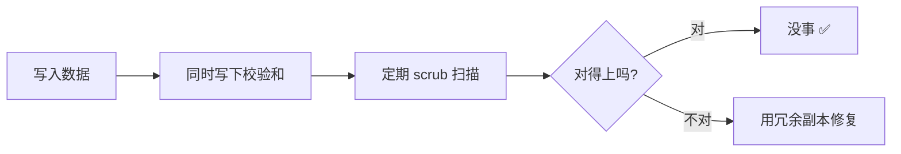

  

# 5.1 文件系统：数据住的"房子"是什么样

> 📌 先读：[2.3 容量与 RAID](../../docs/02-硬件选型/2.3-容量规划与RAID基础.md) · ⏱ 大约 15 分钟

## 为什么先讲这个

文件系统决定了你能用上哪些"数据保护超能力"。

选 ext4，你就没有快照；选 Btrfs 或 ZFS，你就多了校验、快照、自修复。这就像盖房子——地基里有没有预埋水管，决定了以后能不能装淋浴。

## 三个流派

| 特性 | ext4 | Btrfs | ZFS |
| --- | --- | --- | --- |
| 类型 | 传统日志式 | 现代 CoW | 现代 CoW |
| 数据校验 | ❌ | ✅（部分） | ✅（全面） |
| 快照 | ❌ | ✅ | ✅ |
| 自修复 | ❌ | ✅（RAID 下） | ✅ |
| 内存需求 | 低 | 中 | 高 |
| 常见平台 | 通用 Linux | 群晖/飞牛/威联通 | TrueNAS/QuTS |

## 用大白话解释差别

**传统文件系统（ext4）**：像在纸上直接改字——改数据时**覆盖原位置**。简单、成熟、兼容好，但没有校验，数据悄悄变坏了你不一定知道。

**写时复制 CoW（Btrfs / ZFS）**：像写新卡片——改数据时**写到新位置**，再改指向。原来的还在，所以快照能瞬间完成、几乎不占空间，断电时一致性也更好。

**校验和自修复**：文件在盘上可能因磁场、老化发生"静默损坏"（文件还在，内容错了）。ZFS/Btrfs 给每个数据块存个"指纹"（校验和），读取或 scrub 时发现不对，有冗余副本就能自动修好。这是它们最核心的价值。

## 各平台怎么选

| 平台 | 默认文件系统 | 建议 |
| --- | --- | --- |
| 群晖 | Btrfs（新机型） | 选 Btrfs，支持快照校验 |
| 飞牛 fnOS | Btrfs | 支持快照与数据保护 |
| 威联通 | ext4 / ZFS(QuTS hero) | 要 ZFS 选 QuTS hero |
| TrueNAS | ZFS | 全部围绕 ZFS 设计 |
| CasaOS | ext4 / Btrfs | 轻量为主 |

## ZFS 的几个特有词

第一次看 TrueNAS 文档会被这些词绕晕：

- **池（Pool）**：最顶层的存储容器
- **vdev**：池里的设备组（mirror / RAIDZ），决定冗余和性能
- **数据集（Dataset）**：池上的逻辑文件系统，能单独设快照、压缩、权限
- **zvol**：块设备，给虚拟机用

它和传统的"分区 + 目录"不是一个思路，需要点时间适应。见 [5.2](5.2-RAID与存储池实战.md)。

## 几句实在话

1. 能选 CoW 文件系统就选（Btrfs/ZFS），尤其要快照的场景
2. 纯冷存储、大文件，ext4 也够，胜在简单
3. 别在 CoW 文件系统上直接跑数据库/虚拟机（写放大，ZFS 可用 zvol 缓解，见 [8.3](../../docs/08-进阶主题/8.3-性能调优.md)）
4. ZFS 记得定期 scrub，见 [5.5](5.5-硬盘健康监控.md)

## 写在最后

文件系统决定你能用哪些保护能力。ZFS/Btrfs 的校验和快照是质的提升，代价是内存和学习成本。

## 动手试试

1. 查一下你的 NAS 用的什么文件系统。
2. 试着解释："ZFS 为什么能发现静默数据损坏？"
