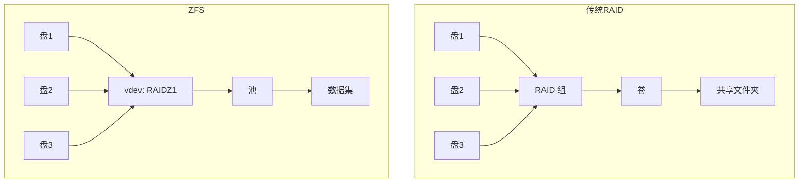

# 5.2 RAID 与存储池实战

> 📌 前置：[2.3 容量规划](../02-硬件选型/2.3-容量规划与RAID基础.md)、[5.1 文件系统](5.1-文件系统.md) · ⏱ 约 18 分钟

## 本章目标

- 理解传统 RAID 与 ZFS RAIDZ 的差异
- 掌握创建存储池的通用流程与注意事项

## 两种范式

### 传统 RAID（群晖/威联通/飞牛常见）

在物理磁盘之上建立 RAID 组，再在其上创建卷和共享文件夹。层级：

```
物理盘 → RAID 组 → 卷 → 共享文件夹
```

### ZFS 存储池（TrueNAS/QuTS hero）

磁盘组成 vdev，vdev 组成池，池上创建数据集。层级：

```
物理盘 → vdev（mirror/RAIDZ）→ 池 → 数据集/快照
```



## ZFS 的 vdev 选择

| vdev 类型 | 最少盘 |  redundancy | 特点 |
| --- | --- | --- | --- |
| mirror（镜像） | 2 | 每组可坏 1 | 快、重建快、容量 50% |
| RAIDZ1 | 3 | 坏 1 | 容量友好，大盘重建风险较高 |
| RAIDZ2 | 4 | 坏 2 | 推荐，大盘更安全 |
| RAIDZ3 | 5 | 坏 3 | 极高冗余 |

> 💡 大容量盘（8TB+）推荐 RAIDZ2 / RAID 6：重建时间长，能多坏一块盘更安心。

## 创建存储池：通用流程

1. **确认磁盘**：⚠️ 逐一核对盘序与序列号，别选错盘。
2. **选择级别**：按冗余需求选 mirror / RAIDZ / RAID 级别。
3. **创建池/卷**：系统会格式化磁盘，⚠️ 此操作不可逆。
4. **创建数据集/共享**：按用途划分（照片、影音、Docker 等）。
5. **设置配额/保留**：避免某个用途占满整个池。
6. **初始化后立即做快照**。

> ⚠️ 创建存储池会清空所选磁盘的所有数据。务必确认备份。

## 规划示例

场景：4×8TB 硬盘，家庭综合用途（照片 + 影音 + Docker）

| 方案 | 可用容量 | 评价 |
| --- | --- | --- |
| RAID 5 / RAIDZ1 | ~22TB | 容量最大，但大盘重建有风险 |
| **RAID 6 / RAIDZ2** | ~15TB | ✅ 推荐，安全与容量平衡 |
| RAID 10 / 双 mirror | ~15TB | 性能最好，容量同上 |

> 💡 若在意 Docker/虚拟机性能，可考虑"小 SSD 池（高速）+ 大 HDD 池（容量）"的组合，见 [8.3 性能调优](../08-进阶主题/8.3-性能调优.md)。

## 热备盘与重建

- **热备盘（Hot Spare）**：平时空闲，故障时自动顶替。适合盘位充足、无人值守的场景。
- **重建（Resilver/Rebuild）**：更换故障盘后，系统用冗余数据重建。**期间风险升高**，应避免高负载，并尽快完成。
- 重建完成后建议做一次 scrub 验证，见 [5.5](5.5-硬盘健康监控.md)。

## 日常维护

- 定期查看池状态（是否降级/degraded）
- 收到硬盘告警立刻处理，不要拖
- 定期 scrub（如每月一次）
- 保持可用空间，别用到 90% 以上

## 小结

存储池是数据的地基。选对冗余级别、确认磁盘、留足余量、定期巡检，是四件必须做对的事。

## 练习

1. 根据你的硬盘数量和用途，选定 RAID/vdev 级别并说明原因。
2. 查一下你的系统如何查看存储池状态，把命令或菜单路径记下来。
