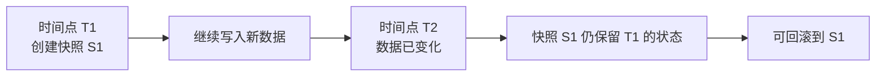

# 5.3 快照与版本管理

> 📌 前置：[5.1 文件系统](5.1-文件系统.md) · ⏱ 约 12 分钟

## 本章目标

- 理解快照的原理与能力边界
- 能用快照完成误删回滚
- 正确认识"快照不是备份"

## 什么是快照

**快照（Snapshot）是某一时刻数据的只读影像（时间点视图）。**

借助 CoW 机制，快照几乎瞬间创建，且初始只占用极少空间（只记录变化前的块）。



## 快照能做什么

- **误删恢复**：删错文件，从快照找回
- **勒索病毒应对**：文件被加密，回滚到感染前的快照
- **更新前保护**：系统/应用升级前打快照，失败可回滚
- **版本管理**：保留多个时间点，随时对比

## 快照不能做什么（关键）

> ⚠️ **快照不是备份！**
>
> - 快照和原始数据**在同一台设备上**。设备被盗、损坏、火灾，快照一起没。
> - 勒索病毒若拿到足够权限，可能删除所有快照。
> - 快照依赖底层文件系统，文件系统整体损坏时可能全部失效。
>
> 真正的备份必须是**独立的另一份**，见 [5.4 备份 3-2-1 原则](5.4-备份3-2-1原则.md)。

## 各平台快照入口

| 平台 | 功能名称 | 说明 |
| --- | --- | --- |
| 群晖 | Snapshot Replication | 共享文件夹/数据集快照，支持复制 |
| 威联通 | 快照管理 | QuTS hero 支持块级快照 |
| TrueNAS | Snapshots / Replication | 数据集快照，可异地复制 |
| 飞牛 fnOS | 快照管理 | 文件系统快照 |
| Btrfs 通用 | `btrfs subvolume snapshot` | 命令行 |

## 实操示例：Btrfs 快照

```bash
# 创建只读快照
sudo btrfs subvolume snapshot -r /mnt/data /mnt/snapshots/data-20261122

# 列出快照
sudo btrfs subvolume list /mnt

# 从快照恢复单个文件（复制出来）
cp /mnt/snapshots/data-20261122/important.docx /mnt/data/

# 删除旧快照
sudo btrfs subvolume delete /mnt/snapshots/data-20261122
```

## 实操示例：ZFS 快照

```bash
# 创建快照
sudo zfs snapshot tank/photos@20261122

# 列出快照
zfs list -t snapshot

# 回滚整个数据集（⚠️ 会丢弃快照之后的更改）
sudo zfs rollback tank/photos@20261122

# 从快照恢复单个文件
cp /tank/photos/.zfs/snapshot/20261122/IMG_001.jpg /tank/photos/

# 删除快照
sudo zfs destroy tank/photos@20261122
```

> ⚠️ `zfs rollback` 会丢弃快照之后的所有更改，执行前务必确认。

## 快照策略建议

| 场景 | 频率 | 保留 |
| --- | --- | --- |
| 重要文档 | 每小时 | 24 份 + 每天 30 天 |
| 照片库 | 每天 | 30 份 |
| 系统/容器配置 | 变更前 + 每周 | 4～8 份 |
| 影音（可再下载） | 关闭或少量 | — |

> 💡 快照不是越多越好：过多快照会占用空间、影响性能，且增加管理复杂度。定期清理过期快照。

## 防护建议

- 为快照设置**只读/不可变**属性（若系统支持）
- 限制删除快照的权限，不要用管理员账号跑日常服务
- 将快照复制到另一台设备（Snapshot Replication / zfs send），这就接近"备份"了

## 小结

快照是应对误删与勒索的"后悔药"，快而轻。但请牢记：它与数据同生共死，不能替代真正的异地备份。

## 练习

1. 为你的一个共享文件夹创建快照，并练习恢复一个测试文件。
2. 写下一句话："快照不能替代备份，因为___"。
