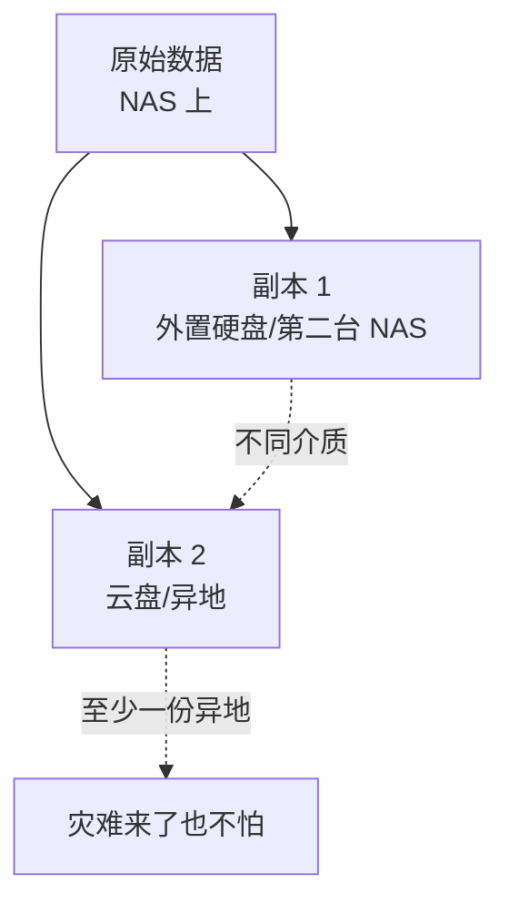

# 5.4 备份 3-2-1 原则

> 📌 前置：[5.2](5.2-RAID与存储池实战.md)、[5.3 快照与版本管理](5.3-快照与版本管理.md) · ⏱ 约 15 分钟

## 本章目标

- 理解并应用 3-2-1 备份原则
- 为家庭数据设计一套可落地的备份方案

## 什么是 3-2-1 原则

**3-2-1 备份黄金法则：**

- **3 份数据**：原始数据 + 至少 2 份副本
- **2 种不同介质**：如 NAS + 外置硬盘 + 云盘
- **1 份异地**：至少一份放在不同物理位置（防火灾、失窃、 regional 灾难）



## 家庭场景落地

| 层级 | 方案 | 成本 | 自动化 |
| --- | --- | --- | --- |
| 原始 | NAS 主存储 | — | — |
| 副本 1 | 外接硬盘定时备份 / 第二台 NAS | 中 | 可自动 |
| 副本 2（异地） | 云盘（加密后上传） | 低～中 | 可自动 |
| 冷备 | 硬盘放防潮箱，定期更新 | 低 | 手动 |

> 💡 **推荐组合**：NAS（主力）+ 云盘（异地、加密）+ 外置硬盘（冷备）。三者角色不同，互补而非重复。

## 备份工具选择

| 平台/场景 | 工具 | 说明 |
| --- | --- | --- |
| 群晖 | Hyper Backup | 支持云、外接盘、另一台 NAS，可加密去重 |
| 威联通 | HBS3 | 功能类似 |
| TrueNAS | Replication / Cloud Sync | zfs send 或同步到云 |
| 通用 | `restic` / `borgbackup` | 加密、去重、增量，命令行强大 |
| 通用 | Syncthing | 多设备同步（注意：同步 ≠ 备份，见下） |

## 实操示例：restic 备份到外置盘

```bash
# 初始化备份仓库（首次）
restic init --repo /mnt/usb/backup-repo

# 执行备份
restic -r /mnt/usb/backup-repo backup /mnt/nas/photos

# 查看快照
restic -r /mnt/usb/backup-repo snapshots

# 恢复
restic -r /mnt/usb/backup-repo restore LATEST --target /restore/path
```

使用脚本 + 定时任务实现自动化，示例见 [`examples/scripts/backup-restic.sh`](../../examples/scripts/backup-restic.sh)。

## 同步 ≠ 备份

> ⚠️ 这是最常见的误区。Syncthing、云盘同步、Drive 同步都是"同步"：
>
> - 你在 A 删除文件，B 也会删除
> - 文件被勒索病毒加密，两端同时被加密
>
> 同步解决"多设备一致"，备份解决"历史版本可恢复"。两者都要有。

## 加密与隐私

上传到云盘前建议先加密（restic、borg、Cryptomator 等），这样即使云盘厂商或他人访问，也看不到你的文件内容。密钥务必单独妥善保存——丢了密钥，备份也无法恢复。

## 验证备份

> 💡 **没有验证过的备份，等于没有备份。**
>
> - 定期做恢复演练（哪怕只恢复一个文件）
> - 检查备份任务是否真的成功（而非"显示绿色"）
> - 设置任务失败告警，见 [8.5 监控与告警](../08-进阶主题/8.5-监控与告警.md)

## 小结

3 份数据、2 种介质、1 份异地。记住同步不是备份，并定期演练恢复。做到这些，你的数据才真正安全。

## 练习

1. 为你的数据画一张 3-2-1 备份架构图，标出每份数据的位置与介质。
2. 做一次恢复演练：从备份中恢复一个测试文件，记录耗时与结果。
