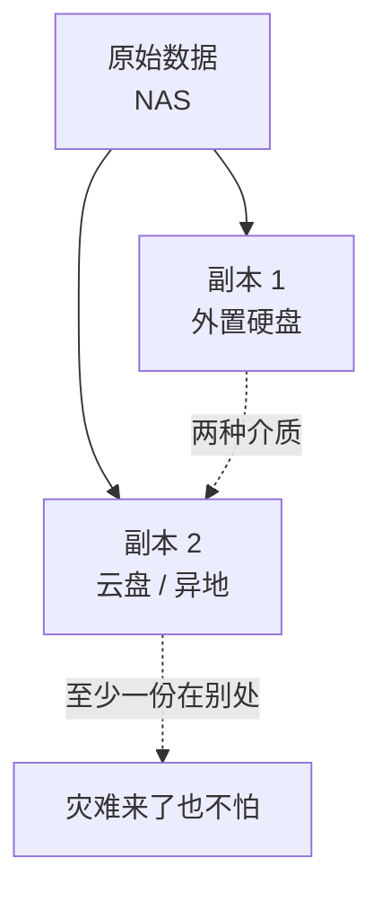

# 5.4 备份 3-2-1：让数据真的丢不了

<p align="center">
  
</p>

> 📌 先看 [5.2](5.2-RAID与存储池实战.md)、[5.3 快照](5.3-快照与版本管理.md) · ⏱ 大约 15 分钟

## 开头那张图，其实是一套公式

三本相册、一个木盒、远处的小屋——展开来就是那句经典的 **3-2-1 备份法则**：

- **3 份数据**：原件 + 至少两个副本
- **2 种介质**：别都放在同一种盘上（比如 NAS + 云盘 + 外置硬盘）
- **1 份异地**：至少一份放在不同的物理地点（防火、防盗、防区域灾难）



## 为什么是"3-2-1"这么具体

因为它防的是不同的事：

- 多一份 → 防硬件坏
- 不同介质 → 防同类介质集体出问题
- 一份异地 → 防整个屋子出事（火灾、失窃、地震）

少任何一条，就有一个致命缺口。

## 为什么"镜像 NAS"不算两份

英文社区有篇很有意思的文章，把常见配置逐一打分（[The 3-2-1 Backup Rule, Actually Implemented](https://asidehouse.com/story/the-3-2-1-backup-rule-actually-implemented)）：

| 你的配置 | 算几份？ | 为什么 |
| --- | --- | --- |
| 一台做了 RAID 的 NAS | 1 份 | 冗余在一个-copy 内部 |
| 同一个池上的快照 | 0 份 | 池没了它也没了 |
| 同一块盘上的两个文件夹 | 1 份 | 盘坏了一起坏 |
| NAS 旁放个备份盘 | 1 份 | 不算异地，火灾一起没 |

看完这张表很多人会冒冷汗——原来自己一直以为的"双保险"，其实是"1-1-0"。

## 家庭方案怎么落地

| 层级 | 方案 | 成本 | 自动化 |
| --- | --- | --- | --- |
| 原始 | NAS 主存储 | — | — |
| 副本 1 | 外置硬盘定时备份 / 第二台 NAS | 中 | 可以自动 |
| 副本 2（异地） | 云盘（先加密再传） | 低～中 | 可以自动 |
| 冷备 | 硬盘放防潮箱，定期更新 | 低 | 手动 |

> 💡 **推荐组合**：NAS 主力 + 云盘异地（加密）+ 外置硬盘冷备。三者角色不同，互相补位。

## 一个关键提醒：加密

上传到云盘前，先用 restic、borg、Cryptomator 之类加密。这样即使云盘厂商或别人能看到文件，也是一堆乱码。

> ⚠️ 但密钥要**单独存好**。丢了密钥，备份也救不回来——这是很多人踩过的坑。

## 动手：用 restic 备份

```bash
# 第一次：初始化仓库
restic init --repo /mnt/usb/backup-repo

# 备份
restic -r /mnt/usb/backup-repo backup /mnt/nas/photos

# 看看有哪些快照
restic -r /mnt/usb/backup-repo snapshots

# 恢复
restic -r /mnt/usb/backup-repo restore LATEST --target /restore/path
```

配合定时任务就自动了，脚本示例在 [`examples/scripts/backup-restic.sh`](../../examples/scripts/backup-restic.sh)。

## 再说一遍：同步不是备份

这是最常见的误会，值得单独强调。

Syncthing、云盘同步、各种 Drive——它们是**同步**：

- 你在 A 删了，B 也跟着删
- 文件被勒索加密，两端一起被加密

同步解决"多设备一致"，备份解决"历史版本可恢复"。**两样都要有。**

[Homelab Backups Explained（safeguard.sh）](https://www.safeguard.sh/resources/blog/homelab-backups-explained-3-2-1-restic-borg-offsite-copies-and-restore-tests) 还提到一个重要点：很多勒索病毒会先找到并删除能触及的备份，所以**离线/不可变的备份**特别重要。

## 最重要的一步：验证

> 💡 **没验证过的备份，等于没有备份。**
>
> - 定期做恢复演练——哪怕只恢复一个文件
> - 看任务是不是真的成功了，而不是"显示绿色"
> - 给失败设置告警，见 [8.5 监控告警](../../docs/08-进阶主题/8.5-监控与告警.md)

## 小结

3 份数据、2 种介质、1 份异地。记住同步不是备份，定期演练恢复。做到这些，你的数据才真的丢不了。

## 小练习

1. 画出你的 3-2-1 架构图，标出每份数据在哪、是什么介质。
2. **做一次恢复演练**：从备份里找回一个测试文件，记下花了多久。
