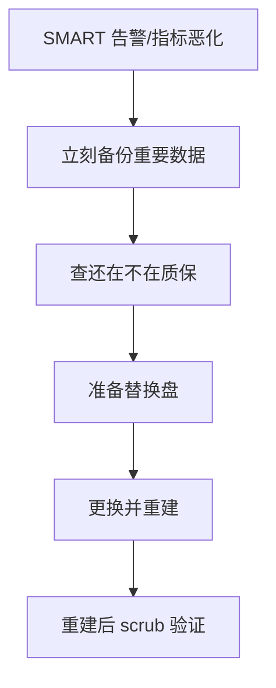

# 5.5 硬盘体检：在它坏掉之前发现

> 📌 先读：[2.2 硬盘选型](../../docs/02-硬件选型/2.2-硬盘选型.md) · ⏱ 大约 12 分钟

## S.M.A.R.T. 是什么

硬盘其实会"喊疼"，只是你得会听。

S.M.A.R.T.（硬盘自我监测、分析与报告技术）记录了一堆健康指标，能帮你预测它是不是快不行了。系统里的"硬盘健康状态"就是读的这些数据。

## 几个该关注的指标

| ID | 名字 | 大白话 | 注意 |
| --- | --- | --- | --- |
| 5 | 重映射扇区 | 坏的地方被替换的次数 | 大于 0 要留意，增长更快 |
| 187 | 无法纠正的错误 | 读不出来的次数 | 危险信号 |
| 188 | 命令超时 | 反应慢/卡住 | 增长说明不稳 |
| 197 | 待映射扇区 | 等着被替换的坏道 | 大于 0 说明有坏道 |
| 190 | 温度 | 硬盘体温 | 25～45°C 合适 |
| 9 | 通电时间 | 干了多少小时 | 参考寿命 |

> ⚠️ **看趋势，别只看单次数值**。某个指标"一直在涨"往往比"某次很高"更危险。不同厂商定义也有差异。

## 怎么查看

**命令行：**

```bash
sudo apt install smartmontools       # 先装工具
sudo smartctl -H /dev/sda            # 整体健康
sudo smartctl -a /dev/sda            # 详细指标
sudo smartctl -A /dev/sda | grep -i temperature   # 温度
```

**各平台界面：**

| 平台 | 入口 |
| --- | --- |
| 群晖 | 存储管理器 → HDD/SSD → 健康状态 |
| 威联通 | 存储与快照总管 → 磁盘健康 |
| TrueNAS | Storage → Disks → SMART 测试 |
| 飞牛/CasaOS | 存储管理 / 终端 smartctl |

## 主动测一测

```bash
sudo smartctl -t short /dev/sda   # 短测，几分钟
sudo smartctl -t long /dev/sda    # 长测，几小时
sudo smartctl -l selftest /dev/sda  # 看结果
```

> 💡 新盘到手先跑一次长测，尽早发现次品。这也是社区里"新盘先跑一遍基准"的习惯（[NEBULA](https://ooppll.icu/) 上有把 SSD 基准测试搬进飞牛的实践），呼应 [2.2](../../docs/02-硬件选型/2.2-硬盘选型.md)。

## ZFS 用户记得 scrub

scrub 是 ZFS 主动扫描、修复损坏数据的机制：

```bash
zpool status          # 看池状态
sudo zpool scrub tank # 启动 scrub
```

建议每月一次，换盘后再多跑一次。

## 把告警打通

- 开启系统自带邮件/App 通知，并**发个测试消息确认收得到**
- 关注：硬盘降级、SMART 告警、温度过高、池异常
- 进阶告警见 [8.5](../../docs/08-进阶主题/8.5-监控与告警.md)

## 发现异常怎么办



> ⚠️ **第一反应永远是"先备份"**，而不是"再观察观察"。硬盘坏起来往往很突然。

## 写在最后

看趋势、定期测、ZFS 做 scrub、告警要打通。发现异常先备份再处理。

## 动手试试

1. 查看所有硬盘的 SMART 信息，记下温度和关键指标。
2. 配一个邮件告警，发测试消息确认收到。
