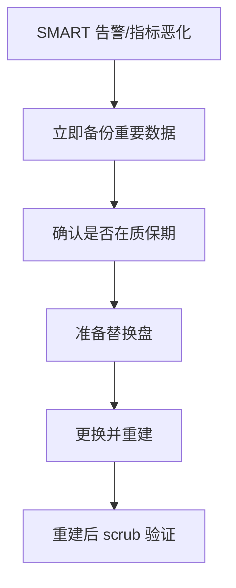

# 5.5 硬盘健康监控

<p align="center">
  
</p>


> 📌 前置：[2.2 硬盘选型](../02-硬件选型/2.2-硬盘选型.md) · ⏱ 约 12 分钟

## 本章目标

- 理解 S.M.A.R.T. 的关键指标
- 能查看硬盘温度与健康状态
- 建立巡检与告警机制

## S.M.A.R.T. 是什么

S.M.A.R.T.（Self-Monitoring, Analysis and Reporting Technology）是硬盘的自我监测系统。它记录各种健康指标，帮助预测故障。

## 关键指标

| 指标 ID | 名称 | 含义 | 关注点 |
| --- | --- | --- | --- |
| 5 | Reallocated Sectors Count | 重映射扇区数 | >0 需警惕，增长更快 |
| 187 | Reported Uncorrectable | 无法纠正的错误 | >0 危险信号 |
| 188 | Command Timeout | 命令超时 | 增长表示不稳定 |
| 197 | Current Pending Sector | 待映射扇区 | >0 说明有坏道 |
| 198 | Offline Uncorrectable | 离线不可纠正错误 | >0 危险 |
| 190 | Airflow Temperature | 温度 | 建议 25～45°C |
| 9 | Power-On Hours | 通电时长 | 参考寿命 |

> ⚠️ **单一数值不是绝对标准**：趋势比绝对值更重要。某个指标**持续增长**往往比"一次很高"更危险。不同厂商定义也有差异。

## 查看方法

### 命令行（Linux）

```bash
# 安装工具
sudo apt install smartmontools

# 查看整体健康
sudo smartctl -H /dev/sda

# 查看详细信息
sudo smartctl -a /dev/sda

# 查看温度
sudo smartctl -A /dev/sda | grep -i temperature
```

### 各平台

| 平台 | 入口 |
| --- | --- |
| 群晖 | 存储管理器 → HDD/SSD → 健康状态 |
| 威联通 | 存储与快照总管 → 磁盘健康 |
| TrueNAS | Storage → Disks → SMART 测试 |
| 飞牛/CasaOS | 存储管理/终端 + smartctl |

## 主动测试

```bash
# 短测试（几分钟）
sudo smartctl -t short /dev/sda

# 长测试（数小时）
sudo smartctl -t long /dev/sda

# 查看测试结果
sudo smartctl -l selftest /dev/sda
```

> 💡 新盘到手建议先跑一次长测试，尽早发现次品。这也是社区里"新盘先跑一遍基准/测试"习惯的意义，呼应 [2.2 硬盘选型](2.2-硬盘选型.md)。

## ZFS scrub

对 ZFS 而言，scrub 是主动扫描并修复数据损坏的机制：

```bash
# 查看 scrub 状态
zpool status

# 启动 scrub
sudo zpool scrub tank

# 通过 Web 界面：TrueNAS → Storage → Scrub
```

建议每月一次，并在更换硬盘后额外执行一次。

## 建立告警

- 系统自带的邮件/App 通知要开启并测试
- 进阶可自建监控告警，见 [8.5 监控与告警](../08-进阶主题/8.5-监控与告警.md)
- 关注：硬盘降级、SMART 告警、温度过高、池状态异常

## 发现异常怎么办



> ⚠️ **第一反应永远是"先备份"**，而不是"再观察观察"。硬盘故障往往来得突然。

## 小结

S.M.A.R.T. 看趋势、定期主动测试、ZFS 做 scrub、告警要打通。发现异常先备份再处理。

## 练习

1. 查看你所有硬盘的 SMART 信息，记录温度与关键指标。
2. 配置一次邮件告警并发送测试通知，确认能收到。
