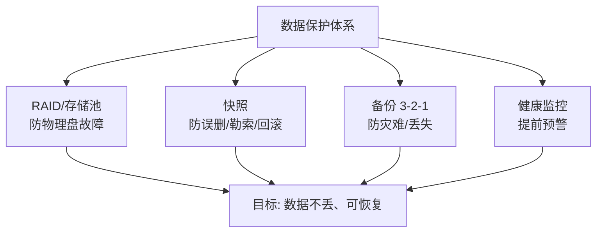

# 05 存储与数据保护 · 本章概览

> 难度：⭐⭐⭐ · 预计阅读：70 分钟 · 是否需要设备：建议边读边操作

## 本章目标

读完本章，你将能够：

1. 理解主流文件系统的特性与适用场景
2. 正确配置 RAID / 存储池，理解其保护边界
3. 用快照实现误删回滚与版本管理
4. 设计并落地一套符合 3-2-1 原则的备份方案
5. 监控硬盘健康，提前发现故障征兆

## 核心主题

> 💡 这是全书**最重要**的一章。NAS 的根本价值是"把数据安全地存住"，其余功能都是附加。

- **文件系统是地基**：ZFS / Btrfs / ext4 决定了可用的保护能力
- **RAID 管可用，备份管存亡**：两者不可互相替代
- **快照是"后悔药"**：应对误删、勒索病毒，但不能替代备份
- **监控是早发现**：S.M.A.R.T. 与告警让你在硬盘坏掉前行动

## 小节列表

| 小节 | 核心问题 | 关键产出 |
| --- | --- | --- |
| [5.1 文件系统](5.1-文件系统.md) | ext4/Btrfs/ZFS 怎么选？ | 认知基础 |
| [5.2 RAID 与存储池实战](5.2-RAID与存储池实战.md) | 怎么配 RAID？ | 存储池方案 |
| [5.3 快照与版本管理](5.3-快照与版本管理.md) | 误删了怎么办？ | 回滚方案 |
| [5.4 备份 3-2-1 原则](5.4-备份3-2-1原则.md) | 什么才是真备份？ | 备份体系 |
| [5.5 硬盘健康监控](5.5-硬盘健康监控.md) | 如何提前发现问题？ | 监控告警 |

## 数据保护全景

## 关键认知：层层设防

| 威胁 | RAID | 快照 | 备份 | 监控 |
| --- | --- | --- | --- | --- |
| 单盘物理损坏 | ✅ | — | ✅ | 预警 |
| 误删文件 | ❌ | ✅ | ✅ | — |
| 勒索病毒加密 | ❌ | ✅* | ✅ | — |
| 文件系统损坏 | 部分 | 部分 | ✅ | — |
| 整机失窃/火灾 | ❌ | ❌ | ✅（异地） | — |
| 硬盘渐进劣化 | — | — | — | ✅ |

> *快照需设置不可变/只读并妥善保护，否则勒索病毒也可能删除快照。

## 小结

数据安全没有银弹，靠的是"RAID + 快照 + 备份 + 监控"四层叠加。只做其中一层，都留有致命缺口。

## 练习

见 [`exercises/05-存储与数据保护.md`](../../exercises/05-存储与数据保护.md)。
