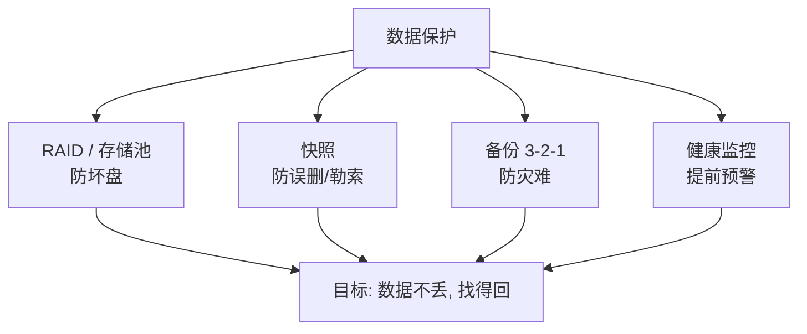

  

# 05 守住数据：全书最重要的一章

> ⏱ 大约 70 分钟 · 难度 ⭐⭐⭐ · 建议边读边动手

## 先看这张图

图里有三本一模一样的相册、一个上锁的小木盒，还有远处一间亮着灯的小屋。

这不是装饰。它画的正是数据安全的四层防线：

- **三本相册** → RAID 和多份拷贝，坏一本还有别的
- **上锁的木盒** → 加密与快照，能回到从前
- **远处的小屋** → 异地备份，火灾失窃也不怕
- **旁边打盹的猫** → 日常监控，安安静静守着

如果这一章你只记一张图，就记这张。

## 为什么这章最重要

NAS 的本质是什么？不是看电影，不是跑 Docker，是——**把重要的数据稳稳地留住。**

照片、孩子的成长视频、工作文档、父母的老照片……这些东西丢了，是买不回来的。其他功能都是加分项，这一章是地基。

> 💡 有个说法很扎心但很真实：**RAID 不是备份，快照也不是备份。** 很多人以为做了 RAID 就高枕无忧，直到误删了一个文件夹，或者在论坛上看到有人被勒索病毒加密了全部数据。

## 四层防线，层层设防

| 遇到的事 | RAID | 快照 | 备份 | 监控 |
| --- | --- | --- | --- | --- |
| 一块盘物理坏了 | ✅ | — | ✅ | 会报警 |
| 手滑删了文件 | ❌ | ✅ | ✅ | — |
| 勒索病毒加密 | ❌ | ✅（要设好） | ✅ | — |
| 整机被盗/火灾 | ❌ | ❌ | ✅（异地那份） | — |
| 硬盘慢慢老化 | — | — | — | ✅ 提前发现 |

看明白这张表，你就理解为什么"只做一层"是不够的了。

## 路线一览

| 小节 | 聊什么 | 你会得到 |
| --- | --- | --- |
| [5.1 文件系统](5.1-文件系统.md) | ext4/Btrfs/ZFS 的门道 | 认知基础 |
| [5.2 RAID 与存储池](5.2-RAID与存储池实战.md) | 怎么配、怎么重建 | 一个稳妥的方案 |
| [5.3 快照](5.3-快照与版本管理.md) | 误删了怎么找回来 | "后悔药" |
| [5.4 备份 3-2-1](5.4-备份3-2-1原则.md) | 什么才算真备份 | 一套保命体系 |
| [5.5 硬盘健康](5.5-硬盘健康监控.md) | 怎么提前发现问题 | 监控告警 |

## 社区共识

关于"RAID 不是备份"这件事，英文社区有一篇讲得很透彻的文章 [RAID is not backup（Big Iron）](http://www.bigiron.cc/guides/raid-is-not-backup-what-backup-actually-means)，它给"真备份"列了几个标准：独立存在、能恢复到过去、源机器出事时不受影响。我们 [5.4](5.4-备份3-2-1原则.md) 的讨论就参考了它。

## 一句掏心窝的话

> 你可能会觉得这些配置很麻烦。但想想：如果明天硬盘坏了，你最心疼的是什么？把那个东西备份好，就从这里开始。

## 小练习

翻到 [exercises/05-存储与数据保护.md](../../exercises/05-存储与数据保护.md)。这一章的练习要认真做，特别是**恢复演练**——没验证过的备份，等于没有备份。
