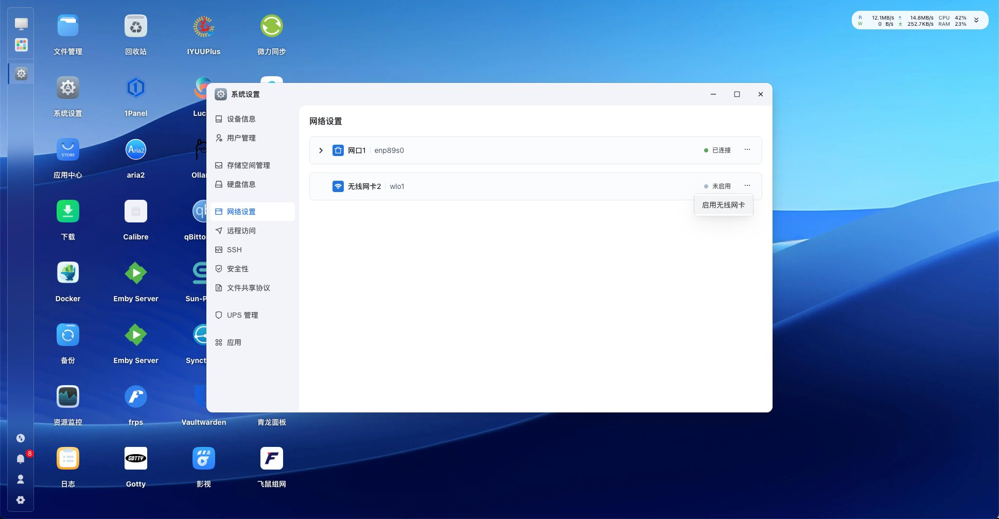

# 6.1 内网传文件慢？先看这几环

> 📌 先读：[2.1 核心部件](../../docs/02-硬件选型/2.1-核心部件选型.md) · ⏱ 大约 12 分钟

**有些 NAS 支持 WiFi 连接**（比如飞牛），但家用场景仍建议有线——稳定、速度上限高：

<p align="center">
  
</p>

> 💡 截图来自 [飞牛官方帮助中心](https://help.fnnas.com/)（见 [致谢](../../CREDITS.md)）。

## 木桶效应

内网传输速度取决于最短的那块板。网口、网线、交换机、客户端硬盘——任何一环是百兆，整体就被卡在百兆（约 12MB/s）。


很多人抱怨"NAS 好慢"，结果一查是网线是老五类，或者网口协商在百兆。

## 各环节能对上吗

**网口速率**

| 速率 | 理论 | 实际约 |
| --- | --- | --- |
| 百兆 | 12.5 MB/s | 10～11 |
| 千兆 | 125 MB/s | 100～115 |
| 2.5G | 312 MB/s | 250～280 |
| 万兆 | 1250 MB/s | 900+ |

**网线**：超五类能跑千兆，六类更适合千兆/2.5G，超六类上万兆。劣质或过长的线会让协商速率掉下来。

**交换机**：端口速率要匹配；多设备同时访问，交换能力更重要。

**飞牛的局域网访问设置界面**，SMB/WebDAV 等服务的开关都在这里：

<p align="center">
  
</p>

> 💡 截图来自 [飞牛官方帮助中心](https://help.fnnas.com/)（见 [致谢](../../CREDITS.md)）。

## 给 NAS 一个固定"门牌号"

建议给 NAS 分配固定地址，不然重启后 IP 变了，你就找不到它了。

两种办法：

1. 在 NAS 上设静态 IP（简单，但可能和 DHCP 冲突）
2. **在路由器做 DHCP 保留**（推荐：按 MAC 分配固定 IP，集中管理）

记下 IP 和主机名，方便以后访问。

## 链路聚合是怎么回事

把多个网口绑在一起（LACP）：

- 多客户端同时访问时，总带宽更高
- 一条链路断了还能用（冗余）

> ⚠️ 但链路聚合**不会让单个客户端变快**。想要单连接更快，得靠 2.5G/万兆。

## IPv6 简单说

现在很多家庭有 IPv6，设备能拿到公网地址，这给远程访问提供了新思路。但要配好防火墙，别裸奔。详见 [6.2](6.2-远程访问方案对比.md)。

## 测一下

```bash
# NAS 上起服务端
iperf3 -s

# 客户端测
iperf3 -c <NAS的IP>
```

或者直接复制一个大文件，看实际速度。见 [4.5](../../docs/04-第一次搭建/4.5-验收清单.md)。

## 写在最后

逐环检查：网口、网线、交换机、客户端。千兆够用，频繁传大文件上 2.5G。固定 IP 用 DHCP 保留最省心。

## 动手试试

1. 查一下 NAS 网口的实际协商速率（`ethtool` 或系统设置）。
2. 用 iperf3 或实际复制测一次，记录结果。
