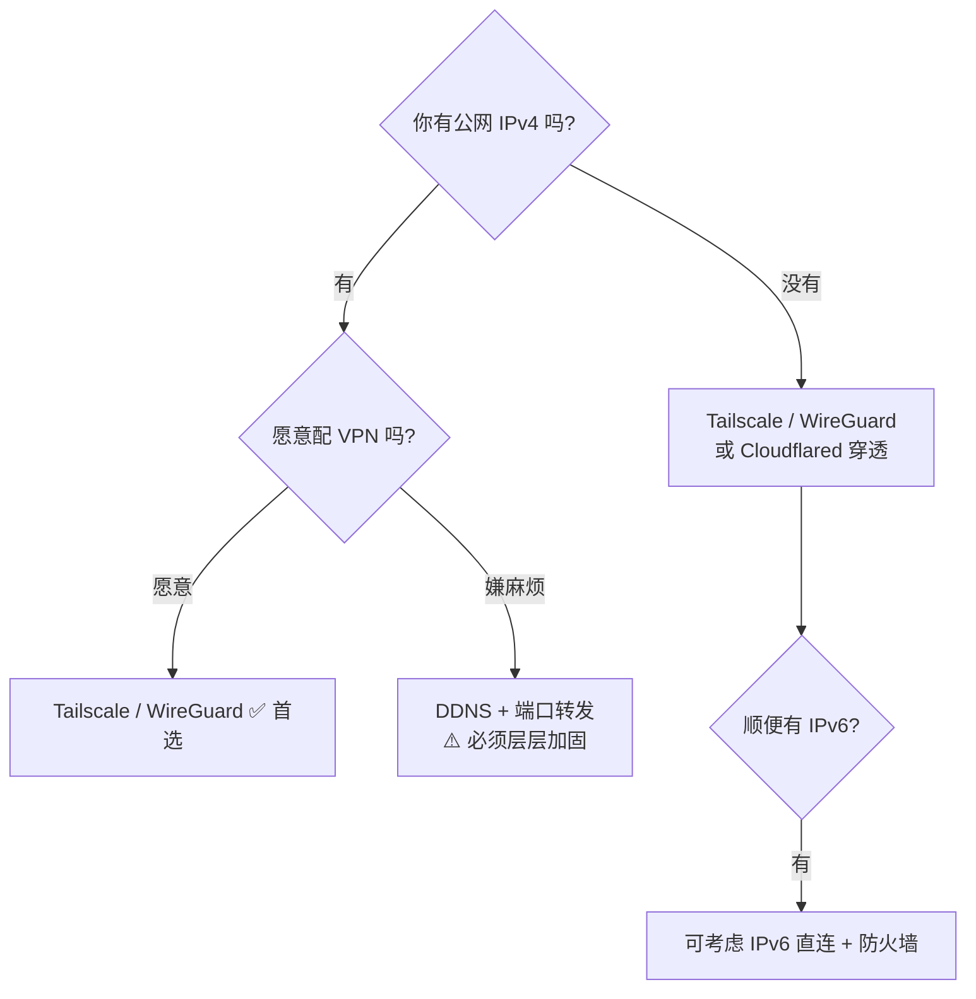

<p align="center">
  
</p>

# 6.2 远程访问：人在外面，怎么安全地回去

> 📌 先读 [6.5 安全加固](6.5-安全加固.md) · ⏱ 大约 18 分钟

## 那句老话先说前面

> ⚠️ **别把 NAS 管理界面直接丢到公网上。**

这是无数人用血泪换来的教训。家庭 NAS 被勒索、被扫描、被爆破，十有八九是因为图中了"端口转发 + 弱密码"这个组合。

所以这一章的顺序是：**先讲安全的方案，再讲有风险的方案。** 你最好读完再动手。

## 先看地图



## 五个方案，摊开来说

| 方案 | 难度 | 安全性 | 速度 | 要公网 IP | 一句话 |
| --- | --- | --- | --- | --- | --- |
| VPN 组网（Tailscale/WireGuard） | 低～中 | 高 | 好 | ❌ | 大多数人的答案 ✅ |
| 内网穿透（FRP/Cloudflared） | 中 | 中～高 | 看中转 | ❌ | 没公网 IP 的救星 |
| DDNS + 端口转发 | 中 | 低（不加固的话） | 看上传 | ✅ | 能用，但风险高 |
| IPv6 直连 | 中 | 中（要配防火墙） | 好 | 有 IPv6 就行 | 新思路 |
| 厂商中继（QuickConnect 等） | 低 | 中 | 看厂商 | ❌ | 图省事可以 |

## 我的建议：从 Tailscale 开始

如果你看完还是晕，直接用 Tailscale。

它像个"一键组网的钥匙"：在 NAS 和你的手机/电脑上都装一下，登录同一个账号，它们就组成了一个私有网络。不用公网 IP、不用配端口转发、不用研究 DDNS，安全性还好。

```bash
# 在 NAS 上安装（以 Linux 为例，具体看官方最新说明）
curl -fsSL https://tailscale.com/install.sh | sh
sudo tailscale up

# 然后在手机/电脑上也装上，登录同一账号
# 之后用 Tailscale 分配的 IP 访问 NAS 就行
```

原理是它基于 WireGuard 建立了加密隧道（想深挖可以看 [Tailscale 官方文档](https://tailscale.com/kb/)，见 [致谢](../../CREDITS.md)）。进阶还能自建控制服务器（Headscale）。

## 其他方案，简单说说

**WireGuard 自建**：性能好、够灵活，但要公网 IP 或中转，适合爱折腾的人。

**Cloudflared 隧道**：没公网 IP 又想把服务分享给别人时很好用，配置示例在 [`examples/docker-compose/cloudflared/`](../../examples/docker-compose/cloudflared/docker-compose.yml)。

**DDNS + 端口转发**：有公网 IP 才行，但等于把服务放在公网门口。如果非要用，务必：强密码 + 2FA + HTTPS + 改端口 + 限来源 IP + fail2ban。**别直接转发管理界面。**

**IPv6**：很多家庭已经有 IPv6 了，设备能拿到公网地址。但一定要配防火墙限制来源，别裸奔。

## 一个容易被忽略的事实

> 💡 家庭宽带的**上传带宽**通常很小（比如 30～50Mbps）。所以不管用哪种方案，从外网传大文件都可能慢。这不是配置问题，是物理限制。想改善就得升级带宽，或者只传小文件。

## 安全底线（不管选哪种）

1. 强密码 + 双因素认证
2. 关掉用不到的服务和端口
3. 优先 VPN，而不是直接暴露服务
4. 开失败登录锁定
5. 系统勤更新

详见 [6.5 安全加固](6.5-安全加固.md)。

## 小结

首选 Tailscale/WireGuard：没有公网 IP 也能安全访问。DDNS + 端口转发风险高，非要用就层层加固。

## 小练习

1. 搞清楚你的网络：有公网 IPv4 吗？有 IPv6 吗？
2. 选定一个方案，写下理由和实施步骤。
3. 配好之后，用手机流量（关掉 WiFi）测试一次访问。
