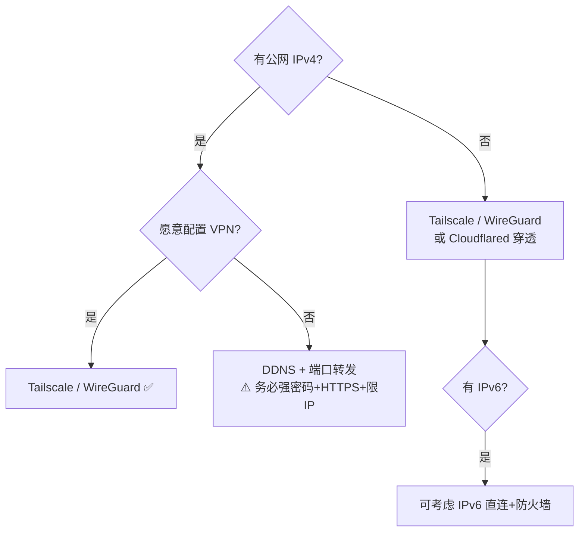

# 6.2 远程访问方案对比

> 📌 前置：[6.1 局域网基础](6.1-局域网基础.md)、[6.5 安全加固](6.5-安全加固.md) · ⏱ 约 18 分钟

## 本章目标

- 理解主流远程访问方案的原理与取舍
- 选出适合自己网络环境的方案

## 方案全景

| 方案 | 难度 | 安全性 | 速度 | 需要公网IP | 适合 |
| --- | --- | --- | --- | --- | --- |
| VPN（Tailscale/WireGuard） | 低～中 | 高 | 好 | ❌ | 大多数人 ✅ |
| 内网穿透（FRP/Cloudflared） | 中 | 中～高 | 受中转影响 | ❌ | 无公网 IP |
| DDNS + 端口转发 | 中 | 低（若不加固） | 取决于上传 | ✅ | 有公网 IP |
| IPv6 直连 | 中 | 中（需防火墙） | 好 | IPv6 即可 | 有 IPv6 |
| 厂商中继（QuickConnect 等） | 低 | 中 | 受厂商限制 | ❌ | 图省事 |

## 推荐路线



> 💡 **最推荐：Tailscale / WireGuard 这类组网 VPN。** 无需公网 IP、配置简单、安全性高，是家庭 NAS 远程访问的首选。

## 方案一：Tailscale（组网 VPN）

原理：基于 WireGuard 的 Mesh VPN，设备间建立加密隧道，无需公网 IP 和端口转发。

步骤概览：

```bash
# 在 NAS 上安装（以 Linux 为例，具体以官方为准）
curl -fsSL https://tailscale.com/install.sh | sh
sudo tailscale up

# 在其他设备安装并登录同一账号
# 之后用 Tailscale 分配的 IP 访问 NAS
```

- ✅ 简单、安全、穿透 NAT
- ⚠️ 依赖官方控制服务器（免费版对个人足够）
- 进阶可自建控制服务器（Headscale）

## 方案二：WireGuard（自建 VPN）

- 性能好、配置灵活
- 需要公网 IP 或被中转
- 适合愿意深入配置的用户

## 方案三：内网穿透（FRP / Cloudflared）

- 适合无公网 IP、又想发布服务给他人访问的场景
- Cloudflared Tunnel 无需公网 IP，安全性较好
- 示例配置见 [`examples/docker-compose/cloudflared/docker-compose.yml`](../../examples/docker-compose/cloudflared/docker-compose.yml)

## 方案四：DDNS + 端口转发

- 有公网 IP 时可行
- ⚠️ 高风险：直接暴露服务到公网，必须配合强密码、HTTPS、限 IP、改端口、_fail2ban_ 等
- **不推荐**直接转发 NAS 管理界面

> ⚠️ 家庭宽带上传带宽通常有限（如 30～50Mbps），外网访问大文件会较慢，这与方案无关。

## 方案五：IPv6 直连

- 很多家庭已有 IPv6，设备可获得公网 IPv6 地址
- 必须在路由器/系统防火墙上限制访问来源
- 注意 IPv6 地址会变化，配合 DDNS 使用

## 安全底线（无论哪种方案）

1. 强密码 + 双因素认证
2. 关闭不必要的服务与端口
3. 优先 VPN，而非直接暴露服务
4. 开启失败登录锁定
5. 定期更新系统

详见 [6.5 安全加固](6.5-安全加固.md)。

## 小结

首选 Tailscale/WireGuard 这类 VPN：无公网 IP 也能安全访问。DDNS + 端口转发风险高，务必层层加固。

## 练习

1. 判断你的网络环境：有无公网 IPv4？有无 IPv6？
2. 选定一种远程访问方案，写下理由与实施步骤。
