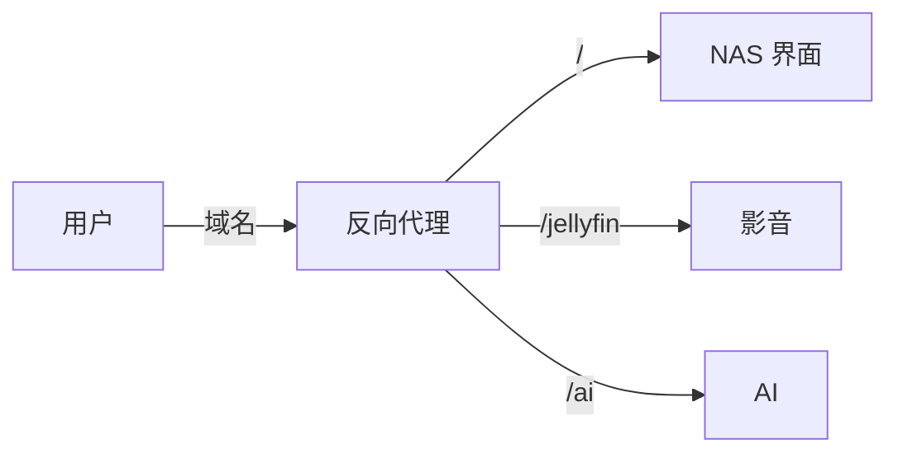

# 6.3 反向代理：给一堆服务一个优雅的门牌

> 📌 先读：[6.2 远程访问](6.2-远程访问方案对比.md) · ⏱ 大约 15 分钟

## 为什么需要它

你的 NAS 上跑了影音、文件、AI、监控……每个都用 `IP:端口` 访问，又丑又难记。

反向代理让你用一个域名，按路径或子域名分发到不同服务：

```
https://nas.example.com/         → NAS 管理界面
https://nas.example.com/jellyfin → 影音
https://nas.example.com/ai       → AI 应用
```



## 用什么工具

| 工具 | 特点 | 适合 |
| --- | --- | --- |
| Nginx Proxy Manager | 图形界面，好用 | 家庭用户 ✅ |
| Traefik | 自动发现容器 | 进阶/Docker 重度用户 |
| Caddy | 配置简洁，自动 HTTPS | 喜欢简单的人 |
| 系统自带反代 | 群晖/威联通内置 | 品牌机用户 |

## 动手前要准备

1. **域名**：买一个（如 example.com）
2. **DNS 解析**：指向你的 NAS（公网 IP、IPv6 或 Tunnel）
3. **证书**：给域名申请 HTTPS 证书，见 [6.4](6.4-HTTPS与证书.md)

没域名也能用 IP 或内网域名做本地练习。

## Nginx Proxy Manager 示例

部署配置在 [`examples/docker-compose/nginx-proxy-manager/`](../../examples/docker-compose/nginx-proxy-manager/docker-compose.yml)，然后在 Web 界面添加代理主机：

| 字段 | 示例 |
| --- | --- |
| Domain Names | `nas.example.com` |
| Scheme | `http` |
| Forward Host/IP | `192.168.1.10`（或容器名） |
| Forward Port | `8096`（Jellyfin 为例） |
| SSL | 申请 Let's Encrypt 证书 |

## 子域名还是路径

| 方式 | 例子 | 优点 | 缺点 |
| --- | --- | --- | --- |
| 子域名 | `jellyfin.example.com` | 干净、兼容好 | 要多配 DNS |
| 路径 | `example.com/jellyfin` | 一个域名搞定 | 有些应用不支持 |

> 💡 优先用**子域名**——不少应用对子路径支持得很差。

## 常见问题

- **502 Bad Gateway**：后端没起来，或代理地址/端口写错了
- **容器名访问**：反代和容器在同一个 Docker 网络时，可以直接用容器名代替 IP
- **WebSocket**：影音、代码类服务要打开 WebSocket 支持（NPM 有开关）

## 写在最后

域名 + 反代让多服务访问变得优雅。Nginx Proxy Manager 是家庭用户最省心的选择，进阶再玩 Traefik。

## 动手试试

1. 给两个服务配子域名反代，浏览器验证。
2. 想想：如果 NAS 在内网没公网 IP，反代还能用吗？结合 [6.2](6.2-远程访问方案对比.md) 的 Tunnel 方案回答。
