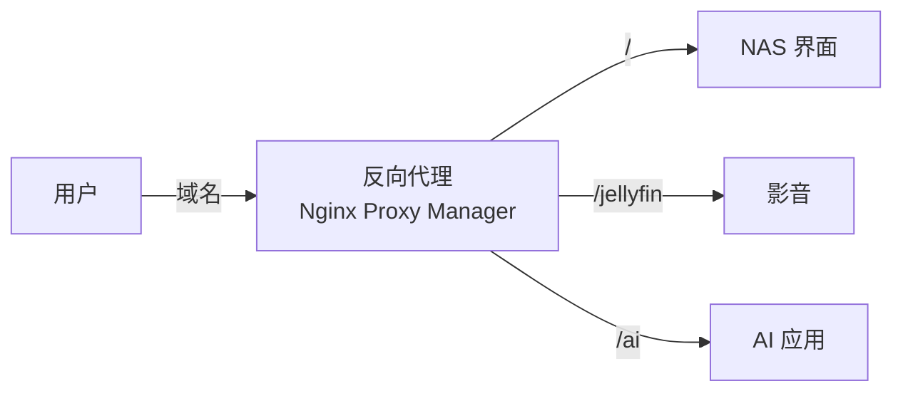

# 6.3 反向代理与域名

<p align="center">
  
</p>


> 📌 前置：[6.2 远程访问方案对比](6.2-远程访问方案对比.md) · ⏱ 约 15 分钟

## 本章目标

- 理解反向代理的作用
- 能用域名 + 反代统一访问多个服务

## 为什么需要反向代理

当 NAS 上跑了很多服务（影音、文件、AI……），每个都用 `IP:端口` 访问既难记又不优雅。反向代理让你用一个域名，按路径或子域名分发到不同服务：

```
https://nas.example.com/        → NAS 管理界面
https://nas.example.com/jellyfin → 影音服务
https://nas.example.com/ai      → AI 应用
```



## 常用工具

| 工具 | 特点 | 适合 |
| --- | --- | --- |
| Nginx Proxy Manager | 图形界面，易用 | 家庭用户 ✅ |
| Traefik | 自动发现容器，配置即代码 | 进阶/Docker 重度用户 |
| Caddy | 配置简洁，自动 HTTPS | 喜欢简单配置 |
| 系统自带反代 | 群晖/威联通等内置 | 品牌机用户 |

## 前置准备

1. **域名**：购买一个域名（如 example.com）。
2. **DNS 解析**：把域名解析到 NAS（公网 IP、IPv6、或 Tunnel）。
3. **证书**：为域名申请 HTTPS 证书，见 [6.4 HTTPS 与证书](6.4-HTTPS与证书.md)。

> 💡 没有域名也可以用 `localhost`、`IP` 或内网域名做本地反代练习。

## Nginx Proxy Manager 示例

通过 Docker 部署（示例配置见 [`examples/docker-compose/nginx-proxy-manager/docker-compose.yml`](../../examples/docker-compose/nginx-proxy-manager/docker-compose.yml)），然后在 Web 界面添加代理主机：

| 字段 | 示例值 |
| --- | --- |
| Domain Names | `nas.example.com` |
| Scheme | `http` |
| Forward Hostname / IP | `192.168.1.10`（或容器名） |
| Forward Port | `8096`（以 Jellyfin 为例） |
| SSL | 申请 Let's Encrypt 证书 |

## 路径 vs 子域名

| 方式 | 示例 | 优点 | 缺点 |
| --- | --- | --- | --- |
| 子域名 | `jellyfin.example.com` | 干净、兼容性好 | 需多个 DNS 记录 |
| 路径 | `example.com/jellyfin` | 只需一个域名 | 部分应用不支持子路径 |

> 💡 优先用**子域名**，很多应用对子路径支持不佳。

## 常见问题

- **502 Bad Gateway**：后端服务没启动，或代理地址/端口写错
- **容器名访问**：反代与其他容器在同一 Docker 网络时，可用容器名代替 IP
- **WebSocket**：影音、代码服务等需要开启 WebSocket 支持（NPM 中有开关）

## 小结

域名 + 反向代理让多服务访问变得优雅。Nginx Proxy Manager 是家庭用户最省心的选择；进阶可玩 Traefik。

## 练习

1. 为你的两个服务配置子域名反代，并用浏览器验证。
2. 思考：如果 NAS 在内网无公网 IP，反代还能工作吗？结合 6.2 的 Tunnel 方案回答。
