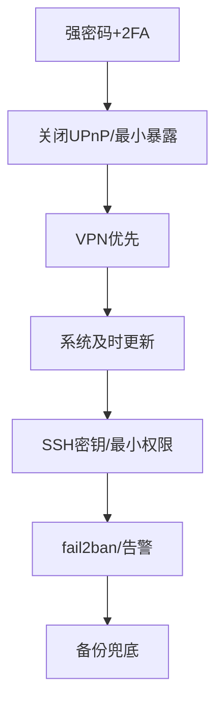

# 6.5 安全加固

<p align="center">
  
</p>


> 📌 前置：建议在读 [6.2 远程访问方案对比](6.2-远程访问方案对比.md) 之前先读本节 · ⏱ 约 15 分钟

## 本章目标

- 完成 NAS 的基础安全加固
- 理解家庭 NAS 最常见的攻击面

## 为什么重要

> ⚠️ 家庭 NAS 被勒索软件攻击的新闻屡见不鲜，常见原因就那么几个：暴露公网、弱密码、未打补丁、开启 UPnP。做好下面的加固，能挡住绝大多数攻击。

## 加固清单

### 账号与密码

- [ ] 修改所有默认密码，使用强密码（长度 + 复杂度 + 唯一）
- [ ] 使用密码管理器（见 [7.4 私有云与相册](../07-应用服务/7.4-私有云与相册.md) 中的密码管理建议）
- [ ] 开启双因素认证（2FA）
- [ ] 禁用或重命名默认管理员账号
- [ ] 按最小权限分配用户

### 网络暴露

- [ ] **关闭 UPnP**（路由器和 NAS 都要检查）
- [ ] 不直接暴露 NAS 管理界面到公网
- [ ] 优先用 VPN 访问，见 [6.2](6.2-远程访问方案对比.md)
- [ ] 只开放必要端口，改默认端口只能减少扫描，不能替代真正防护
- [ ] 配置防火墙，限制来源 IP

### 系统与更新

- [ ] 开启系统自动更新（重要版本及时装）
- [ ] 更新 Docker 镜像，修复已知漏洞
- [ ] 移除不用的套件/服务/账号

### 访问控制

- [ ] 开启失败登录锁定 / fail2ban
- [ ] SSH 禁用密码登录，改用密钥
- [ ] Docker 容器避免用 root/privileged 运行
- [ ] 定期审查用户与权限

## fail2ban 示例

fail2ban 可自动封禁多次登录失败的 IP。示例配置见 [`examples/configs/fail2ban/jail.local`](../../examples/configs/fail2ban/jail.local)。

```bash
# 查看封禁状态
sudo fail2ban-client status sshd

# 手动解封
sudo fail2ban-client set sshd unbanip 1.2.3.4
```

## SSH 密钥登录

```bash
# 生成密钥对（在客户端）
ssh-keygen -t ed25519

# 将公钥部署到 NAS 的 ~/.ssh/authorized_keys
# 然后在 NAS 的 sshd_config 中设置：
# PasswordAuthentication no
```

> ⚠️ 修改 SSH 配置前，务必保留一个已登录的会话，确认密钥登录可用后再禁用密码，否则可能把自己锁在外面。

## 备份仍然重要

> 💡 即使做了所有加固，也**不能替代备份**。勒索软件可能通过你疏忽的入口进来。完整的 3-2-1 备份（[5.4](../05-存储与数据保护/5.4-备份3-2-1原则.md)）是最后一道防线。

## 安全检查清单总结



## 小结

强密码、关 UPnP、用 VPN、勤更新、限权限、做备份。这六条做到，家庭 NAS 的安全性就超过绝大多数用户了。

## 练习

1. 逐项勾选上面的加固清单，记录未完成项。
2. 关闭路由器的 UPnP，并确认 NAS 服务仍能在内网正常访问。
