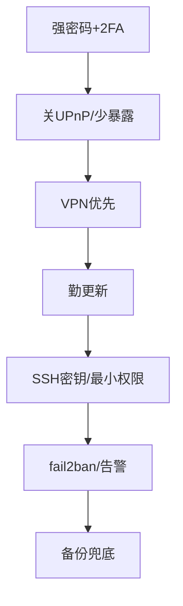

<p align="center">
  
</p>

# 6.5 安全加固：别让自家大门敞着

> 📌 建议在读 [6.2 远程访问](6.2-远程访问方案对比.md) **之前**先看这节 · ⏱ 大约 15 分钟

## 先说个扎心的事实

家庭 NAS 被勒索、被扫描、被爆破的事，新闻里隔三差五就有。

原因翻来覆去就那么几个：**暴露公网、弱密码、不补丁、开着 UPnP。**

好消息是：把下面这几条做到，就能挡住绝大多数攻击。不需要你成为安全专家。

## 账号和密码

- [ ] 改掉所有默认密码，用强密码（长 + 复杂 + 不重复）
- [ ] 用密码管理器（见 [7.4](../../docs/07-应用服务/7.4-私有云与相册.md)）
- [ ] 开双因素认证（2FA）
- [ ] 禁用或改名默认管理员账号
- [ ] 按最小权限分配用户

## 网络暴露

- [ ] **关掉 UPnP**（路由器和 NAS 都查一遍）
- [ ] 不把管理界面直接丢到公网
- [ ] 用 VPN 访问，见 [6.2](6.2-远程访问方案对比.md)
- [ ] 只开必要端口（改默认端口只是减少扫描，不是真防护）
- [ ] 配防火墙，限制来源 IP

## 系统和更新

- [ ] 开系统自动更新
- [ ] 更新 Docker 镜像，修补漏洞
- [ ] 卸掉不用的套件、服务、账号

## 访问控制

- [ ] 开失败登录锁定 / fail2ban
- [ ] SSH 禁用密码登录，改用密钥
- [ ] 容器别用 root/privileged
- [ ] 定期审查用户和权限

fail2ban 的配置示例在 [`examples/configs/fail2ban/`](../../examples/configs/fail2ban/jail.local)。

```bash
sudo fail2ban-client status sshd   # 看封禁状态
```

SSH 改密钥登录时有个坑：

> ⚠️ 改 SSH 配置前，**保留一个已登录的会话**，确认密钥登录能用再禁用密码。否则可能把自己锁在外面。

## 最后一道防线：备份兜底

> 💡 就算所有加固都做了，也不能替代备份。勒索病毒可能从你疏忽的口子进来。完整的 3-2-1 备份（[5.4](../../docs/05-存储与数据保护/5.4-备份3-2-1原则.md)）是最后一道防线。



## 写在最后

强密码、关 UPnP、用 VPN、勤更新、限权限、做备份。这六条做到，家庭 NAS 的安全性就超过大多数人了。

## 动手试试

1. 逐项勾选上面的清单，记下没完成的。
2. 关掉路由器 UPnP，确认内网服务还能正常访问。
