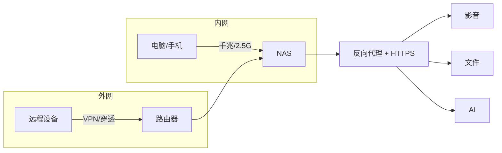

# 06 网络与远程访问 · 本章概览

> 难度：⭐⭐⭐ · 预计阅读：60 分钟

## 本章目标

读完本章，你将能够：

1. 理解局域网内影响 NAS 访问速度的关键因素
2. 对比各种远程访问方案，选出安全合适的方案
3. 配置域名与反向代理，用统一入口访问多个服务
4. 为服务启用 HTTPS
5. 完成基础的安全加固

## 核心主题

- **先内网后外网**：内网不稳，外网免谈
- **安全优先**：默认不暴露端口到公网，优先 VPN / 内网穿透
- **统一入口**：域名 + 反向代理 + HTTPS 是优雅访问多服务的标准姿势
- **最小暴露**：只开必要的端口，只给必要的权限

## 小节列表

| 小节 | 核心问题 | 关键产出 |
| --- | --- | --- |
| [6.1 局域网基础](6.1-局域网基础.md) | 内网怎么提速？ | 网络优化 |
| [6.2 远程访问方案对比](6.2-远程访问方案对比.md) | 外网怎么访问？ | 方案选择 |
| [6.3 反向代理与域名](6.3-反向代理与域名.md) | 多服务怎么统一入口？ | 反代配置 |
| [6.4 HTTPS 与证书](6.4-HTTPS与证书.md) | 怎么启用加密？ | HTTPS 配置 |
| [6.5 安全加固](6.5-安全加固.md) | 怎么不被攻击？ | 安全检查清单 |

## 网络访问全景

## 安全心法

> ⚠️ 把 NAS 直接暴露公网（端口转发 + 弱密码）是家庭 NAS 被攻击的头号原因。请务必先读 [6.5 安全加固](6.5-安全加固.md)，再决定远程访问方案。

## 小结

网络部分的核心不是"能连上"，而是"安全地连上"。优先内网优化，外网用 VPN，多服务用反代 + HTTPS。

## 练习

见 [`exercises/06-网络与远程访问.md`](../../exercises/06-网络与远程访问.md)。
