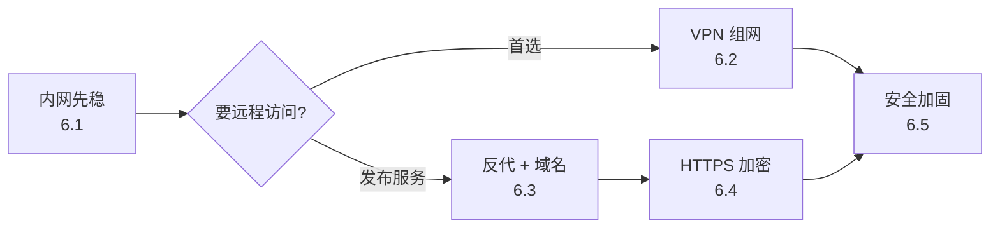

  

# 06 连上它：内网要快，外网要稳

> ⏱ 大约 60 分钟 · 难度 ⭐⭐⭐

## 一个让人抓狂的场景

NAS 装好了，照片也在里面。你兴冲冲地在公司打开手机，想给同事看一张孩子照片——**转了半天圈，打不开。**

于是你开始搜索"NAS 外网访问"，跳出来一堆词：端口转发、DDNS、内网穿透、IPv6、VPN、反向代理……每个都像在说方言。

这一章就是来把这些方言翻译成人话的。

## 先记住一条铁律

> ⚠️ **不要把 NAS 管理界面直接暴露到公网。**

这是家庭 NAS 被攻击的头号原因。威联通就曾因公网暴露出过勒索事件。正确的做法在 [6.2](6.2-远程访问方案对比.md) 和 [6.5](6.5-安全加固.md) 会细讲——**先修好内功（安全），再谈远程访问。**

## 路线图

## 你会得到什么

| 小节 | 解决什么 |
| --- | --- |
| [6.1 局域网基础](6.1-局域网基础.md) | 内网传文件为什么慢 |
| [6.2 远程访问方案](6.2-远程访问方案对比.md) | 人在外面怎么安全访问 |
| [6.3 反向代理与域名](6.3-反向代理与域名.md) | 多个服务用一个优雅入口 |
| [6.4 HTTPS 与证书](6.4-HTTPS与证书.md) | 给访问加把锁 |
| [6.5 安全加固](6.5-安全加固.md) | 别让门户大开 |

## 一个省心推荐

如果你被这些方案绕晕了，先从 **Tailscale** 开始。它像个"一键组网的钥匙"，不用公网 IP、不用配端口转发、安全性还好。等你用顺了，再去了解其他方案也不迟。

> Tailscale 和 WireGuard 的原理与配置可参考其官方文档（见 [致谢](../../CREDITS.md)）。

## 小练习

翻到 [exercises/06-网络与远程访问.md](../../exercises/06-网络与远程访问.md)，先测一下内网速度，再决定要不要配远程访问。别跳过测速——很多"外网慢"其实是内网就慢。
