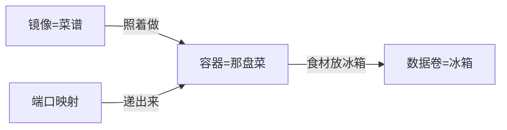

<p align="center">
  
</p>

# 7.1 Docker：一个个小隔间，装下各种应用

> 📌 先把 [6.5 安全加固](../../docs/06-网络与远程访问/6.5-安全加固.md) 看了 · ⏱ 大约 20 分钟

## 别被名词吓到

第一次接触 Docker，你会看到一堆词：镜像、容器、数据卷、端口映射。听起来像在考计算机等级考试。

但其实 idea 特别简单。想象你家的厨房：

- **镜像 Image** = 菜谱（怎么做一道菜）
- **容器 Container** = 照着菜谱做出来的那盘菜（能吃的实例）
- **数据卷 Volume** = 冰箱（菜可以端走，但食材得放冰箱里存着）
- **端口映射** = 上菜的窗口（厨房在里面，菜从窗口递出来）



懂了这个，Docker 就没那么可怕了。

## 为什么 NAS 圈都爱用 Docker

因为它解决了一个痛点：装应用不再需要折腾依赖、改环境、怕把系统搞乱。

每个应用住进自己的"小隔间"，互不打扰。想删就删，想装就装，系统干干净净。这就是 [7 章开头](README.md) 说的"搭台唱戏"——Docker 就是那个台。

## 各家在哪儿用 Docker

| 平台 | Docker 在哪 |
| --- | --- |
| 群晖 | Container Manager |
| 威联通 | Container Station |
| TrueNAS SCALE | Apps / 原生 Docker |
| 飞牛 fnOS | Docker 应用 |
| CasaOS | 核心功能 + 应用商店 |
| 通用 Linux | 官方 Docker Engine |

## 第一个容器（跑起来看看）

```bash
# 拉一个 nginx 跑起来
docker run -d --name hello -p 8080:80 nginx:alpine

# 看它在不在
docker ps

# 玩完了，清理掉
docker stop hello && docker rm hello
```

跑通了就说明 Docker 能用了。就这么简单。

## 真正推荐的方式：Compose

一个一个 `docker run` 太麻烦，而且命令长了容易记错。实际用得最多的是 **Compose**——用一个 `docker-compose.yml` 文件把要跑的东西全写清楚：

```yaml
version: "3.8"
services:
  app:
    image: nginx:alpine
    container_name: myapp
    ports:
      - "8080:80"
    volumes:
      - /volume1/docker/myapp/data:/data   # 食材放冰箱
    environment:
      - TZ=Asia/Shanghai
      - PUID=1000
      - PGID=1000
    restart: unless-stopped
```

```bash
docker compose up -d          # 启动
docker compose logs -f        # 看日志
docker compose pull && docker compose up -d   # 更新
```

现成的例子都在 [`examples/docker-compose/`](../../examples/README.md)，改改路径就能用。

## 那条铁律，再说一遍

> ⚠️ **容器可以随便删，数据必须留在外面。**
>
> 所有要保留的数据——配置、数据库、照片——都必须通过 `volumes` 映射到 NAS 的实际目录。否则删容器的时候，数据会跟着一起灰飞烟灭。

这不是危言耸听，是新手最常踩的坑。装完一个应用，先确认它的数据卷映射对了，再往下走。

映射路径用绝对路径，权限用 PUID/PGID 对上你的 NAS 用户（否则容器没权限写）。这些目录记得定期备份，见 [5.4 备份](../../docs/05-存储与数据保护/5.4-备份3-2-1原则.md)。

## 几条安全底线

- 别动不动 `--privileged`（给容器最高权限）
- 别用 root 跑（用 PUID/PGID 指定用户）
- 只映射必要的端口，公网访问配合反代 + HTTPS
- 用官方或可信镜像，定期更新
- 密码放 `.env` 文件，别写死在配置里（`.env` 已在 `.gitignore` 里）

想深入了解，可以看 [Docker 官方文档](https://docs.docker.com/)（见 [致谢](../../CREDITS.md)）。

## 命令小抄

| 命令 | 干嘛的 |
| --- | --- |
| `docker ps -a` | 列出所有容器 |
| `docker logs -f <容器>` | 追日志 |
| `docker exec -it <容器> sh` | 钻进容器 |
| `docker compose down` | 停掉并移除 |
| `docker image prune` | 清理没用的镜像 |
| `docker system df` | 看看占了多大磁盘 |

## 写在最后

记住"菜谱 / 菜 / 冰箱"这三个比喻，Docker 就通了。重点是数据持久化——容器可弃，数据不可丢。

## 小练习

1. 跑通那个 nginx 小容器，再删掉它。
2. 用 Compose 部署一个应用，把它的配置目录映射到 NAS，然后删掉容器重建，确认配置还在。
