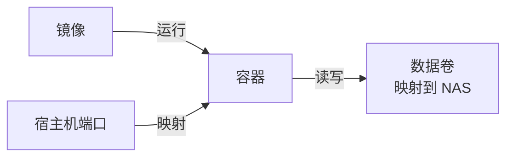

# 7.1 Docker 基础

> 📌 前置：[6.5 安全加固](../06-网络与远程访问/6.5-安全加固.md) · ⏱ 约 20 分钟

## 本章目标

- 理解镜像、容器、数据卷、网络的核心概念
- 能用 docker compose 部署一个应用
- 理解数据持久化的正确做法

## 核心概念

| 概念 | 比喻 | 说明 |
| --- | --- | --- |
| 镜像 Image | 安装包/模板 | 只读的应用模板 |
| 容器 Container | 运行中的程序 | 镜像的运行实例 |
| 数据卷 Volume | 外接硬盘 | 持久化数据的目录 |
| 端口映射 | 门牌转发 | 把容器端口映射到宿主机 |
| Compose | 部署清单 | 用 YAML 定义多个容器 |



## 各平台 Docker 支持

| 平台 | Docker 方案 |
| --- | --- |
| 群晖 | Container Manager |
| 威联通 | Container Station |
| TrueNAS SCALE | Apps / 原生 Docker |
| 飞牛 fnOS | Docker 应用 |
| CasaOS | 核心功能 + App Store |
| 通用 Linux | 官方 Docker Engine |

## 第一个容器

```bash
# 拉取并运行一个测试容器
docker run -d --name hello -p 8080:80 nginx:alpine

# 查看运行中的容器
docker ps

# 停止并删除
docker stop hello && docker rm hello
```

## Docker Compose（推荐方式）

创建 `docker-compose.yml`：

```yaml
version: "3.8"
services:
  app:
    image: nginx:alpine
    container_name: myapp
    ports:
      - "8080:80"
    volumes:
      - /volume1/docker/myapp/data:/data   # 数据持久化到 NAS
      - ./config:/config
    environment:
      - TZ=Asia/Shanghai
      - PUID=1000
      - PGID=1000
    restart: unless-stopped
```

```bash
# 启动
docker compose up -d

# 查看日志
docker compose logs -f

# 更新（先拉取新镜像）
docker compose pull && docker compose up -d
```

> 💡 完整示例见 [`examples/docker-compose/`](../../examples/README.md)，包含多个可直接使用的 Compose 文件。

## 数据持久化（重中之重）

> ⚠️ **容器是可抛弃的，数据不是。** 所有需要保留的数据（配置、数据库、媒体）必须通过 `volumes` 映射到 NAS 的实际存储路径。否则删除容器，数据一起消失。

- 使用**绝对路径**映射，避免相对路径导致数据散落。
- 目录权限要正确（PUID/PGID 匹配 NAS 用户），否则容器无法写入。
- 定期备份这些映射目录，见 [5.4 备份 3-2-1 原则](../05-存储与数据保护/5.4-备份3-2-1原则.md)。

## 安全实践

- 尽量不用 `--privileged`
- 不以 root 运行容器（用 PUID/PGID 指定用户）
- 只映射必要端口，公网访问配合反代 + HTTPS
- 使用官方或可信镜像，定期更新
- 凭据用 `.env` 文件或 secrets，不写进 Compose（`.env` 已在 `.gitignore` 中）

## 常用命令速查

| 命令 | 作用 |
| --- | --- |
| `docker ps -a` | 列出所有容器 |
| `docker logs <容器>` | 查看日志 |
| `docker exec -it <容器> sh` | 进入容器 |
| `docker compose down` | 停止并移除容器 |
| `docker image prune` | 清理无用镜像 |
| `docker system df` | 查看磁盘占用 |

## 小结

Docker 的重点不是命令，而是"镜像/容器/数据卷"的心智模型与数据持久化。先把这两点吃透，部署任何应用都大同小异。

## 练习

1. 用 Compose 部署一个测试容器，验证重启后数据仍在。
2. 检查你现有的容器：哪些数据没有持久化？记录下来准备修正。
