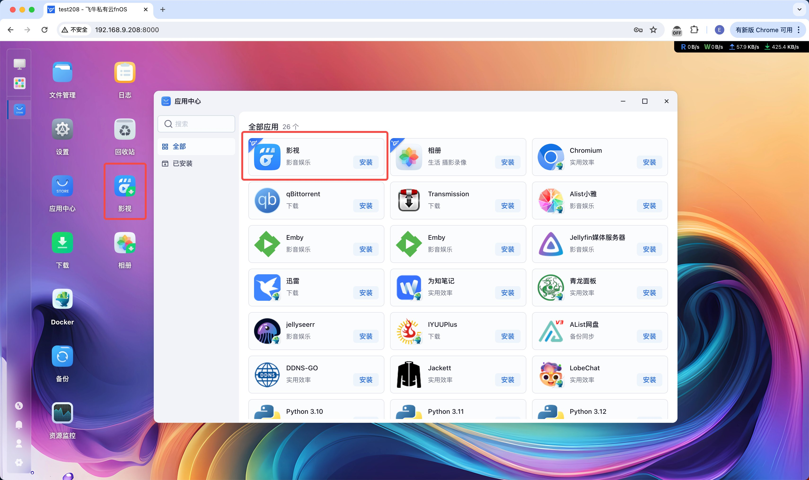
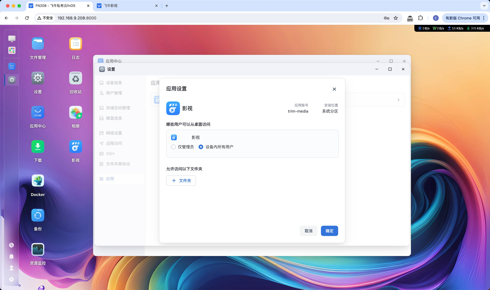
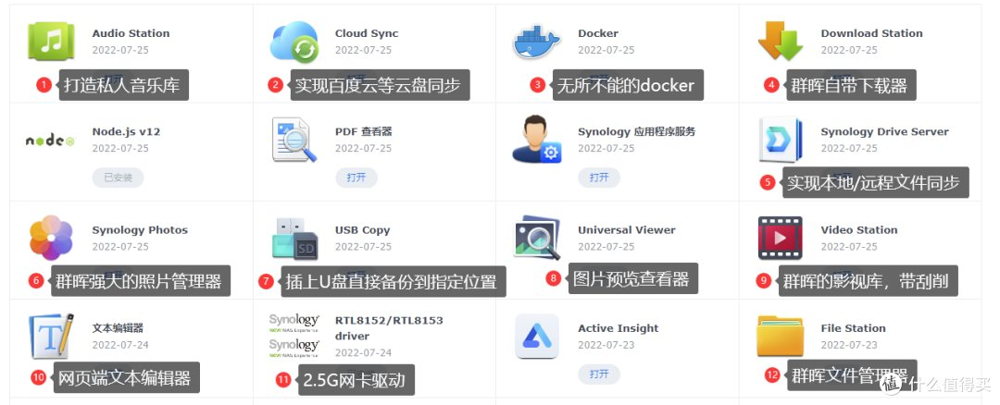
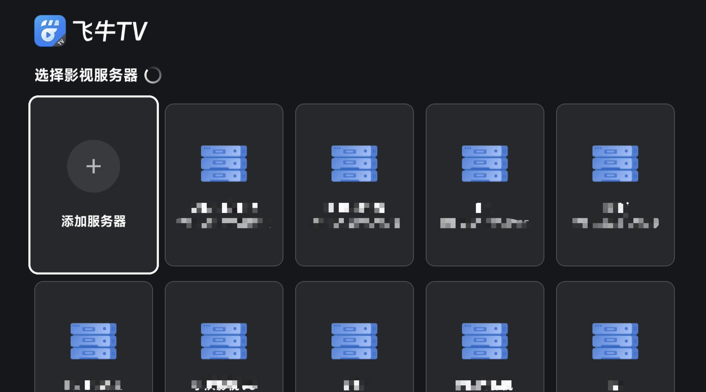
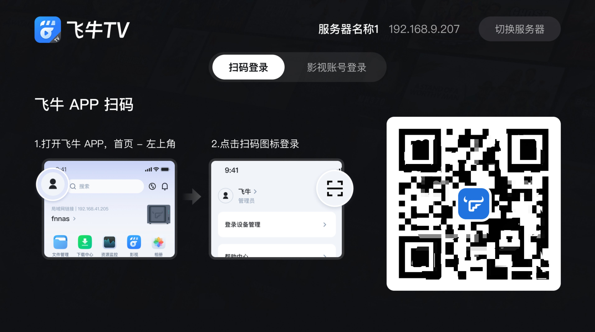
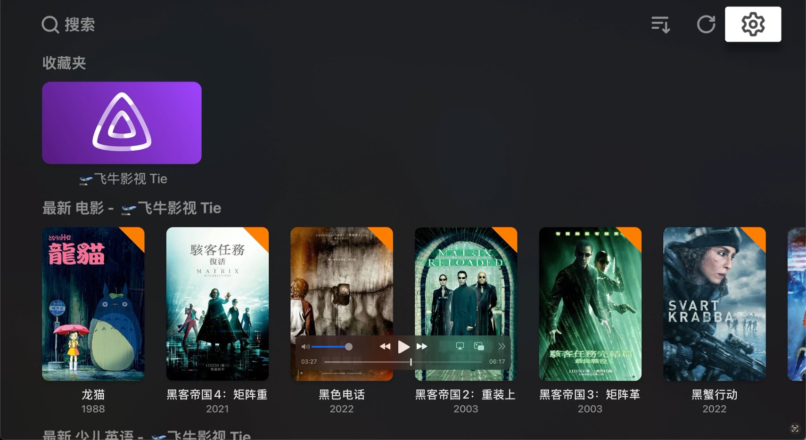

# 7.2 影音中心：把客厅变成私人影院

> 📌 先读：[7.1 Docker 基础](7.1-Docker基础.md) · ⏱ 大约 15 分钟

## 选哪个

| 方案 | 类型 | 特点 |
| --- | --- | --- |
| Jellyfin | 开源免费 | 无订阅、社区活跃、隐私好 ✅ |
| Emby | 部分开源 | 体验好，高级功能要订阅 |
| Plex | 商业 | 成熟，但需账号、部分付费 |

> 💡 家庭自建首选 **Jellyfin**：免费、开源、不用强制注册账号。

## 先搞懂"转码"

这是影音里最容易晕的词：

- **直播（Direct Play）**：客户端直接播原文件，**不消耗服务器性能**
- **转码（Transcode）**：服务器实时把视频转成客户端能播的格式/码率，**很吃 CPU**

> 💡 优先让客户端直播。转码是兜底手段。想要流畅的 4K 转码，CPU 要带硬件编解码（Intel Quick Sync），见 [2.1](../../docs/02-硬件选型/2.1-核心部件选型.md)。

## 媒体库怎么摆

```
/media
├── movies/
│   └── 星际穿越 (2014)/星际穿越 (2014).mkv
├── tvshows/
│   └── 剧名/Season 01/
└── music/
```

> 💡 **规范命名是刮削成功的关键。** 电影带年份、剧集带季集号，海报和简介才能自动匹配上。命名乱七八糟，海报就对不上。

**飞牛自带影视中心的安装与配置界面**，找片、刮削、播放都在应用里：

<p align="center">
  
</p>

<p align="center">
  
</p>

> 💡 截图来自 [飞牛官方帮助中心](https://help.fnnas.com/)（见 [致谢](../../CREDITS.md)）。

群晖自带 Video Station 的界面，和 Jellyfin 是两种思路（前者简单、后者更开放）：

<p align="center">
  
</p>

> 💡 截图来自 [什么值得买的群晖教程](https://post.smzdm.com/p/agq0p693/)（见 [致谢](../../CREDITS.md)）。

## 部署 Jellyfin

配置示例在 [`examples/docker-compose/jellyfin/`](../../examples/docker-compose/jellyfin/docker-compose.yml)。

```yaml
services:
  jellyfin:
    image: jellyfin/jellyfin:latest
    container_name: jellyfin
    volumes:
      - /volume1/docker/jellyfin/config:/config
      - /volume1/media:/media:ro
    devices:
      - /dev/dri:/dev/dri   # 有核显就映射，开启硬件转码
    ports:
      - "8096:8096"
    restart: unless-stopped
```

要点：`/config` 必须持久化（数据库和元数据都在里面）；`/dev/dri` 有核显才映射。公网访问配合反代 + HTTPS，见 [6.3](../../docs/06-网络与远程访问/6.3-反向代理与域名.md)。

**飞牛自带 TV 端**，装到电视上就能直接看海报墙：

<p align="center">
  
</p>

<p align="center">
  
</p>

用 **Infuse** 的话，配置 SMB 连接指向 NAS 的媒体共享即可（这是很多 Apple TV 用户的首选）：

<p align="center">
  
</p>

> 💡 截图来自 [飞牛官方帮助中心](https://help.fnnas.com/)（见 [致谢](../../CREDITS.md)）。司波图在视频里也提到自己依然订阅 Infuse 看片（见 [15.1](../15-中文视频与博客/15.1-B站UP主.md)）。

## 客户端

电视装 Jellyfin TV 客户端或 Kodi 插件，手机装官方 App，浏览器直接访问都行。

## 常见问题

- **刮削不到中文信息**：换个元数据源，或手动检查命名
- **转码卡顿**：确认硬件转码开了，或降低码率、尽量直播
- **字幕乱码**：客户端里把字幕编码设成 UTF-8

## 写在最后

影音中心的核心：规范媒体库 + Jellyfin + 尽量直播。硬件转码能显著改善体验。

## 动手试试

1. 整理 10 部影片，按规范命名建立媒体库。
2. 部署 Jellyfin，验证海报和剧集信息能不能正确刮削出来。
